# Mora language and toolchain specification

Version 0.1 (draft). Status: under review.

Mora is a programming language with the syntax and feel of modern C#, memory managed by reference counting and single ownership instead of a garbage collector, and compilation to a single native executable. This document is the design the MVP is built against. It defines the language, its memory model, the runtime, the standard library surface the MVP ships, the compiler architecture and the toolchain. Work that comes after the MVP is specified at the level needed to keep MVP decisions compatible with it.

In linguistics a *mora* is the unit of timing that decides a syllable's weight, written μ. In Spanish, *mora* is a blackberry.

## Contents

1. Introduction
2. A tour of Mora
3. Source text and lexical structure
4. Program structure
5. Types
6. Declarations
7. Expressions and statements
8. Generics and interfaces
9. Macros
10. Memory model
11. Errors and panics
12. Async and concurrency
13. Runtime and ABI
14. Compiler architecture
15. Standard library (MVP surface)
16. HTTP and JSON
17. Toolchain, CLI and editor support
18. Libraries, WebAssembly and packages (post-MVP)
19. Targets, distribution and installation
20. Testing and quality
21. Project conventions
22. Roadmap
23. Decisions register
24. Open questions
25. References

## 1. Introduction

### 1.1 Who it is for

Mora is for application developers who want native binaries with predictable memory use and no collector pauses, without learning Rust's lifetimes to get them. Its syntax and idioms come from C#, so a developer who knows C#, Java or TypeScript reads Mora on the first day. Mora is not C#: where its model differs (ownership, errors as values, interfaces instead of inheritance), it follows its own model rather than imitating C# (D-53).

### 1.2 Goals

- **G1. Familiar, not a copy.** Syntax, names and idioms come from C# wherever they fit Mora's model. Mora does not aim for compatibility: it leaves out C# features that conflict with deterministic memory or safety, such as exceptions, inheritance, reflection and `null` references. Where a C# habit would mislead, the compiler says what to write in Mora.
- **G2. Deterministic memory.** No garbage collector, no finalizer thread, no pauses. Values are freed at a point the reader can see in the source. Allocation and reference-count costs are visible.
- **G3. Safe by default.** No null references, no use-after-free, no data races, no unchecked casts. Programs cannot reach undefined behaviour without an `unsafe` block (post-MVP) or an FFI call.
- **G4. One native binary.** `mora build` produces one executable with no runtime to install, no JIT and no framework.
- **G5. Rust toolchain.** The compiler, runtime, language server, formatter and package tool are written in Rust and ship as one `mora` executable plus a runtime library per target.
- **G6. Libraries as WebAssembly** (post-MVP). A library ships as one `.wasm` file that carries its metadata and typed IR, for both wasm and native consumers (§18).
- **G7. Portable core.** Linux, macOS and Windows come first, but no part of the compiler, runtime or standard library may assume an operating system, a CPU, a pointer width or a byte order outside a target-specific layer. Adding a target, including an embedded device with no OS, means adding a target description, a runtime platform layer and, if Cranelift cannot generate its code, a backend; it never means changing the front end, MIR or the memory model (§19.4).

### 1.3 Non-goals

- Source or binary compatibility with .NET, NuGet or existing C# code. There is no bridge to .NET libraries (D-9).
- Runtime reflection, `dynamic`, `System.Object` or loading code by name at runtime.
- Lifetime annotations. Borrowing uses the familiar `in` and `ref` parameter conventions, and a borrow never outlives the call that created it (§10).
- A virtual machine. The REPL and `mora run` compile to machine code too.

### 1.4 Anti-goals

These would make Mora a failure even if every test passed:

- **Rust with different syntax.** A developer writing their first REST endpoint must not meet lifetime errors, borrow-checker puzzles or ownership vocabulary they have to look up. Every memory-model error says what would go wrong in plain terms and offers a concrete fix (§17.6).
- **A C# clone.** Adding a feature because C# has it, or keeping a C# quirk for the sake of familiarity.
- **Hidden costs.** An allocation, a boxing conversion or an atomic operation that the reader cannot predict from the source.
- **A second-class platform.** Windows is a first-class target from the first milestone, because many application developers work on it.

### 1.5 What the MVP is

The MVP is done when the program in §2.2, a REST API with JSON request and response bodies, builds with `mora build` into a native executable on Linux, macOS and Windows (x86_64 and aarch64 where §19.1 lists them), passes its integration tests in CI on all three, and a developer new to Mora can install the toolchain with one command, open the project in VS Code and get diagnostics, hover types and go-to-definition.

Two release lines follow from that:

| Line | Milestones | Contents |
|---|---|---|
| **MVP (v0.1)** | M0 to M7 | Native compilation with Cranelift, the memory model, the expressive core, macros, the standard library core, async with a single-threaded executor, HTTP/1.1 server, JSON, LSP, VS Code extension, formatter, REPL, installers |
| **Post-MVP (v0.2 and later)** | M8 onwards | WebAssembly target and `.wasm` libraries, packages and URL imports, capability enforcement, threads and `shared` classes, class inheritance, more macro kinds, arenas, registry and signing, LLVM release backend, Component Model, embedded targets |

### 1.6 How to read this document

- **MUST**, **MUST NOT**, **SHOULD** and **MAY** follow RFC 2119.
- Section references look like §10.4. Decisions look like D-12 and are listed in §23. Open questions look like OQ-3 and are listed in §24.
- **[MVP]** and **[post-MVP]** mark which release line a feature belongs to when a section mixes both. Unmarked text in §§3 to 17 is MVP.
- **[verify]** marks a claim about third-party behaviour (an OS, a linker, a crate) that a test or manual check must confirm before code relies on it.
- Code blocks tagged `mora` are Mora source. Blocks whose first line is `// expect:`, `// error:` or `// warning:` are executable examples that the test suite extracts and runs (§20.4).
- Grammar uses EBNF: `?` optional, `*` zero or more, `+` one or more, `|` alternatives, quoted strings are tokens.

### 1.7 Terms

| Term | Meaning |
|---|---|
| **Value type** | `struct`, `union`, `enum`, primitive, tuple. A value with no identity: copied or moved, and stored where the compiler decides (§6.1). |
| **Shared class** | `class`. Heap object with identity and a reference count; aliases allowed. |
| **Unique class** | `unique class`. Heap object with exactly one owner; moved, never aliased. |
| **Move-only type** | A unique class, or any value type that contains a move-only field or declares a destructor (§10.2). |
| **View type** | `ref struct`, `Span<T>`, `ReadOnlySpan<T>` and non-escaping closures. Can only live on the stack, for at most the current function call (§10.6). |
| **Borrow** | Access to a value through an `in` or `ref` parameter or a view, without owning it. |
| **Retain / release** | Increment / decrement of a shared object's strong count. |
| **Drop** | Running a value's destructor and releasing what it owns. |
| **Place** | A memory location: a local, a parameter, a field of a place, an element of a place. |

## 2. A tour of Mora

This section is informative. The rules are in §§3 to 17.

### 2.1 Hello, world

```mora
// expect: Hello, world!
Console.WriteLine("Hello, world!");
```

A project with this one line in `src/Program.mr` builds into a native executable. The file uses top-level statements, as C# does since version 9. There is no `using System;`, because `Console` lives in the prelude (§15.1).

### 2.2 The MVP acceptance program

This program is the oracle for the MVP (§1.5). It lives in the repository as `examples/users-api`, and its integration test (§20.2) drives it over real TCP on every CI platform.

`mora.toml`:

```toml
[project]
name = "users-api"
version = "0.1.0"
kind = "app"
```

`src/Model.mr`:

```mora
namespace UsersApi;

@Json
public struct User(Id: int, Name: string, Email: string?);

@Json
public struct NewUser(Name: string, Email: string?);
```

`src/UserStore.mr`:

```mora
namespace UsersApi;

public class UserStore {
    private mut _nextId: int = 1;
    private _users: Dictionary<int, User> = new();

    public Add(input: NewUser): User {
        let user = new User(_nextId, input.Name, input.Email);
        _nextId += 1;
        _users[user.Id] = user;
        return user;
    }

    public Find(id: int): User? => _users[id];

    public All(): List<User> => _users.Values.OrderBy(u => u.Id).ToList();

    public Remove(id: int): bool => _users.Remove(id);
}
```

`src/Program.mr`:

```mora
using Std.Net.Http;
using UsersApi;

let store = new UserStore();
let app = WebApp.Create(args);

app.MapGet("/users", async (req: Request) => Results.Json(store.All()));

app.MapGet("/users/{id}", async (req: Request) => {
    let id = req.RouteValue<int>("id")?;
    return switch (store.Find(id)) {
        User u => Results.Json(u),
        none => Results.NotFound(),
    };
});

app.MapPost("/users", async (req: Request) => {
    let input = await req.ReadJsonAsync<NewUser>()?;
    if (input.Name.Length == 0) {
        return Results.BadRequest("name is required");
    }
    let user = store.Add(input);
    return Results.Created($"/users/{user.Id}", user);
});

app.MapDelete("/users/{id}", async (req: Request) => {
    let id = req.RouteValue<int>("id")?;
    return store.Remove(id) ? Results.NoContent() : Results.NotFound();
});

await app.RunAsync("127.0.0.1:8080")?;
```

What the program relies on, with the section that defines each:

| Line | Feature | Section |
|---|---|---|
| `@Json` | Standard-library macro that generates JSON serialization | §9.9, §16.3 |
| `struct User(...)` | Value with public read-only fields, a positional constructor and generated equality | §6.2, §6.5 |
| `Email: string?` | `T?` is an option type; `none` is its empty value | §5.6 |
| `private mut _nextId: int` | Fields are read-only unless marked `mut` | §6.3 |
| `let` / `var` | Immutable and mutable locals | §7.10 |
| `_users[id]` | Lookup returning `V?`, `none` when the key is missing | §15.4 |
| `OrderBy(...).ToList()` | LINQ over monomorphized iterator structs | §15.5 |
| `async (req: Request) => ...` | Escaping async lambda; captures `store` by retain | §10.9, §12 |
| `req.RouteValue<int>("id")?` | `Result` propagation; `HttpError` becomes a 400 response | §11.2, §16.2 |
| `await ...ReadJsonAsync<NewUser>()?` | `?` applies to the awaited value | §7.4 |
| `return Results.NotFound();` in a lambda that returns `Result<Response, HttpError>` | Implicit `Ok` wrapping through a user-defined conversion | §11.3 |
| `switch (x) { User u => ..., none => ... }` | Exhaustive pattern match over `User?` | §7.7 |
| `await app.RunAsync(...)?` at top level | Async entry point whose error ends the process with exit code 1 | §4.6 |

Expected behaviour, which the integration test checks byte for byte:

```text
POST /users {"name":"Ada"}          -> 201, Location: /users/1, {"id":1,"name":"Ada","email":null}
GET  /users/1                       -> 200, {"id":1,"name":"Ada","email":null}
GET  /users                         -> 200, [{"id":1,"name":"Ada","email":null}]
GET  /users/abc                     -> 400, {"error":"route value 'id' is not a valid int"}
GET  /users/9                       -> 404, empty body
POST /users {"name":""}             -> 400, {"error":"name is required"}
POST /users {not json               -> 400, {"error":"invalid JSON at line 1, column 2: expected string"}
DELETE /users/1                     -> 204
DELETE /users/1                     -> 404
```

### 2.3 Memory at a glance

```mora
public struct Point(X: float, Y: float);     // value: copied, no identity

public class Node {                          // shared: reference counted
    public Children: List<Node> { get; } = new();
    public Parent: weak Node;                // back-reference: does not keep the parent alive
}

public unique class TempFile {               // unique: one owner, moved, never aliased
    public Path: string { get; }
    public TempFile(path: string) { Path = path; File.WriteAllText(path, "").Expect("create temp file"); }
    ~TempFile() { _ = File.Delete(Path); }     // runs exactly when the owner goes out of scope
}

static Length(p: Point): float => MathF.Sqrt(p.X * p.X + p.Y * p.Y);  // `in` borrow by default

static Grow(ref p: Point) { p = p with { X = p.X * 2 }; }             // exclusive borrow

static Keep(n: Node, into: List<Node>) { into.Add(n); }               // storing a shared class retains it
```

### 2.4 Unions, options and results

```mora
public union Shape {
    Circle(Radius: float),
    Rect(Width: float, Height: float),
}

public static Area(s: Shape): float => switch (s) {
    Circle(let r) => MathF.PI * r * r,
    Rect(let w, let h) => w * h,
};

public static Total(csv: string): Result<int, ParseError> {
    var sum = 0;
    foreach (let field in csv.Split(',')) {
        sum += int.Parse(field.Trim())?;
    }
    return sum;
}
```

## 3. Source text and lexical structure

### 3.1 Source files

- Source files have the extension `.mr` (D-2) and MUST be UTF-8. A leading byte order mark is accepted and ignored. Any other encoding is error `MR0001`.
- A source file MUST be smaller than 4 GiB (2^32 bytes), because offsets are 32-bit; a larger file is error `MR0003`.
- Line endings may be LF or CRLF. The lexer treats CRLF as one newline. A lone CR is whitespace.
- Identifiers are normalized to NFC before comparison. Two identifiers that differ only in normalization are the same identifier.

### 3.2 Comments and doc comments

- `//` to end of line, and `/* ... */` (not nesting, as in C#). A block comment that is not closed is error `MR0012`.
- `///` starts a doc comment. Doc comments are **Markdown**, not the XML of C# doc comments (D-21). A doc comment attaches to the next declaration. Inline code in backticks that names a symbol, for example `` `List<T>.Add` ``, becomes a link in the LSP hover and in generated docs.
- `#Name(...)` calls an expression macro (§9).

### 3.3 Identifiers

`identifier = XID_Start_or_underscore XID_Continue*` following Unicode UAX #31. A reserved keyword is never an identifier, and there is no escape that makes one usable as a name (D-94). A name that must match outside text, such as a JSON key or an imported C symbol, is given in an attribute: `@JsonName("class")`, `@Import(Name = "default")`.

Naming conventions (PascalCase types and members, camelCase locals and parameters, `_camelCase` private fields, `I` prefix on interfaces) follow the .NET guidelines. The compiler does not enforce them; the formatter does not rename anything; lint `naming` (off by default) reports deviations.

### 3.4 Keywords

Reserved keywords (never identifiers):

```text
abstract as async await bool break byte char class const continue default do
double else enum extern false float for foreach if import in indirect int
interface internal is lazy let long macro move mut namespace new nint none nuint
operator out params private public ref return sbyte shared short sizeof
stackalloc static string struct switch this true uint ulong union unique unsafe
ushort using var weak where while yield
```

`out` has no meaning in the MVP; it stays reserved for variance annotations (§8.8).

Contextual keywords (keywords only in the listed position): `get`, `set`, `value` (accessors); `when` (patterns); `and`, `or`, `not` (patterns); `with` (expressions); `file` (modifiers); `nameof` (expression); `global` (`global using`); `arena` (`using arena`, post-MVP); `args` (top-level statements); `code` and `adds` (macros, §9); `from` (`import ... from`, §4.4); `type` (associated types, §8.7); `allows` (`allows move`, `allows ref struct`, §8.2); `any` (`any IShape`, §8.4); `newtype` (declaration start, §6.12); `test` (section position, §15.9); `contract` (section position, §6.13), and inside a contract section `invariant`, `requires`, `fails`, `ensures`, `also`, `old` and `result`; `_` (discards in patterns and deconstruction, §7.8).

The compiler knows only Mora's syntax (D-59). A word that is not a keyword is an identifier, and code written in another language's syntax gets the ordinary syntax error, `MR0110`.

### 3.5 Literals

**Integer literals.** Decimal `1234`, hexadecimal `0x4D2`, binary `0b1001`, with `_` separators allowed between digits. Suffixes `u`, `l`, `ul` (any case) pick `uint`, `long`, `ulong` as in C#. An unsuffixed literal takes the expected type when there is one and the value fits; otherwise it is `int`, then `long`, then `ulong`, as in C#. A literal that does not fit its type is error `MR0010`. A malformed literal (no digits after `0x` or `0b`, a `_` that is not between two digits, an unknown suffix) is error `MR0014`.

**Real literals.** `1.5`, `1e9`, `1.5e-3`, with suffixes `f` (`float`), `d` (`double`). An unsuffixed real takes the expected type when it is `float` or `double`; otherwise `double`. Unlike C#, `let x: float = 1.5;` compiles. The suffix `m` (`decimal`) is reserved (OQ-12) and is error `MR0014`. A real literal too large for its type is error `MR0010`.

**Character literals.** `'a'`. A `char` is a Unicode scalar value (§5.2), so `'𝄞'` (U+1D11E, outside the BMP) is one `char`. Escapes: `\'`, `\"`, `\\`, `\0`, `\a`, `\b`, `\f`, `\n`, `\r`, `\t`, `\v`, `\uXXXX` (four hex digits, not a surrogate), `\u{X...}` (one to six hex digits). Any other escape, `\u` with the wrong number of digits, or a code point that is not a scalar value is error `MR0013`. A character literal holds exactly one character: `''` and `'ab'` are error `MR0015`.

**String literals.**

| Form | Example | Notes |
|---|---|---|
| Regular | `"a\tb"` | Escapes as for characters |
| Raw | `` `C:\temp` ``, ``` ``a`b`` ``` | No escapes; between runs of backticks, on one line or several (below) |
| Interpolated | `$"x = {x}"`, `` $`{x} "q"` ``, `` $$`{{x}} {y}` `` | Holes `{expr}`, `{expr,alignment}`, `{expr:format}`; with `$$` before a raw string, holes are `{{expr}}` |
| UTF-8 bytes | `"abc"u8` | Type `ReadOnlySpan<byte>` |

String literals have type `string`. A literal of at most 15 bytes is an inline value, and a longer one is an immortal static heap object (§13.4). Loading a literal never allocates; an operation that needs a heap string, such as `AsMemory()` on an inline one, allocates as §13.4 says.

**Raw strings.** A raw string has no escapes: its value is the text between its delimiters, as written. It suits paths, regular expressions, quoted text and embedded documents.

```mora
let path  = `C:\data\users.json`;
let regex = `^\d{3}-\d{4}$`;
let quote = `She said "hi"`;
let sql = `
    select id, name
    from users
    `;
let json = $$`{"id": {{user.Id}}}`;
```

- A raw string opens with a run of N ≥ 1 backticks and closes with the next run of exactly N backticks. A run of any other length is text, so N only has to differ from the length of every run inside: ``` ``a`b`` ``` holds `` a`b ``. One backtick more than the longest run inside always works.
- When the opening run is followed by other text on its line, the string is on one line: the closing run is on the same line, and the value is everything between the two runs.
- When the opening run is followed only by whitespace up to the end of its line, the string spans lines. The value starts on the next line and ends before the line of the closing run, which holds nothing but whitespace before the run. That whitespace is removed from the start of every content line, so the value can be indented with the code around it; a line that holds only whitespace may be shorter. Line breaks inside the value are kept as written.
- `$` before a raw string makes it interpolated. With N `$`, a hole is N braces on each side, and a shorter run of braces is text: with one `$` every `{` opens a hole `{expr}`, and in `` $$`{"id": {{id}}}` `` `{{id}}` is a hole and the outer braces are text. A run of N or more `}` outside a hole, or of 2N or more `{`, is an error, so text with braces uses more `$`. The hole syntax (alignment, format) is the same for every interpolated string.

When a raw string goes inside Markdown code, as in this document, an error page or a doc comment, the code span or fence around it needs more backticks than any run inside it.

As in C#, a `:` at the top level of a hole starts its format, so a conditional expression in a hole goes in parentheses: `$"{(ok ? 1 : 2)}"`.

A string, character literal, raw string or interpolated string that is not closed is error `MR0012`; a regular string ends at the end of its line. Error `MR0016` covers the rules of the other forms: a lone `}` in the text of an interpolated string (write `}}`), more than one `$` before a string that is not raw, in a raw interpolated string with N `$`, a run of N or more `}` outside a hole, or a run of 2N or more `{`, which could open a hole in two ways, and a raw string that spans lines but holds text on its opening line, whose closing backticks do not stand on their own line, or whose content lines do not start with the closing backticks' indentation.

**Other literals.** `true`, `false`, `none` (the empty value of any `T?`, §5.6), `default` (§7.13).

### 3.6 Operators and punctuation

```text
{ } [ ] ( ) . , : ; ? ?? ??= ?. ?[ => -> :: .. ^ @ $
+ - * / % & | ^ ! ~ << >> >>> == != < > <= >= && ||
= += -= *= /= %= &= |= ^= <<= >>= >>>= ++ --
+% -% *% +%= -%= *%=
```

`#` before an identifier calls an expression macro (§9), and `@` before one names an attribute (§6.11). `+%`, `-%` and `*%` are wrapping arithmetic (§7.12). `->` is reserved; where `=>` belongs, it gets a fix to `=>` (§5.8). `::` qualifies a library alias (§4.4). A character that cannot start any token, such as `\` or a non-breaking space, is error `MR0017`.

## 4. Program structure

### 4.1 Projects and compilation units

A **project** is a directory with a `mora.toml` manifest (§17.2). Every `.mr` file under `src/` belongs to the project, and the project compiles as one unit, as a C# project does: the order of files does not matter, and namespaces are independent of file paths. A project builds one artifact: an executable (`kind = "app"`) or a library (`kind = "lib"`).

### 4.2 File layout

```ebnf
CompilationUnit = ImportDecl* UsingDirective* FileNamespace? TopLevelItem* ;
FileNamespace   = "namespace" QualifiedName ";" ;
TopLevelItem    = Attribute* Modifier* ( TypeDecl | FunctionDecl | ConstDecl | StaticDecl ) | Statement ;
```

- A file has at most one namespace declaration, and it is file-scoped (`namespace UsersApi;`). A file with no namespace declaration puts its items in the project's root namespace.
- **Statements** are allowed at top level only in the entry file (§4.6).
- **Functions** may be declared directly in a namespace, as in the tour's `Area`. They behave as static methods of the namespace. The `static` modifier is allowed there and has no effect.

### 4.3 Using directives

| Form | Meaning |
|---|---|
| `using Std.Net.Http;` | Makes the namespace's types and functions visible by simple name |
| `using static Std.Math;` | Makes the static members of a type visible by simple name |
| `using Json = Std.Json.JsonValue;` | Alias for a type or namespace |
| `global using Std.Collections;` | Any of the above, for every file in the project |

The prelude (§15.1) is an implicit `global using Std;`. A value's destructor runs when its owner goes out of scope (§10.8), so `using` only imports names.

### 4.4 Imports

```ebnf
ImportDecl = "import" Identifier ( "from" StringLiteral )? ";" ;
```

`import Core from "../core";` binds the identifier `Core` to the **root namespace** of another project. A library's root namespace is its `[project] namespace` value, defaulting to the project name in PascalCase. After the import, `Core.Parse(...)` calls a function in that root namespace, and `using Core.Text;` opens a nested namespace. When two imports would put the same namespace in scope, `Alias::Name` picks one, as `extern alias` does in C#.

| Source string | Line | Meaning |
|---|---|---|
| `"../core"`, `"./libs/x"` | MVP | Local project path, relative to the importing project. Compiled from source in the same build. |
| `"json@2"` | post-MVP | Registry package (§18.5) |
| `"github.com/owner/repo@1.4"` | post-MVP | Git host and tag |
| `"https://.../x.wasm"` | post-MVP | Direct `.wasm` URL |
| *(none)*: `import Json;` | MVP | An alias declared under `[dependencies]` in `mora.toml` |

In the MVP an unsupported source form is error `MR0122`. The standard library is always available as `Std` and needs no import.

### 4.5 Visibility

| Modifier | Visible to | Default for |
|---|---|---|
| `public` | Every project that imports this one | |
| `internal` | This project | Types and namespace-level functions |
| `private` | The enclosing type | Members |
| `file` | The declaring file | |

A `public` member's signature MUST NOT mention a less visible type (`MR0123`).

### 4.6 Entry point

An app has exactly one entry point:

- **Top-level statements** in the entry file (`src/Program.mr` unless `[project] entry` names another). The statements form the body of a generated `Main`. `args` is in scope with type `string[]`. If any statement contains `await`, the generated `Main` is async (§12.2).
- **Or** one function named `Main` declared anywhere in the project, with one of these signatures, optionally `async`: `Main()`, `Main(args: string[])`, `Main(...): int`, `Main(...): Result<(), E>`, `Main(...): Result<int, E>`. An omitted return type means `()`.

The return type of generated `Main` is inferred: `()` when no statement uses `?` or `return`, otherwise the type that the `return` statements and `?` operators require (for example `Result<(), IoError>`).

| Outcome | Process exit code | Output |
|---|---|---|
| Returns normally, `()` or `Ok(())` | 0 | |
| Returns `int` or `Ok(int)` | that value, truncated to the OS range | |
| Returns `Err(e)` | 1 | `error: {e}` on stderr, using `e`'s `IDisplay` (§8.6) |
| Panics | 101 | Panic message, location and, in debug builds, a backtrace on stderr (§11.4) |
| `Environment.Exit(code)` | `code` | Destructors of live values do not run |

Having both top-level statements and a `Main`, or more than one `Main`, is error `MR0124`. A library with top-level statements is error `MR0125`.

### 4.7 Static state

- `const Name: T = expr;` declares a constant. `expr` must be evaluable at compile time (§14.6), and `T` may be any type the evaluator can build: primitives, `string`, enums, plain structs, tuples and unions of these, and `ReadOnlySpan<T>` of these for a constant sequence (`const Primes: ReadOnlySpan<int> = [2, 3, 5, 7];`). A constant cannot have an array type, because array elements can be written; a constant sequence is a read-only view of read-only data, and `.ToArray()` copies it into an array that can be. A constant string longer than 15 bytes, and every heap string inside a constant, is an immortal object in read-only data (§13.3); a constant string of at most 15 bytes is an inline value. Other constants are values in read-only data.
- `static lazy Name: T = expr;` runs `expr` on first access. A cycle between lazy initializers is a panic (`lazy initialization cycle: A -> B -> A`) at run time, and error `MR0126` when the compiler can see the cycle statically.
- `static mut Name: T = expr;` is mutable global state, with `expr` evaluable at compile time. In the MVP, programs are single-threaded (§12.1). Post-MVP, `static mut` of a non-`shared` type is only reachable from the main thread (OQ-6).

## 5. Types

### 5.1 Kinds of type

| Kind | Declared as | Assignment and passing | Freed when | §|
|---|---|---|---|---|
| Value | `struct`, `union`, `enum`, primitives, tuples | Copy, or move if move-only | Its owner goes out of scope or is overwritten | 6.2, 6.6 |
| Shared reference | `class` | Copies the reference and retains | The last strong reference is released | 6.3 |
| Unique reference | `unique class` | Moves the reference | Its single owner goes out of scope | 6.4 |
| Weak reference | `weak T` where `T` is a shared class | Copies the weak reference | Never owns its target | 9.7 |
| View | `ref struct`, `Span<T>`, `ReadOnlySpan<T>`, non-escaping closures | Copy; can never leave the current call | Never owns | 9.6 |

There is no universal base type, and nothing is boxed implicitly except when a value is converted to a dynamic interface value (§8.4).

### 5.2 Primitive types

| Type | Size | Notes |
|---|---|---|
| `bool` | 1 byte | `true`, `false` |
| `byte`, `sbyte` | 1 | |
| `short`, `ushort` | 2 | |
| `int`, `uint` | 4 | |
| `long`, `ulong` | 8 | |
| `nint`, `nuint` | pointer size | Used for sizes and indexes in FFI. `Length` and indexes are `int` as in C# |
| `float` | 4 | IEEE 754 binary32 |
| `double` | 8 | IEEE 754 binary64 |
| `char` | 4 | A Unicode scalar value: U+0000 to U+D7FF or U+E000 to U+10FFFF. Not a UTF-16 code unit (D-14) |
| `()` | 0 | The unit type. An omitted return type means `()` |

`decimal` and 128-bit integers are post-MVP (OQ-12).

### 5.3 Strings

`string` is an immutable sequence of UTF-8 bytes that is always valid UTF-8 (D-14). It has value equality: `==` compares contents. A `string` is a 16-byte value: up to 15 bytes are stored inline, and a longer string points to a shared, reference-counted heap object (§13.4, D-75).

- `s.Length` is the length **in bytes**. It does not count UTF-16 code units. `s.Chars()` iterates `char` values.
- Indexing a string by `int` (`s[i]`) is error `MR0130`. The hint offers `s.Chars().ElementAt(i)` for characters or `s.AsBytes()[i]` for bytes. Ranges `s[a..b]` slice by byte offset, returning a new `string`, and panic if an offset is not on a character boundary.
- `s.AsSpan()` returns `ReadOnlySpan<byte>` without copying. `StringBuilder` (§15.3) builds strings.
- String literals and `const` strings of at most 15 bytes are inline values; longer ones are immortal static heap objects. Neither is retained or released at run time (§13.4).

### 5.4 Arrays

`T[]` is a fixed-length array on the heap, as in C#: a shared reference type with a reference count, a length and elements stored inline. `new int[10]` creates an array of default values and requires `T : IDefault` (§8.5); a collection expression, `let primes: int[] = [2, 3, 5];`, creates an initialized one (§7.9). Elements are mutable when the array is reached through a mutable place. `a.Length` is `int`. Out-of-bounds access panics.

Multi-dimensional (`T[,]`) and jagged arrays work as `T[][]`; `T[,]` is post-MVP. Fixed-size inline arrays (`InlineArray<T, N>`) are post-MVP.

### 5.5 Tuples

`(int, string)` and named `(Id: int, Name: string)` are value types, as `ValueTuple` is in C#. Tuples support deconstruction (`let (id, name) = pair;`), structural equality and hashing when their elements do, and an `IDisplay` implementation. `()` is the empty tuple and the unit type.

### 5.6 Option types and `none`

`T?` is `Option<T>` for every type `T`, value or reference (D-6). `Option<T>` is the standard-library union:

```mora
public union Option<T> {
    Some(Value: T),
    None,
}
```

- `none` is a literal that converts to any `T?` and means `None` (D-54). It has no type of its own: `let x = none;` is error `MR0131`. A non-optional type can never hold `none`.
- `T` converts implicitly to `T?`, because `Option<T>` implements `IFrom<T>` (§5.10).
- The C# operators work on options: `a ?? b`, `a ??= b`, `a?.Member`, `a?[i]`, and the patterns `none`, `not none`, `T x` and `{ } x` (§7.8).
- Members: `HasValue`, `Value` (panics on `None`, with the message `called Value on none: T?`), `GetValueOrDefault(fallback: T)`, `Expect(message: string)`, `Map`, `AndThen`.
- `T??` is legal and distinct from `T?`. The compiler warns (`MR2001`) when it appears in source.
- **Layout.** `T?` of a type with a niche, an invalid bit pattern the compiler can use for `None`, has the same size as `T` and no tag (D-78). §13.5 lists the types that have one: every pointer type, `string`, `bool`, `char`, enums, unions with a spare tag value, and options of these when their payload has a pattern left over. Other `T?` use a tag byte plus `T`.

Flow typing narrows an option after a check, as the C# nullable analysis does, but here it is a real type change: after `if (user is none) return;` the variable `user` has type `User`, not `User?`.

### 5.7 Result types

```mora
@MustUse
public union Result<T, E> {
    Ok(Value: T),
    Err(Error: E),
}
```

`Result<T, E>` is the only way to report a recoverable error (§11). Members: `IsOk`, `IsErr`, `Value` (panics on `Err`), `Error` (panics on `Ok`), `Expect(string)`, `Map`, `MapError`, `AndThen`, `GetValueOrDefault(T)`. A discarded `Result` is warning `MR2002`; write `_ = expr;` to discard it on purpose.

`Result<T, E>` implements `IFrom<T>` (§5.10, §11.3), so `return value;` works in a function that returns `Result<T, E>`. When `T` and `E` are the same type the conversion is ambiguous and the compiler requires `Ok(value)` (`MR0132`).

### 5.8 Function types

A function type is written with the same arrow as a lambda: the parameter types in parentheses, then `=>` and the result type (D-92).

```mora
Sort<T>(items: List<T>, compare: (T, T) => int) { ... }

items.Sort((a, b) => a.Age - b.Age);       // the lambda has the shape of the type
let isAdult: (User) => bool = u => u.Age >= 18;
let run: () => () = () => Console.WriteLine("tick");
```

- The parentheses are always written, even for one parameter: `(int) => bool`. `() => ()` takes nothing and returns nothing.
- `=>` binds to the right, so `(int) => (int) => int` returns a function. Parentheses group a function type as any type: `((int) => int)?`, `((int) => int)[]`.
- Where `=>` can start a body, after a member's name or a function's parameters, `Name: (int, int) => ...` reads as a tuple type and a body. A member or a return value of function type is written in parentheses there: `OnTick: ((int) => ());`, `Make(): ((int) => int) => x => x * 2;`. Parameters, locals, type arguments and tuple elements take a function type without them.
- `->` is reserved and means nothing; writing it where `=>` belongs is error `MR0110` with a fix to `=>`.
- A lambda or a method group converts to a function type when the signatures match. There is no limit on the number of parameters, and no named function types: a delegate-style name is a `using` alias, `using Comparison<T> = (T, T) => int;`.

A value of a function type is one of two things (§10.9):

- **Non-escaping**: a view (code pointer plus environment pointer on the caller's stack). This is what a lambda becomes when it is passed directly to an `in` parameter.
- **Escaping**: a shared reference to a heap closure object. This is what a lambda becomes in every other position: stored in a field, returned, passed to a `move` parameter, or assigned to a local that is used after it.

A function type parameter declared with the default `in` mode accepts both. A `move` parameter of function type, `move action: () => ()`, accepts only escaping closures. Function types have no equality.

### 5.9 Views

`Span<T>` and `ReadOnlySpan<T>` are views: a pointer and an `int` length over memory the view does not own. User-defined views are declared `ref struct`, as in C#. View rules are in §10.6. Spans are created from arrays, lists (§10.10), strings, `stackalloc` and other spans.

`Memory<T>` and `ReadOnlyMemory<T>` are what .NET uses for async code too: a strong reference to an array (or a string, for `ReadOnlyMemory<byte>`), an offset and a length. They are copyable, not views, so they can be stored and held across `await`. `memory.Span` gives a view for synchronous work. `List<T>` does not produce `Memory<T>`, because its storage can move.

### 5.10 Conversions

A value converts implicitly from `S` to `T` only when `T` implements the standard-library interface `IFrom<S>` (D-91):

```mora
public interface IFrom<S> {
    static abstract From(value: S): Self;
}
```

The compiler knows no conversion of its own beyond boxing into `any I`: the standard library's types get theirs by implementing `IFrom` like any other type.

| From | To | Through |
|---|---|---|
| Integer type | Wider integer type of the same signedness, or wider signed type | `IFrom` implementations in `Std` |
| Integer type | `float`, `double` | `IFrom` in `Std`, only where exact (`int` to `double`, not `long` to `double`) |
| `float` | `double` | `IFrom` in `Std` |
| `T` | `T?` | `Option<T> : IFrom<T>` |
| `T` | `Result<T, E>` | `Result<T, E> : IFrom<T>` (§11.3) |
| A newtype | Its underlying type | An `IFrom` the compiler generates for the newtype (§6.12) |
| `E` | An error type with an `@From` case for `E` | The `IFrom<E>` that `@From` generates (§11.3) |
| `T` where `T : I` | `any I` (dynamic interface value) | Boxing, which changes how the value is stored rather than its type (§8.4) |
| Any numeric | Any numeric | Explicit cast `(T)x`: truncates and wraps for integers, rounds to nearest for floats, saturates float-to-int (NaN becomes 0) |
| Interface value `any I` | Concrete type `C` | Pattern `is C c` or `as C` (gives `C?`). `(C)i` is a checked cast that panics on mismatch |

- An `IFrom` used implicitly MUST be infallible and free of effects: it does not panic, allocate, do I/O or read mutable state. A conversion that allocates, such as boxing a future (§12.2), is an explicit call instead. Effect inference checks this when it arrives; until then it is a rule that `Std` follows and code review enforces.
- A conversion that can fail, or that has a cost the reader should see, is a named function called explicitly: `int.TryFrom(x)` gives `int?`, `Port.From(n)` gives `Port?`.
- Conversions do not chain: `A` to `C` through `B` needs `C : IFrom<A>`.
- There is no implicit conversion between `bool` and integers, between `char` and integers, or from anything to `string`.
- `implicit operator` and `explicit operator` declarations do not exist.

## 6. Declarations

### 6.1 Overview

```ebnf
TypeDecl  = StructDecl | ClassDecl | UnionDecl | EnumDecl | InterfaceDecl | NewtypeDecl ;
NewtypeDecl = Attribute* Modifier* "newtype" Identifier ":" Type ( "is" Pattern )? ( ";" | TypeBody ) ;   (* §6.12 *)
Modifier  = "public" | "internal" | "private" | "file" | "static" | "mut"
          | "unique" | "shared" | "ref" | "async" | "lazy" | "const" | "indirect"
          | "extern" ;
FunctionDecl = Attribute* Modifier* Identifier TypeParams? "(" Params? ")" ( ":" Type )? Constraints*
               ( Block | "=>" Expr ";" | ";" ) ;   (* ";" only with "extern", §13.9 *)
                                                   (* no ": Type" means the function returns () *)
TypeParams = "<" TypeParam ( "," TypeParam )* ">" ;   (* §8 *)
BaseList   = ":" Type ( "," Type )* ;                 (* interfaces only in the MVP *)
```

A type may be generic (§8), may list interfaces it implements, and may nest other type declarations. Every type is sealed: there is no class inheritance in the MVP (OQ-4),, and a base list may only name interfaces.

**Struct or class.** The choice between `struct` and `class` is about meaning, never about cost (D-56):

- A `struct` is a value. It has no identity: assignment copies a copyable struct and moves a move-only one, and two structs are equal when their fields are (§6.2).
- A `class` is an object with identity. Assignment copies a reference to the same object, which is shared and reference counted (§6.3). A `unique class` is an object with identity and one owner (§6.4).

The compiler decides how a value is stored (inline in its owner, on the stack or in a heap cell), under rules that §10.13 will publish (OQ-21). The programmer does not choose it. A struct has no identity, so where it is stored cannot change what a program does.

### 6.2 Structs

```mora
public struct Vector3 {
    public mut X: float;
    public mut Y: float;
    public mut Z: float;

    public Length: float => MathF.Sqrt(X * X + Y * Y + Z * Z);

    public mut Scale(k: float) { X *= k; Y *= k; Z *= k; }
}
```

- A struct is a value type with no identity (§6.1). It is **copyable** when every field is copyable and it declares no destructor; otherwise it is **move-only** (§10.2).
- Fields are read-only unless marked `mut`, as in classes (D-15, §6.3).
- Every struct gets these members without writing them: `IEquatable<T>` with `==` and `!=` comparing fields in order, `IHashable`, and `IDisplay`, which prints `Vector3 { X = 1, Y = 2, Z = 3 }` (§9.6). Each one is generated only when every field supports it. A member the struct declares itself replaces the generated one. A generated member that the program never uses costs nothing: generics are monomorphized and unused functions are not compiled.
- `v with { X = 0 }` creates a copy of `v` with the listed fields replaced. It may name read-only fields, because it creates a new value and does not change `v`. It may name only fields that are visible where it is written. It needs a copyable struct.
- Struct methods receive `this` as an `in` borrow. A method marked `mut` receives `this` as a `ref` borrow and may assign fields; calling it requires a mutable place (`MR0141`). This replaces C#'s `readonly` members with the opposite default.
- `ref struct` declares a view type (§10.6).
- A struct that declares no constructor is created memberwise, `new Vector3 { X = 1, Y = 2, Z = 3 }` (§6.9).

### 6.3 Classes

```mora
public class Counter {
    private mut _count: int;                // mutable field
    public Name: string { get; }            // set once, in the constructor
    public Step: int { get; set; } = 1;     // mutable auto-property

    public Counter(name: string) { Name = name; }

    public Tick() { _count += Step; }
    public Count: int => _count;
}
```

- A class is a shared reference type with identity: heap-allocated with a reference count (§10.4, §13.3).
- **Fields are read-only unless marked `mut`** (D-15). A read-only field is assigned only in its initializer, a constructor or a memberwise `new` (§6.9). `{ get; set; }` and `{ get; private set; }` auto-properties have a mutable backing field; `{ get; }` does not.
- A class gets no generated equality, hashing, printing or `with`: two objects with the same fields are still two objects. `==` on a class is error `MR0233` unless the class implements `IEquatable<T>`, by hand or with `@Equatable` (§9.9). `ReferenceEquals(a, b)` compares identity.
- An object's address is never observable. A value derived from identity, such as an identity hash or an object number in debug output, comes from a per-process counter and is assigned the first time it is asked for, so two runs that receive the same inputs in the same order, I/O completions and task scheduling included, produce the same values (D-61).
- Mutating a `mut` field through any reference is allowed, as in C#. A `let` local of class type means the local cannot be reassigned; it does not freeze the object.
- A class marked `shared` may be referenced from several threads (post-MVP, §12.6). In the MVP the modifier is parsed, checked for its field rules and otherwise has no effect.

### 6.4 Unique classes

```mora
public unique class FileLock {
    private _path: string;
    private mut _renewals: int;
    public FileLock(path: string) { _path = path; File.WriteAllText(path, "").Expect("lock"); }
    public mut Renew() { _renewals += 1; }
    public move Release() { }                   // consumes the lock; the destructor runs at the end
    ~FileLock() { _ = File.Delete(_path); }
}
```

A unique class is a heap object with exactly one owner. Assigning it, passing it to a `move` parameter or returning it moves it. Using a moved-from variable is error `MR0300` (§10.5). A unique class has no reference count: the owner frees it when it goes out of scope. Like a class, it gets no generated equality, and one that declares no constructor is created memberwise (§6.9).

Because a unique object is reached through one owner, it follows the mutation rules of structs, not of shared classes: its `mut` fields can be assigned only through a `ref` borrow, so methods that assign fields are marked `mut` (they take `ref this`) and calling them requires a mutable place (`MR0141`). An `in` borrow of a unique object is read-only. A method marked `move` consumes the object.

In the standard library, `Future<T>` (the boxed future, §12.2), `TaskHandle<T>` and `Subscription` are unique (D-18). I/O handles (`TcpStream`, `TcpListener`) are shared classes whose destructors close the handle, as `Socket` is a class in .NET, because async methods need to keep their receiver alive across `await` (§10.3).

### 6.5 Positional structs

`struct User(Id: int, Name: string, Email: string?);` declares a struct whose positional parameters become public read-only fields. Besides the members every struct gets (§6.2), a positional struct gets:

- a constructor from its positional parameters: `new User(1, "Ada", none)`;
- deconstruction: `let (id, name, email) = user;`, which positional patterns also use (§7.8).

`user with { Name = "Grace" }` and printing as `User { Id = 1, Name = Ada, Email = none }` come from §6.2, as for every struct. A positional struct may declare more members in a body, `struct Point(X: int, Y: int) { public Sum: int => X + Y; }`. Its positional parameters declare its constructor, so it is not created memberwise (§6.9).

Data without identity is a positional struct (D-56).

### 6.6 Unions

```mora
public union Json {
    Null,
    Bool(Value: bool),
    Number(Value: double),
    String(Value: string),
    Array(Items: List<Json>),
    Object(Fields: Dictionary<string, Json>);

    public IsNull: bool => this is Null;
}
```

- A union is a value type holding exactly one of its **cases**. Cases are separated by commas. Members, if any, follow a `;` after the last case.
- A case has zero or more positional fields. Cases are not types: `Json.Bool` is a constructor, and `Bool(let b)` is a pattern. Within code where the expected type is the union (a `switch` on it, an assignment to it, a return from a function that returns it), cases may be named without the union prefix (D-16). Elsewhere, write `Json.Bool(true)`.
- A union is copyable when every case field is copyable, and move-only otherwise.
- **Recursion.** A union that contains itself without indirection has infinite size and is error `MR0150`. Mark the case `indirect` (or the whole union `indirect union`): its fields then live in an immutable, reference-counted heap cell, as in Swift. `List<Json>` in the example already gives indirection.
- `@NonExhaustive` requires code in other projects to include a `_` arm when matching, so that adding a case is not a breaking change (§18.4).

### 6.7 Enums

`enum Color { Red, Green, Blue = 10 }` declares a closed set of named integer constants backed by `int`, or by another integer type with `enum Color : byte`. Enums are copyable value types with equality, hashing and `IDisplay` (prints the name).

Unlike C#, an enum is **closed**: `switch` over it is checked for exhaustiveness, and the cast `(Color)7` panics when 7 is not a declared value. `Color.TryFrom(7)` returns `Color?`. An enum marked `@Flags` is open: any combination of its bits is valid, bitwise operators are defined, and switches over it are not checked for exhaustiveness.

### 6.8 Interfaces

```mora
public interface IShape {
    Area(): float;
    Name: string => "shape";                // default implementation
    static abstract Unit: IShape { get; }   // static abstract member, as in C# 11
}
```

- Interfaces declare methods, properties, indexers, operators and static abstract members, with or without default implementations. An interface may extend other interfaces.
- A struct, class or union implements an interface by listing it in its base list and providing every member that has no default. Implementation is by name and signature, as in C#; explicit implementation (`IShape.Area(): float => ...`) is allowed and makes the member callable only through the interface.
- Members of different interfaces are different members, even when they have the same name and signature. A type that implements `IReader` and `IWriter`, each with a default `Describe()`, uses `IReader`'s default through `IReader` and `IWriter`'s through `IWriter`. A default is not a member of the implementing type: `pipe.Describe()` compiles only if the type declares `Describe()`, and a public member the type declares implements every interface member it matches, as in C#.
- A type's own implementation always replaces a default, whether the member is called through a generic parameter or through a dynamic interface value. Inside a default, `this` is the implementing type: generic code calls the default directly, specialized for that type, and a dynamic interface value calls it through the vtable (§13.6).
- An interface may replace a default of an interface it extends (`IShape.Name: string => "round";`), and the more derived default wins. When one member gets different defaults from two interfaces and neither of them extends the other, the implementing type MUST implement the member itself (`MR0235`); the error names both defaults. One default reached through two paths is not a conflict.

  ```mora
  public interface IShape { Name: string => "shape"; }
  public interface IRound : IShape { IShape.Name: string => "round"; }
  public interface IPointy : IShape { IShape.Name: string => "pointy"; }

  public class Badge : IRound, IPointy {
      public Name: string => "badge";  // required: IRound and IPointy disagree about IShape.Name
  }
  ```

- Implementing an interface for a type declared elsewhere (a retroactive implementation) is post-MVP (OQ-5).
- How interfaces are dispatched is in §8.3 and §8.4.

### 6.9 Members

**Declaration order.** Every declaration puts the name first and the type after a colon (D-58). A field or property is `Balance: decimal`. A method is its name, its parameters and then `:` and the return type: `public Deposit(amount: decimal): decimal`. A function with no `: Type` after its parameter list returns `()`. A parameter is `amount: decimal`, with any mode or modifier before the name: `ref p: Point`, `params xs: ReadOnlySpan<int>`, `this s: string`. The same order holds for locals (§7.10), lambda parameters (§7.6), local functions, union case fields and positional parameters.

```mora
public class Account {
    public mut Balance: decimal;
    public Owner: string { get; }

    public Account(owner: string) { Owner = owner; }

    public Deposit(amount: decimal): decimal {
        Balance += amount;
        return Balance;
    }

    public Reset() { Balance = 0; }
}
```

- Type patterns keep their order: `x is Circle c` and the arm `Circle c => ...` test a type and bind a name; they do not declare anything. Base lists (`class A : I`), `where` clauses, named arguments (`f(x: 1)`) and `: this(...)` use `:` in other positions and do not change.

**Methods** follow C# syntax, apart from the order above, including expression bodies (`=>`), optional parameters with constant defaults (`port: int = 80`), named arguments, `params` arrays (`params xs: ReadOnlySpan<T>`) and overloading by parameter types. Overload resolution follows the C# rules restricted to the conversions of §5.10. Parameter modes are in §10.3.

**Properties and indexers** use C# accessor syntax: `get`, `set`, expression-bodied getters and `this[...]` indexers. A setter on a struct is a `mut` member.

**Constructors.** `public T(...) { ... }`, as in C#. A constructor may first run another constructor of the same type with `: this(...)`, as in `public Counter(name: string) : this(name, 1) { }`; the fields that constructor assigns count as assigned. A class has no parameter list after its name: every field's mutability and ownership is written in a field declaration (D-51). A struct may have one, which makes it a positional struct (§6.5) whose parameters are public read-only fields. Every field without an initializer MUST be assigned on every path before the constructor returns, and `this` MUST NOT be used except to assign fields until then (`MR0140`). Constructors cannot fail; use a static factory that returns `Result<T, E>` when construction can fail.

**Memberwise creation.** A struct, class or unique class that declares no constructor is created by naming its fields (D-57):

```mora
public class Options {
    public Host: string = "127.0.0.1";
    public Port: int;
    public mut Retries: int = 3;
}

let options = new Options { Port = 8080, Retries = 5 };
```

- `new T { F = v, ... }` MUST assign every field that has no initializer (`MR0143`). It may also assign a field that has one, and the value given replaces the initializer. An auto-property counts as a field and is assigned by its name.
- Read-only fields may be assigned, because creating a value is not mutating it.
- `new() { F = v, ... }` does the same where the target type is known. On such a type, `new T()` and `new()` name no fields.
- Memberwise creation is available only where every field without an initializer is visible. Where one is not, `new T { ... }` is error `MR0144`. A library type that keeps such a field private is created only through what the library provides.
- Declaring any constructor turns memberwise creation off. A type enforces its invariants with a constructor, or with a static factory that returns `Result<T, E>`. On such a type, `new T(args) { M = v }` runs the constructor and then assigns the listed members as ordinary assignments, so it may name only `mut` fields and properties with a `set` accessor.

A field without an initializer is required: every way of creating the value sets it. A read-only field or property can be set only when the value is created.

**Destructors.** `~T() { ... }` declares the destructor (D-17). A class, unique class or struct may have one. It takes no parameters and no modifiers. It runs exactly once, when the value dies (§10.8). Inside it, `this` is a borrow that MUST NOT escape (`MR0142`). A method called from the destructor could still store `this`; the runtime checks after every class destructor that the strong count is still zero, and aborts with `object of type T was resurrected by its destructor` otherwise (D-46). A struct with a destructor is move-only.

**Operators** are `public static` methods named `operator +` and so on, declared name-first like any method: `public static operator +(a: Vec, b: Vec): Vec`. Arithmetic, bitwise, shift and unary operators may be declared. The comparison operators may not (D-90): `==` and `!=` always call `IEquatable<T>.Equals`, and `<`, `>`, `<=` and `>=` always call `IComparable<T>.CompareTo` (§8.5), so equality and ordering can never disagree with the operators. Declaring `operator ==`, `!=`, `<`, `>`, `<=` or `>=` is error `MR0238`; the type implements the interface instead, by hand or with `@Equatable` and `@Comparable` (§9.9).

```mora
@Equatable @Comparable
public struct Money {
    public Cents: long;

    public static operator +(a: Money, b: Money): Money => new Money { Cents = a.Cents + b.Cents };
}
```

**Conversions** are `IFrom<S>` implementations (§5.10). A type declares no conversion operators.

**Extension methods** are static methods whose first parameter has the `this` modifier, declared in a static class or directly in a namespace, as in C# 3. They are found through `using` directives. C# 14 extension blocks are post-MVP.

### 6.10 Constants and statics

As in §4.7. A type may declare `const` and `static` members, and `static class` declares a type with only static members.

### 6.11 Attributes

Attributes are compile-time only (D-10). An attribute is `@` and a name, with arguments in parentheses when it takes any: `@Json`, `@Cfg(Os = "linux")`. Each attribute has its own `@`, and several may precede one declaration or statement: `@Equatable @Comparable struct Money`. The `[` that starts a collection, a list pattern or a capture list never starts an attribute (D-94). An attribute either names a macro (§9) or is one of these built-in attributes:

| Attribute | On | Effect |
|---|---|---|
| `@Name`, `@Name(args)` naming a macro | as the macro allows | Runs an attribute macro (§9) |
| `@Cfg(Os = "...", Arch = "...", Debug = bool, Feature = "...")` | any declaration, any statement | Compiles the item only when every condition holds (§17.2) |
| `@Allow("MR2001")`, `@Warn(...)`, `@Deny(...)` | any declaration | Changes the level of a lint or warning |
| `@MustUse` | type, function | Discarding a value of that type, or that function's result, warns `MR2002` |
| `@NonExhaustive` | union, enum | §6.6 |
| `@Flags` | enum | §6.7 |
| `@Test`, `@Test(Ignore = "reason")`, `@Test(MaxAllocations = n)` | function in a `test` section, or at file level in `tests/` | Test function for `mora test` (§15.9) |
| `@Benchmark`, `@Benchmark(MaxAllocations = n)` | function in a `test` section, or at file level in `tests/` | Benchmark for `mora bench` (§15.9) |
| `@Import(Lib = "c", Name = "strlen")` | `extern` function | FFI import (§13.9) |
| `@Export(Name = "...")` | function | Exported with the C ABI under that name |
| `@Layout(C)` | struct | C field order and alignment, for FFI |
| `@Inline`, `@Inline(Never)` | function | Inlining hint |
| `@Obsolete("message")` | any declaration | Using it warns `MR2003` with the message |
| `@RequiresCapability("net.listen")` | function | Declares that calling it needs the capability (§18.6) |

### 6.12 Newtypes

`newtype Name : T;` declares a new value type with the same layout as `T`, its underlying type (D-62). It may carry a **refinement**, written with the patterns of §7.8 after `is`, that every value of the type satisfies:

```mora
public newtype UserId : long;
public newtype OrderId : long;
public newtype Port : int is >= 1 and <= 65535;
public newtype Percent : double is >= 0.0 and <= 100.0;
public newtype Slug : string is { Length: > 0 and <= 64 };
```

- **Layout.** The same as `T`, with no tag and no header. `Port?` is laid out as every option of a value type is (§5.6).
- **Into the underlying type.** A newtype converts implicitly to `T`, because every `Port` is an `int`: the compiler generates `int : IFrom<Port>` (§5.10).
- **From the underlying type.** A value of the underlying type never converts implicitly; only a constant does, as the next rule says. `UserId.From(value: long): UserId` wraps a value of the underlying type when the newtype has no refinement. With a refinement, `Port.From(value: int): Port?` checks it and returns `none` when it fails. `Port.Parse` parses a `T` and then checks the refinement, and its `ParseError` names the refinement.
- **Constants are checked at compile time.** A constant of the underlying type assigned to a newtype is checked by constant evaluation (§14.6): `let port: Port = 8080;` compiles, and `let port: Port = 70000;` is error `MR0260`, "70000 is not a valid `Port` (requires `>= 1 and <= 65535`)".
- **Distinct types.** A `UserId` is not an `OrderId`, though both are `long`: passing one where the other is expected is an ordinary type mismatch.
- **Derived members.** Equality, hashing, ordering, printing and `@Json` come from the underlying type, so a `UserId` is a JSON number. Deserializing runs the refinement and reports a `JsonError` that names it.
- **No derived arithmetic.** `UserId + UserId` does not compile. `@Arithmetic` opts in to same-type `+` and `-` and to `*` and `/` by a scalar of the underlying type. On a refined newtype, each result is checked against the refinement in every profile, and a result outside it panics: `Port` 65535 plus 1 is not a `Port`.
- **Members.** A newtype may have a body with members, as a struct does. Inside it, `value` names the underlying value and is read-only; a member that needs a different value builds one through `From`.
- **Default value.** A newtype implements `IDefault` (§8.5) when its underlying type does and that default satisfies the refinement, which constant evaluation checks. `Port`'s underlying default, `0`, fails `>= 1`, so `default(Port)`, `new Port[4]` and a `@Default` field of type `Port` are error `MR0190`, unless the body implements `IDefault` with a valid value.

The refinement is checked once, where a value is created (`From`, `Parse`, a constant, deserialization, a default value, an `@Arithmetic` result), so code that receives a `Port` never checks it again. A predicate refinement that calls a function, `newtype Email : string where EmailAddress.IsValid(value);`, comes after the MVP, once effect inference can prove the predicate pure (OQ-22).

### 6.13 Contract sections [post-MVP]

A type states the rules of its members in a `contract` section, linked to each member by name, so the rules never sit on the signature line (D-63). The MVP reserves `contract` at section position; the checks arrive in v0.2.

```mora
public class Account {
    public mut Balance: Cents;
    public mut IsFrozen: bool;

    public Withdraw(amount: Cents): Result<(), AccountError> {
        Balance -= amount;
        return Ok(());
    }

    contract {
        invariant Balance >= 0;

        Withdraw {
            fails with AccountError.Frozen when IsFrozen;
            fails with AccountError.Insufficient when amount > Balance;
            ensures Balance == old(Balance) - amount;
        }
    }
}
```

| Clause | Constrains | Checked | On violation |
|---|---|---|---|
| `invariant cond;` | The type's state | After constructors and after every public member that may assign fields | Panic that blames the member |
| `requires cond;` | The caller's input | Before the body, unless proven or turned off by the profile (below) | Panic that blames the caller |
| `fails with E when cond;` | A declared failure | Before the body, in every build, because it is program behaviour | Returns `Err(E)` and the body does not run |
| `ensures cond;` | The result and the new state | After the body, in `dev` and under `mora test`; trusted in `release` | Panic that blames the member |

- **Linked by name.** An entry names a member, and the member's parameters are in scope. Only when overloads share a name does the entry add parameter types: `Withdraw(Cents) { ... }`. An unknown or ambiguous name is an error with one fix per candidate.
- **Order.** `requires` clauses run first, then `fails` clauses in written order, then the body.
- **Expressions are effect-free.** `result` names the return value inside `ensures`. `old(e)` is valid only inside `ensures`, evaluates `e` on entry and requires a copyable type.
- **Visibility.** `requires` and `fails` refer only to members at least as visible as the member, because a caller must be able to check them.
- **Messages.** A violation prints the clause's source text and the values of its operands, as `#Assert` does (§9.9).
- **Placement.** A type may have several `contract` sections, so an entry can sit next to its member. Free functions use a `contract` section at file level.
- **Interfaces** carry contracts and their implementations inherit them. An implementation may only weaken `requires` (`requires else`, OR-ed) or strengthen `ensures` (`ensures also`, AND-ed).
- **Profiles.** `contracts = "all" | "public-requires" | "none"` in `[profile.*]`; `dev` and `mora test` default to `"all"`, `release` to `"public-requires"`. `fails` clauses are behaviour and run in every profile.
- **Readers.** Package metadata stores the sections. Hover, generated documentation, JSON Schema, `mora diff` and the property tester read them, and a stronger `requires`, a weaker `ensures` or a new `fails` case on a public member is a breaking change.

Single-value ranges belong in newtype refinements (§6.12), so a contract section holds the relational rules, the failures and the postconditions.

## 7. Expressions and statements

Expressions and statements follow C# syntax and evaluation order (left to right, operands before the operator, arguments in order) unless this section says otherwise.

### 7.1 Operator precedence

From highest to lowest:

| Level | Operators | Associativity |
|---|---|---|
| Primary | `x.y`, `x?.y`, `f(x)`, `a[i]`, `a?[i]`, `x++`, `x--`, `new`, `nameof`, `default`, `sizeof`, `switch (x) { ... }`, postfix `x?` (propagation) | left |
| Unary | `+x`, `-x`, `!x`, `~x`, `++x`, `--x`, `^x`, `(T)x`, `await x` | right |
| Range | `x..y`, `x..`, `..y`, `..` | none |
| `with` | `x with { ... }` | left |
| Multiplicative | `*`, `/`, `%`, `*%` | left |
| Additive | `+`, `-`, `+%`, `-%` | left |
| Shift | `<<`, `>>`, `>>>` | left |
| Relational, type | `<`, `>`, `<=`, `>=`, `is`, `as` | left |
| Equality | `==`, `!=` | left |
| Bitwise | `&`, then `^`, then `\|` | left |
| Logical | `&&`, then `\|\|` | left |
| Coalescing | `??` | right |
| Conditional | `c ? a : b` | right |
| Assignment, lambda | `=`, compound assignments, `??=`, `=>` | right |


### 7.2 Member access and calls

- `x.y` on a value of type `T?` is error `MR0162`, with fixes `x?.y` and `x.Value.y`. Flow narrowing (§5.6) removes the need in most code.
- `ref` arguments are marked at the call site, `F(ref x)`. `move` at the call site is optional (§10.3). There are no `out` parameters (D-93): a function that produces several values returns a tuple, an option or a `Result`.
- Method groups convert to function types. Extension methods are looked up after instance members.

### 7.3 Object creation

`new T(args)`, `new T(args) { Prop = v }`, target-typed `new()` and `new(args)`, and `new T[n]` for an array of `n` default values. Arrays with given elements come from collection expressions (§7.9). `new` on a struct or union creates a value; on a class, a heap object with a strong count of one; on a unique class, a heap object owned by the receiving place.

### 7.4 Propagation: `?`

`e?` evaluates `e`, which MUST be a `Result<T, E>` or a `T?`:

- `Ok(v)`, or a `v` that is not `none`, produces `v`;
- `Err(err)` returns `Err(err')` from the enclosing function, where `err'` is `err` converted to the function's error type by identity or through `IFrom` (§11.3); with no such conversion, error `MR0201`;
- `none` returns `none` from the enclosing function, which must return an option type (`MR0202`).

The enclosing function is the innermost function, lambda or async block. Inside a lambda, `?` returns from the lambda.

**With `await`.** In `await e?` the `?` applies to the awaited value: it parses as `(await e)?`. A `Future` is never a valid operand of `?`, so the rule only removes the need for parentheses (D-19).

**With the conditional operator.** After a primary expression, `?` begins a conditional expression when a `:` at the same nesting depth follows before the end of the expression (`;`, `)`, `]`, `}` or `,` at depth zero); otherwise it is propagation. `x?.y` is always conditional access on an option, and so is `x?[i]` written without a space between `?` and `[`; with a space, `flag ? [1] : []` is a conditional with a collection expression. A `?` directly followed by `:` is propagation, so `c ? r? : d` propagates in the first arm. After propagation, member access needs parentheses: `(r?).Name`. Writing `r?.Name` on a `Result` is error `MR0161` with that fix.

### 7.5 Option operators

`a ?? b`, `a ??= b`, `a?.m`, `a?[i]` work on `T?` as in C#. `a?.m` has type `U?` when `m` has type `U`, and `U?` (not `U??`) when `m` already has type `U?`.

### 7.6 Lambdas

```mora
x => x * 2
(x: int, y: int) => x + y
async (req: Request) => Results.Ok()
static (x: int) => x + 1                 // captures nothing
[weak this] () => this?.Refresh()          // weak capture, as in Swift
[move conn] async () => await conn.Close() // move a unique value into the closure
```

Parameter and return types are inferred from the target function type. A parameter with a written type puts the name first, `(x: int)` (§6.9). Capture rules and escaping are in §10.9. A lambda's body may use `return`, `?` and, if it is `async`, `await`.

### 7.7 `switch` expressions and statements

There is one `switch`, written the same way as a statement and as an expression (D-89):

```mora
switch (command) {
    "start" => Start(),
    "stop" when force => Kill(),
    "stop" => {
        Flush();
        Stop();
    }
    _ => Console.WriteLine($"unknown command {command}"),
}

let status = switch (store.Find(id)) {
    User u => Results.Json(u),
    none => Results.NotFound(),
};
```

- `switch (e) { arms }` evaluates the first arm whose pattern matches and whose guard is true. An arm is `pattern [when guard] => body`, where the body is an expression or a block. A comma separates arms; after a block it may be left out.
- At the start of a statement, a `switch` is a statement and the arms' values are discarded. Anywhere else it is an expression of primary precedence: its result type is the best common type of the arms, or the target type. In an expression, a block arm has type `()` unless it always returns or panics, so a block that produces a value is written as a separate function.
- The arms MUST be exhaustive in both positions (`MR0170`, §7.8); `_ => ...` covers the rest. There is no fall-through, and no `case`, `default:` or `break` inside a `switch`.

### 7.8 Patterns

| Pattern | Example | Matches |
|---|---|---|
| Constant | `0`, `"GET"`, `Color.Red` | Equal value |
| `none`, `not none` | `none` | Option is `None` / `Some` |
| Type | `User u`, `Circle c` on an interface value | Option is `Some` and binds the value; or interface value holds that concrete type |
| Binding | `let x`, `var x` | Anything; binds immutable (`let`) or mutable (`var`) |
| Discard | `_` | Anything |
| Relational | `< 0`, `>= 'a'` | Comparison with a constant |
| Logical | `> 0 and < 10`, `none or ""`, `not 0` | Combination |
| Case | `Circle(let r)`, `Shape.Rect(_, > 0)`, `None` | Union case, with nested patterns for its fields |
| Positional | `(0, let y)` | Tuple, or positional struct by deconstruction (§6.5) |
| Property | `{ Name: "Ada", Age: > 18 }`, `{ } x` | Members match nested patterns; `{ }` matches any value other than `none` |
| List | `[1, 2, .. let rest]`, `[_, _]` | Arrays, lists and spans by length and elements |

`e is pattern` is a `bool` expression; bindings in it are definitely assigned where the expression is known to be true, as in C#.

**Exhaustiveness.** A `switch` over a type with finitely many shapes (`bool`, enums without `@Flags`, unions, options, results, tuples of those) MUST cover every value. The compiler checks this with the usefulness algorithm of Maranget (§25). Error `MR0170` lists one missing value, for example `missing case: Rect(_, _)`. An arm that can never match is warning `MR2010`. Matching on integers or strings requires a `_` arm unless the patterns cover every value (for example all 256 `byte` values).

### 7.9 Collection expressions

`[a, b, c]` and spreads `[..xs, d]` build a collection of the target type: `T[]`, `List<T>`, `HashSet<T>`, `Span<T>` (on the stack), `ReadOnlySpan<T>` (static data when every element is constant), or any type with a `static Create(ReadOnlySpan<T>)` method. Without a target type the collection is a `List<T>` (D-20). `[]` without a target type is error `MR0171`.

### 7.10 Locals

| Declaration | Meaning |
|---|---|
| `let x = e;` | Immutable, type inferred |
| `let x: T = e;` | Immutable, explicit type |
| `var x = e;` | Mutable, type inferred |
| `var x: T = e;` | Mutable, explicit type |
| `let x;` / `let x: T;` / `var x: T;` | Declared now, definitely assigned before use (`MR0181`); a `let` assigned exactly once |
| `Twice(x: int): int => x * 2;` | Local function, declared name-first like a method (§6.9) |

A local always starts with `let` or `var`. An explicit type goes after the name and a colon.

Reassigning a `let` local is error `MR0182`. Lint `prefer-let` (warn by default) flags a `var` that is never reassigned. As in C#, a local MUST NOT shadow another local or parameter of an enclosing scope (`MR0180`).

### 7.11 Statements

`if`/`else`, `while`, `do`/`while`, `for`, `foreach`, `break`, `continue`, `return`, blocks, local functions, expression statements (calls, assignments, increments, `await`) and `switch`. `foreach (let x in xs)`, `foreach (var x in xs)`, `foreach (let x: T in xs)` and `foreach (ref var x in span)` iterate anything with a `GetEnumerator()` method whose result implements `IEnumerator<T>` (§15.5). Mutating a collection while a `foreach` runs over it panics (§10.10). `yield return` iterators are post-MVP (OQ-9). `using arena { }` is post-MVP (§10.12).

### 7.12 Arithmetic

- Integer arithmetic uses the C# binary numeric promotion rules.
- **Overflow** in `+`, `-`, `*`, unary `-`, `++` and `--` panics in debug builds and wraps in release builds, unless the profile sets `overflow-checks = true` (§17.2). `+%`, `-%`, `*%` and their compound forms always wrap (D-12).
- Integer division and remainder by zero panic in every build. `int.MinValue / -1` panics.
- Shift counts are masked to the operand width, as in C#. `>>>` is the unsigned shift.
- Floating point follows IEEE 754 with round-to-nearest-even and no traps.

### 7.13 Other expressions

- `default` and `default(T)` require `T : IDefault` (§8.5). A class has no default value, so `default(User)` is error `MR0190`.
- `nameof(x)` gives the identifier as a `string` constant.
- `sizeof(T)` gives the size in bytes of a value type at compile time.
- `x with { F = v }` on structs (§6.2).
- `^i` is an index from the end and `a..b` a range, for arrays, spans, lists and strings.
- String interpolation (§3.5) formats each hole through `IDisplay` (§8.6). When the target is a `ref Formatter` parameter the parts are written directly into it; otherwise the expression allocates one `string`.

## 8. Generics and interfaces

### 8.1 Generic declarations

Types, methods, local functions and interfaces may take type parameters, with C# syntax (`class Cache<TKey, TValue>`, `Max<T>(a: T, b: T): T where T : IComparable<T>`). Type arguments are inferred at call sites by the C# method type inference rules, and lambdas are typed from their target.

Generics are **monomorphized** (D-11): each distinct instantiation is compiled separately, and a generic type parameter is never boxed. Instantiation is driven from the entry point and from public functions of libraries (§14.7). Polymorphic recursion that would create instantiations without bound is error `MR0220` (depth limit 64).

### 8.2 Constraints

| Constraint | Meaning |
|---|---|
| `where T : IFoo, IBar<T>` | `T` implements the interfaces |
| `where T : struct` | `T` is a value type |
| `where T : class` | `T` is a shared class |
| `where T : unique` | `T` is a unique class |
| `where T : allows move` | `T` may be move-only. Without it, `T` must be copyable (D-23) |
| `where T : allows ref struct` | `T` may be a view type |

A constraint narrows the types a parameter accepts; `allows` widens them, so the two read differently. A type that can be created with no arguments is constrained with `where T : IDefault` (§8.5).

A type parameter is **copyable by default**, so generic code written as in C# (`var a = item; var b = item;`) compiles. Containers that must hold unique values declare `where T : allows move`; inside them, `T` follows the move rules of §10.5. Every standard collection declares `where T : allows move`.

### 8.3 Static dispatch

A call through a constrained type parameter (`item.CompareTo(other)` with `T : IComparable<T>`) is resolved at instantiation and compiled as a direct call. This is the default and has no run-time cost.

A bare interface type is never a box (D-67):

- **In a parameter**, `Print(value: IDisplay)` declares an implicit type parameter: it means `Print<T>(value: T) where T : IDisplay`. Each call is monomorphized and statically dispatched.
- **In a return type**, `Active(): IEnumerable<User>` declares an opaque type: the function returns one concrete type, which callers see only through the interface. Returning two different concrete types is error `MR0237`; the fix is to return `any IEnumerable<User>`.
- **Anywhere else** (a field, a type argument, a local with a written type, an array element), a bare interface type is error `MR0236`, because a value stored there must be boxed; write `any I` (§8.4).

```mora
public static Print(value: IDisplay) {
    Console.WriteLine(value);
}

public static TotalArea(shapes: List<any IShape>): double {
    return shapes.Sum(s => s.Area());
}
```

### 8.4 Dynamic interface values

`any I` (`s: any IShape`, `List<any IShape>`) is a **dynamic interface value**: a pair of a data pointer and a vtable pointer (§13.6). `any` is the only way to write one, so every box is visible in the source (D-67).

- Converting a shared class to an interface value retains it; copying the value retains; it is copyable.
- Converting a copyable struct or union **boxes** it: the value moves into a heap cell with a reference count, as in C#. Boxing is the only implicit allocation in the language. The LSP shows an inlay hint at every boxing site, and lint `boxing` (allow by default) reports them.
- Converting a move-only value to an interface value is error `MR0230` in the MVP (OQ-10).
- `any I` is allowed only if `I` has no static abstract members and no generic methods (`MR0231`). An associated type constrained to an interface `J` is erased to `any J`: through an `any IEnumerable<T>` value, `GetEnumerator()` returns a boxed `IEnumerator<T>`. An opaque return (§8.3), `GetUsers(): IEnumerable<User>`, keeps the concrete iterator and has no box.
- `is C c`, `as C` and `(C)i` test the concrete type through the type identifier in the vtable (§13.6). There is no other run-time type information.

### 8.5 Built-in interfaces

| Interface | Members | Used by |
|---|---|---|
| `IEquatable<T>` | `Equals(in other: T): bool` | `==`, `!=`, `Dictionary`, `HashSet`, `Contains` |
| `IComparable<T>` | `CompareTo(in other: T): int` | `<`, `>`, `<=`, `>=`, `OrderBy`, `Sort` |
| `IFrom<S>` | `static abstract From(value: S): Self` | Implicit conversions and `?` (§5.10, §11.3) |
| `IHashable` | `Hash(ref h: Hasher)` | `Dictionary`, `HashSet` |
| `IDisplay` | `Format(ref f: Formatter, spec: ReadOnlySpan<byte>)` and `ToString(): string`, each with a default written in terms of the other | Interpolation, `Console.WriteLine`, `ToString()` |
| `IDefault` | `static abstract Default: T { get; }` | `default`, `new T[n]`, `@Default` |
| `IClone<T>` | `Clone(): T` | Explicit deep copies. Copying a class reference never clones |
| `IEnumerable<T>` | `type Enumerator : IEnumerator<T>; GetEnumerator(): Enumerator` | `foreach`, LINQ |
| `IEnumerator<T>` | `mut Next(): T?`; default `SizeHint(): (Lower: int, Upper: int?)`, which returns `(0, none)` | `foreach`, LINQ |
| `IFuture<T>` | `mut Poll(ref waker: Waker): Poll<T>` | `await`, `Task.*` (§12.2) |
| `IParse<T>` | `static abstract Parse(text: ReadOnlySpan<byte>): Result<T, ParseError>` | `int.Parse`, `RouteValue<T>`, query values |
| `INumber<T>` | Arithmetic and comparison operators, `Zero`, `One`, `MinValue`, `MaxValue` as static abstract members | Generic math over primitives |

A type that implements `IDisplay` MUST override at least one of `Format` and `ToString` (`MR0232`); most types override `ToString()`. Because there is no `object`, a type has no `ToString()`, `Equals` or `GetHashCode` unless it implements these interfaces, generates them with a macro or is a type that gets them generated, such as a struct (§8.6). Using `==` on a type without `IEquatable<T>` is error `MR0233`, whose hint suggests `@Equatable` or `ReferenceEquals(a, b)` for identity of shared classes.

### 8.6 Generated implementations

`==`, hashing, ordering, printing, defaults, cloning and JSON are generated by standard-library macros such as `@Equatable` and `@Json` (§9.9). Structs, tuples, enums and unions get `Equatable`, `Hashable` and `Display` automatically (§9.6). Classes do not, because they have identity (§6.1).

### 8.7 Associated types

An interface may declare an associated type, `type Enumerator : IEnumerator<T>;`, and an implementing type binds it with `type Enumerator = ListEnumerator<T>;`. Generic code refers to it as `TSource.Enumerator`. The standard library uses associated types so that LINQ chains compile to concrete iterator structs (§15.5); application code rarely needs them.

### 8.8 Variance

Generic variance is post-MVP (OQ-3). When it lands it keeps the C# spelling, `interface IProducer<out T>` and `interface IConsumer<in T>`: variance annotations appear only in type parameter lists and parameter modes only in parameter lists, so the two uses of `in` and `out` never meet (D-25). In the MVP, `in` or `out` on a type parameter is error `MR0234`.

## 9. Macros

Macros generate code at compile time (D-48). They are the one place where Mora departs from C# on purpose: C# source generators take a lot of boilerplate to write, and Rust's procedural macros make authors parse token streams. A Mora macro is a plain Mora function that receives a typed model of the code it is attached to and returns quoted Mora code. Writing one should take minutes, and reading one should need no knowledge beyond this section.

### 9.1 A complete example

```mora
public macro Equatable(t: Type) adds IEquatable<$t> {
    let checks = t.Fields.Where(f => !f.IsWeak).Select(f => code(this.$f == other.$f));
    return code {
        public Equals(in other: $t): bool => $(checks.JoinWith("&&", whenEmpty: code(true)));
    };
}
```

```mora
// expect: True
@Equatable
public class Point {
    public X: int;
    public Y: int;
    public Point(x: int, y: int) { X = x; Y = y; }
}

Console.WriteLine(new Point(1, 2) == new Point(1, 2));
```

### 9.2 Declaring macros

```ebnf
MacroDecl = Attribute* Modifier* "macro" Identifier "(" MacroParams ")" AddsClause? Block ;
AddsClause = "adds" Type ( "," Type )* ;
```

There are two kinds, told apart by the first parameter:

| Kind | First parameter | Used as | Returns |
|---|---|---|---|
| **Attribute macro** | `t: Type` (a struct, class, union or enum) or `m: Member` (a field, property or method) | `@Name` or `@Name(args)` on the declaration | `code { ... }`: members added to the type |
| **Expression macro** | anything else | `#Name(args)` in an expression | `code(...)`: one expression that replaces the call |

- Further parameters of an attribute macro are its attribute arguments, which must be compile-time constants and may be named and optional: `@Json(NameCase = NameCase.Snake)` calls `macro Json(t: Type, nameCase: NameCase = NameCase.Camel)`.
- Parameters of an expression macro are either constants (`string`, numbers, enums, which the call site must pass as constants) or `Expr`, a typed handle to the argument expression.
- `adds` lists the interfaces an attribute macro makes its type implement. The compiler reads this clause **before** running any macro, so other macros see the interfaces through `Implements` (§9.6). A macro that returns members implementing an interface not listed in `adds`, or lists an interface it does not implement, is error `MR0610`.
- Macros are declared like functions, in any namespace, with the usual visibility. They are found by name through `using` directives, like types. `macro` is a reserved keyword.

### 9.3 Quoting: `code`

`code` builds the output and is the only way to produce code:

| Form | Produces | Example |
|---|---|---|
| `code { members }` | Member declarations | `code { public Count: int => $n; }` |
| `code(expression)` | One expression | `code(this.$f == other.$f)` |
| `code(type)` | A type, when the parenthesized text is a type | `code(List<$t>)` |

The result has type `Code`. Quoted code is ordinary Mora: it is parsed when the macro itself is compiled, so a syntax error inside `code { }` is an error in the macro's project, reported at the macro, and never surfaces in the projects that use it.

**Splices** insert values into quoted code:

| Splice | Value spliced | Inserts |
|---|---|---|
| `$x` or `$(expr)` | `Code` | The code fragment |
| | `Type` | A reference to the type |
| | `Field`, `Property`, `Method`, `Case` | Its name, as an identifier in member position (`this.$f`) |
| | `Ident` (from `Ident.Of("Get" + f.Name)`) | An identifier |
| | `string`, number, `bool`, enum | A literal |
| `$..xs` | `IEnumerable<Code>` and the like | Each element in sequence: members one after another, or arguments separated by commas |

`JoinWith(separator, whenEmpty:)` on a sequence of `Code` joins expressions with an operator such as `&&` or `+`. A splice whose value does not fit its position (a `Type` where an expression is needed) is error `MR0611`, reported at the splice in the macro source.

### 9.4 Hygiene

- **One scope per expansion.** Every `code` fragment built during one invocation of a macro shares one hygiene scope. When fragments are spliced into each other, the combined code is resolved as one piece, so a name introduced by one fragment is visible in the fragments spliced inside it. In §9.1, `other` inside `code(this.$f == other.$f)` refers to the parameter that the outer `code { }` declares.
- Locals, parameters and labels introduced inside `code` are renamed so that they never collide with the user's names or with another expansion's names.
- Names written literally inside `code` that the expansion itself does not declare resolve where the **macro** is declared. In a macro from `Std.Json`, `JsonWriter` means `Std.Json.JsonWriter` whatever the user's `using` directives say.
- Names inserted with `$` resolve where the macro is **used**.
- Member names the macro declares (`public Equals`) are the type's API and are not renamed. A generated member that clashes with an existing one is error `MR0612`, pointing at both.

### 9.5 The typed model: `Std.Meta`

Macros read a read-only view of the declarations they are attached to. They never see tokens or syntax trees.

| Type | Members |
|---|---|
| `Type` | `Name`, `FullName`, `Kind` (`Struct`, `Class`, `UniqueClass`, `Union`, `Enum`), `IsPositional`, `TypeParameters`, `Fields`, `Properties`, `Methods`, `Cases`, `Attributes`, `Implements(Type)`, `IsCopyable`, `IsPlain`, `IsOptional`, `Underlying` (for `T?`, `T[]`, `List<T>`, `Dictionary<K, V>`), `TypeArguments`, `Location`, `Doc` |
| `Field`, `Property` | `Name`, `Type`, `IsMut`, `IsWeak`, `IsPublic`, `HasInitializer`, `Attributes`, `Location`, `Doc` |
| `Method` | `Name`, `Parameters` (`Name`, `Type`, `Mode`, `HasDefault`), `ReturnType`, `IsAsync`, `IsStatic`, `Attributes`, `Location` |
| `Case` | `Name`, `Fields`, `Index` |
| `Attribute` | `Name`, `Arguments` (constants by name) |
| `Expr` | `Type`, `Text` (source text, for messages), `IsConstant`, `Constant`, `Location` |

`Std.Meta` also provides `Fail(location, message)`, which stops the macro and reports a compile error at a location in the user's code, and `Warn(location, message)`. For example, `@Json` on a type with a field of type `TcpStream` reports ``Json cannot serialize `Conn`: `TcpStream` has no @Json and is not a supported type`` on that field.

### 9.6 What a macro sees

Every attribute macro on a type sees the type **as written in source**, plus the interfaces that every macro on any type `adds` (§9.2). It does not see the members other macros generate. This makes expansion independent of order, cacheable per macro and type, and free of cycles: the compiler can run all macros of a build in any order or in parallel and get the same result.

Structs get their `Equatable`, `Hashable` and `Display` automatically (§6.2): the compiler applies the standard-library macros of §9.9 to every struct, tuple, enum and union that does not already declare those members, when every field meets the macro's requirement. Classes are left alone; a class gets these members only from macros written on it.

### 9.7 Running macros

- Macros are compiled with the JIT (§14.16) and run inside the compiler during a build, after declarations and signatures are resolved and before function bodies are type-checked (§14.1).
- **Sandbox.** A macro, and everything it calls, may not use a function marked `@RequiresCapability`: no files, network, environment, clock or randomness (`MR0613`). Its output therefore depends only on its inputs, which is what makes caching sound.
- **Limits.** Each invocation gets 5 seconds and 256 MiB. A macro that exceeds them, or panics, fails the build with an error at the use site that includes the macro's panic message and location.
- **Caching.** An expansion is cached under a hash of the toolchain version, the model it read, and the MIR of the macro and of every function the macro calls, directly or transitively. Editing a helper that a macro calls therefore reruns that macro; editing an ordinary function body reruns no macro, and editing a field reruns only the macros on that type.
- **Same project.** A macro may be used in the project that declares it, as long as the macro and the functions it calls do not themselves depend on types that use the macro (`MR0614`, which shows the cycle).

### 9.8 Seeing and debugging expansions

- `mora expand [--type UsersApi.User] [file.mr]` prints the source with every expansion inserted, formatted by `mora fmt`.
- The LSP offers "Show expansion" on every macro use and shows the macro's doc comment on hover.
- An error inside generated code has its primary span at the macro use and a secondary span at the line of the `code` block that produced it: ``note: generated by `Json` at std/Json/Macros.mr:42``.
- `Console.WriteLine` inside a macro prints to the build output with the prefix `[macro Json]`, which is the quickest way to debug one.
- `Std.Testing.MacroTest` runs a macro on a source snippet and compares the expansion with an expected snippet, so macro authors can unit-test the output.

### 9.9 Standard-library macros

These macros replace a fixed derive list; the compiler has no special knowledge of them beyond §9.6:

| Macro | Adds | Requirement on fields |
|---|---|---|
| `@Equatable` | `IEquatable<T>` comparing fields in order; for unions, the case and then its fields. `==` and `!=` follow from it (§6.9) | `IEquatable` |
| `@Hashable` | `IHashable`, consistent with `Equatable` | `IHashable` |
| `@Comparable` | `IComparable<T>`, lexicographic by field order; unions order by case declaration order first. The four relational operators follow from it (§6.9) | `IComparable` |
| `@Display` | `IDisplay` in the struct format `Point { X = 1, Y = 2 }`; unions print `Circle(1.5)` | `IDisplay` |
| `@Default` | `IDefault` from field initializers or field defaults; for unions, the case marked `@Default` | `IDefault` |
| `@Clone` | `IClone<T>`, cloning fields that implement `IClone` and copying the rest | copyable or `IClone` |
| `@Json` | `IJsonSerialize` and `IJsonDeserialize` (§16.3) | `IJsonSerialize` / `IJsonDeserialize` |
| `@Error` | On a union or struct: `IError`, and for each case with a single field marked `@From`, `IFrom<F>` for that field's type `F`, wrapping the value in the case (§11.3) | `IDisplay` on the type |
| `@Arithmetic` | On a newtype (§6.12): same-type `+` and `-`, and `*` and `/` by a value of the underlying type; on a refined newtype each result is checked against the refinement | The underlying type has those operators |
| `#Assert(condition)` | An assertion that, on failure, prints the condition's source text and the values of its operands: `assertion failed: total > 0 (total = -3)` | |

A `weak` field is skipped by `Equatable`, `Hashable` and `Comparable`, and printed as `<weak>` by `Display`.

### 9.10 Not in the MVP

Macros that add top-level declarations next to their type, macros on namespaces or whole files, macros that read files (an `#Embed` with a declared input), and statement macros. Each would extend §9.2 without changing what exists.

## 10. Memory model

Values are the default, classes are reference counted, unique classes have one owner, and the compiler removes most reference-count traffic statically (D-3). Borrowing uses `in` and `ref`. A borrow never outlives the call that created it, except for views, whose lifetime the compiler checks inside one function body. No lifetime syntax exists.

This section is normative and is the part of the spec the test suite checks most closely (§20.3).

**Enforcement.** Every ownership, move, borrow, view and escape rule in this section is checked at compile time, and a violation is an **error** that fails the build, never a warning (D-49). No flag, attribute or `@Allow` turns one off. Only the following are checked at run time, because they depend on values or on code paths the compiler cannot see, and each one panics or aborts instead of continuing with corrupted memory: a structural change to a collection while a span of it is live or while it is being enumerated (§10.10), a destructor that resurrects its object (§6.9), and reference-count overflow (§13.3). An unsound program can be built only through FFI (§13.9) or the standard library's private `unsafe` dialect (§13.11).

### 10.1 Ownership

Every value has exactly one **owner**, which is a place: a local, a parameter, a field, an element of a collection or array, a closure environment slot, or a temporary.

- For a value type, the owner holds the value inline.
- For a shared class, the owner holds one **strong reference**. The object itself is owned jointly by all strong references and dies when the last one is released.
- For a unique class, the owner holds the only reference. The object dies with its owner.

When an owner dies (§10.8) it drops the value it holds: for a shared reference, a release; for a unique reference or value type, the value's drop.

### 10.2 Copyable and move-only types

| Category | Types | `b = a` does |
|---|---|---|
| Copyable, plain | Primitives, enums, and structs, tuples and unions whose fields are all plain | Bitwise copy |
| Copyable, counted | `string`, arrays, shared classes, `weak T`, dynamic interface values, escaping closures, and structs, tuples and unions that contain any of these and no move-only field | Copy, retaining every reference in it |
| Move-only | Unique classes, `Future<T>`, every struct or union that declares a destructor or contains a move-only field | Move: `a` is no longer usable |
| View | `Span<T>`, `ReadOnlySpan<T>`, `ref struct`, non-escaping closures | Bitwise copy, subject to §10.6 |

A type is **plain** when it contains no reference of any kind. Plain types matter in §10.4, because overwriting a plain value can never free memory.

When a copyable value is used for the last time, the compiler moves it instead of copying it. For types whose drop runs no user code this is visible only through weak references, which may read `none` once the last strong use has passed (§10.8). For types whose drop runs a destructor, §10.8 fixes when it runs.

### 10.3 Parameter modes

| Mode | Declared | At the call site | The callee may | Representation |
|---|---|---|---|---|
| `in` (default) | `x: T` or `in x: T` | `F(a)` | Read; call non-`mut` methods; pass it on as `in`; store it only if `T` is copyable, which copies or retains | Pointer, or the value itself for plain types up to two machine words. No retain |
| `ref` | `ref x: T` | `F(ref a)`, `a` a mutable place | Read, assign, call `mut` methods; store only by copy | Pointer to the caller's place (or a temporary, §10.4) |
| `move` | `move x: T` | `F(a)` or `F(move a)` | Own it: store it, move it, drop it | By value, or a pointer for large values. Ownership transfers |

- Storing an `in` or `ref` parameter of a move-only type is error `MR0310`. The message says: ``cannot store `conn` because `Connection` is unique and the parameter only borrows it; declare the parameter `move conn: Connection` ``.
- A `move` parameter of a copyable type copies the argument unless the argument is a local that is not used afterwards, or the caller writes `move a`. After `move a`, `a` is moved-from even if its type is copyable.
- For a shared class, an `in` parameter borrows the reference: the callee may mutate the object's `mut` fields, since that is what a class is, but cannot make the caller's place point elsewhere.
- **`this`.** In shared class methods, `this` is an `in` borrow of the reference. In unique class, struct and union methods it is an `in` borrow, or a `ref` borrow for `mut` methods. A method marked `move` takes `this` by `move`, consuming the receiver.
- **Async functions** take every parameter as if it were `move` (§12.3). `ref` and view parameters on an async function are error `MR0312`, as they are in C#. For async instance methods, `this` follows the same rule: a shared class's `this` is retained into the future, which is why I/O handles are shared classes (§6.4). An async instance method on a unique class, struct or union must be marked `move`, consuming the receiver (`MR0313`). Async I/O takes buffers as `Memory<byte>` and `ReadOnlyMemory<byte>` (§5.9), which own a reference to their storage and so can live across `await`.
- Return values are always owned by the caller.

### 10.4 Borrowing from places

A borrow is cheap when the compiler can prove the borrowed place does not change during the call, and costs a copy otherwise. The rule depends on how the place is reached.

**Exclusive places** are locals, parameters, their struct, tuple and union fields, and anything reached through a unique reference held in one of those. Nothing but the current function can reach them during a call, except through closures the function itself created. Borrowing an exclusive place passes a pointer, with no copy and no reference-count change. The compiler checks inside the function that one call does not borrow the same exclusive place twice in conflicting ways (`ref a` together with `in a` or another `ref a`): `MR0320`.

An `in` borrow of a unique object is read-only all the way down: through it, the object's `mut` fields cannot be assigned (§6.4). Two `in` borrows of the same unique object in one call are therefore harmless.

**Aliased places** are fields of shared class objects, array elements, closure environment slots, elements reached through a span or `Memory<T>`, and `static mut` variables. Other code can write them during a call through another reference. Collection elements are not places: `List<T>` and `Dictionary` indexers are methods whose getter returns a copy, so `F(list[i])` borrows a temporary and `ref list[i]` is error `MR0323`, as it is in C# (CS0206). `const` values and initialized `static lazy` variables never change and are borrowed like read-only fields. Borrowing an aliased place follows this table:

| Place | `in` borrow | `ref` borrow |
|---|---|---|
| Plain type | Pointer | Pointer |
| Read-only field (not `mut`), any type | Pointer; the object that holds the field is kept alive for the call | Not allowed, the field is read-only (`MR0321`) |
| `mut` field, element or slot of a copyable non-plain type | Snapshot: a copy, retaining what it contains, released after the call | Copy-in/copy-out: the callee gets a temporary, written back when it returns |
| `mut` field, element or slot of a move-only type | Not allowed (`MR0322`). Use `Take()` or `Std.Mem.Replace` to move it out, then put it back | Same |

The **root** of a borrow through an aliased place is the shared object (or array) that holds the place. The caller keeps the root alive for the duration of the call: it retains the root, unless the root is itself held by an exclusive place that the call cannot change, which is the common case.

Copy-in/copy-out means that code which reads the field through another reference during the call sees the old value until the call returns. Swift's `inout` behaves the same way.

A non-escaping closure that captures a local mutably makes that local aliased for the call it is passed to. If the same call also borrows the local, the borrow is a snapshot.

These rules are what make the following safe. The assignment inside `Print` releases the only other reference to the string that `s` refers to:

```mora
// expect: OLD
class Box { public mut Value: string = "old".ToUpper(); }
static Print(s: string, b: Box) { b.Value = "new"; Console.WriteLine(s); }
let b = new Box();
Print(b.Value, b);   // `b.Value` is a `mut` field of a class: passed as a snapshot
```

### 10.5 Moves

The compiler tracks, for every local and parameter of a move-only type, whether it is initialized, moved or maybe-moved at each point (a flow-sensitive analysis over the IR, §14.8).

- Using a moved or maybe-moved value is error `MR0300`. The diagnostic points at the move and at the use.
- Assigning a new value to a moved-from `var` makes it usable again.
- Moving part of a value out of a local (one field of a struct) is error `MR0301`. Move the whole value, or use `Take()` on a `T?` field, or `Std.Mem.Replace(ref place, newValue)`, which returns the old value.
- Moving a value out of an aliased place is error `MR0302`, with the same hints.
- Moving a value declared outside a loop inside the loop body is error `MR0303` unless the loop assigns it again before the next iteration.
- When a local is maybe-moved at the end of its scope, the compiler keeps a hidden drop flag and drops the value only if the flag says it is still initialized.

### 10.6 Views

A view (§5.9) refers to memory it does not own, so the compiler keeps it inside the function that created it, using rules adapted from C#'s ref safety rules (§25). Each view has a **scope**: the function body, or a narrower block if it refers to a block's local or `stackalloc` memory.

- A view type may appear only as a local, a parameter, a return value or a field of another view type. It may not be a field of a non-view type, a collection element, a type argument without `where T : allows ref struct`, a capture of an escaping closure, or live across an `await` (`MR0340`).
- **Static data.** A `ReadOnlySpan<T>` over immortal read-only data, which the compiler builds for a constant sequence (§4.7), never outlives its source, because that source never dies. It may be the type of a `const`, and it is the only view type that may; copied out of the constant, it follows the rules above like any other view.
- **Returning views.** A function that returns a view returns one that refers to its arguments. At the call site, the result's scope is the narrowest scope among the arguments that are views or borrowed places. `Head(s: ReadOnlySpan<byte>): ReadOnlySpan<byte> => s[..4];` compiles; returning a span of a local array is error `MR0343`.
- **Sources stay put.** While a view derived from a local is live (from its creation to its last use), that local may not be assigned, moved or `ref`-borrowed (`MR0341`). The diagnostic reads ``cannot change `buffer` while `span` (created on line 12) is still used on line 15``.
- **Temporaries.** A view of a temporary that is used after the statement ends is error `MR0342`, with the hint to store the temporary in a local first.
- **Shared sources.** When a view is taken from a shared object (`order.Items.AsSpan()`), the compiler keeps a hidden strong reference to the object for as long as the view is live, so the object cannot die under it. When the source is a snapshot of a `mut` field (§10.4), the snapshot also lives until the view's last use, so `let s = box.Data.AsSpan();` compiles.
- **Hidden owners stay local.** A view that depends on a hidden reference, a snapshot or a collection guard (§10.10) cannot be returned from the function that created it (`MR0344`), because those hidden values die with the function. Views that only depend on the function's arguments (`s[..4]` of a span parameter, `text.AsSpan()` of a `string` parameter, `array.AsSpan()` of an array parameter) can be returned: the argument stays in the caller's place while the view is live, and the caller keeps it alive. A short string's bytes live in that place (§13.4), so this holds for inline strings too. The hint for `MR0344` suggests taking a `Span<T>` parameter or returning `Memory<T>`. This keeps spans two words wide (§13.5).

Views of growable collections need one more rule, §10.10.

### 10.7 Weak references

- `weak T` is allowed for shared classes only (`MR0350` otherwise): as a field, a local or a capture (`[weak this]`).
- Reading a weak reference gives `T?`: a new strong reference if the object is alive, `none` if it has died. Assigning a `T` stores a weak reference; assigning `none` clears it.
- An object's destructor runs when its strong count reaches zero, even with weak references outstanding. Because a value is released at its last use (§10.8), a weak reference can read `none` before the end of the scope that held the last strong reference. Its memory is freed when the weak count also reaches zero (§13.3).
- **Lint `strong-cycle`** (warn by default, `MR2020`) reports pairs of distinct class types that hold strong references to each other through fields, options or standard collections. The message names the two fields and suggests making the back-reference `weak`. A type referring to itself (a tree of `Node`) is not reported.

### 10.8 Drops and destructors

- Locals are dropped at the end of their scope, in reverse order of declaration, on every exit path: falling off the end, `return`, `break`, `continue` and `?`. A moved-from local is not dropped.
- Temporaries are dropped at the end of the full expression statement that created them, except that a temporary bound by `let` or `var` lives as long as that local.
- A value whose drop runs user code (it has a destructor, or contains something that does) is dropped exactly at those points. A value whose drop only releases memory MUST be released right after its last use, including the last use of any view or hidden owner that depends on it (§10.6), in every build profile (D-70), as Swift does. The early release is visible through weak references: a `weak` reference to the object reads `none` once the last strong use has passed, even inside the scope. Code that needs the object alive until a later point uses it there, for example with `Drop(x)`. Releasing at last use lowers memory use and lets `with` and string `+=` reuse storage (§14.19).
- **Order inside a value.** When a class's strong count reaches zero: its destructor body runs, then its fields are dropped in declaration order, then its memory is freed if no weak references remain. Struct and union values drop the same way (destructor, then fields; for a union, the fields of its current case). Collections and arrays drop their elements in index order.
- Releasing a long chain of objects (a linked list of a million nodes) does not recurse: the runtime releases chains with an explicit work list, so dropping deep structures cannot overflow the stack (§13.3).
- A destructor cannot be called directly (`MR0360`). `Drop(x)`, from the prelude, takes `move x` and ends a value's life early.
- A panic inside a destructor aborts the process (§11.4).

### 10.9 Closures

A lambda becomes one of three things, decided by where it is written (D-43):

| Lambda passed to | Becomes | Captures | Allocation |
|---|---|---|---|
| An `in` parameter whose type is a function type (`f: (T) => ()`) | A non-escaping closure: a view | By reference | None |
| A parameter whose type is a generic type parameter (`pred: TPredicate` with `where TPredicate : (T) => bool`) | A closure struct: an anonymous value type with one field per capture, as in Rust | By value, following the escaping rules below | None, unless a capture is shared |
| Anything else: a `move` parameter, a field, a local, a return value, a collection | An escaping closure: a shared heap object | By value, following the escaping rules below | One environment object |

Inside a callee, an `in` parameter of function type is itself a view: it can be called and passed on as `in`, but not stored (`MR0333`, with the hint to declare it `move`). APIs that keep callbacks, such as `Signal<T>.Subscribe` and `WebApp.MapGet`, take `move` function parameters. LINQ operators take closure structs, which is how §15.5's iterator chains store their predicates with no heap allocation.

**Non-escaping closures.** Their environment lives on the caller's stack and they capture locals by reference. They can read and assign captured variables. This covers `List<T>.ForEach`, `Sort` comparers and callbacks run during the call.

**Escaping closures and closure structs.** Captures work as in C#:

- A captured variable that is never assigned after capture (`let` locals, parameters, `var` locals that are not reassigned) is captured by copy, retaining what it holds.
- A captured `var` that is assigned after capture, by the closure or by the enclosing function, is **shared**: the compiler moves it into a heap cell owned jointly by the function and every closure that captures it, which is what a C# display class does. The LSP marks such variables with an inlay hint.
- A move-only variable must be listed as `[move x]` and is moved into the closure (`MR0330` otherwise). The closure owns it and later code in the function cannot use it.
- `[weak x]` and `[weak this]` capture a weak reference; inside the closure the variable has type `T?`.
- `ref` and view-typed variables cannot be captured by an escaping closure (`MR0331`).
- `static` lambdas capture nothing (`MR0332` if they try).

### 10.10 Growable collections and interior views

`List<T>`, `Dictionary<TKey, TValue>`, `HashSet<T>` and `StringBuilder` can reallocate their storage, which would leave a view of the old storage dangling. Each of them keeps a **borrow count**:

- Creating a view of the collection's storage (`list.AsSpan()`) increments the count. The compiler inserts a hidden guard value that decrements it, and the guard lives exactly as long as the span is live (§10.6).
- An operation that changes the collection's structure (`Add`, `Insert`, `Remove`, `Clear`, `EnsureCapacity`, `TrimExcess`, assigning a new key in a dictionary) checks the count first and panics if it is not zero: `collection was modified while a view of it was in use`.
- **Enumerators do not use the count** (D-42). As in .NET, a collection keeps a version number that every structural change increments. An enumerator holds a strong reference to the collection, the version it started with and a position; each `Next()` compares versions and panics with `collection was modified during enumeration` when they differ, and bounds-checks the position. Enumerators are therefore copyable and have no destructor, so they can be boxed (§8.4) and stored inside LINQ iterator structs. C# throws `InvalidOperationException` in both situations, so code ported from C# keeps its behaviour.
- Writing an element (`list[i] = x`) is not a structural change and is allowed while a view is live; §10.4 already makes it safe.

### 10.11 Leak and misuse detection

Debug builds link the debug runtime (§13.8), which:

- poisons freed memory and traps on a release of a dead object or a strong count underflow (a compiler or runtime bug, reported as `internal error: refcount underflow` with the type name);
- keeps every live shared object on an intrusive list, and at process exit reports objects still alive, grouped by type, with counts. `mora run --leak-check` and `mora test` turn this report into a failure. The report finds strong cycles among the leaked objects (trial deletion, as in Bacon and Rajan, §25) and names the fields that form them;
- does not change release builds, which have neither the list nor the report.

### 10.12 Arenas [post-MVP]

`using arena { ... }` makes every allocation inside the block (including in functions it calls) come from a bump allocator, and frees the arena in one step. Arena objects are still reference counted and still run destructors. The arena counts its live allocations; when the block ends and the count is zero, its memory is freed at once. If some object escaped the block, the arena stays until the last of its objects dies, and the debug runtime warns that the arena outlived its block. This keeps arenas safe without an escape check. Allocator-parameterized collections (`List<T, Arena>`) come with this milestone too (OQ-13).

### 10.13 What the optimizer guarantees

Programmers can rely on these cases having no reference-count operations, or none beyond the release that must happen, in optimized builds (`--release`), and the test suite checks each with IR snapshots (§20.3):

1. Passing a reference as an `in` argument from an exclusive place.
2. The last use of a local, which moves instead of copying.
3. A local that is only ever borrowed, never stored.
4. Returning a newly created object.
5. Reading a read-only field and borrowing it.
6. Calling a method on `this`.
7. A non-escaping closure capturing a reference.
8. Passing a `mut` field of a shared object as an `in` argument to a function that cannot write that field makes no snapshot (§10.4).
9. A retain and release pair around a call to a function that cannot release objects of that type is removed.
10. A value whose drop runs no user code is released immediately after its last use (§10.8).

Debug builds keep these guarantees too.

Allocation and layout guarantees hold in every build profile, so a test that counts allocations (§15.9) gives the same answer in `dev` and `release`. The test suite checks each with MIR snapshots or allocation counts:

1. **Stack promotion.** A class or unique object of at most 1 KiB, or an array of constant length within that size, never touches the heap when its reference is used only in locals of the creating function, as an `in` argument to a parameter that does not escape, as the receiver of a method whose `this` does not escape, or by a non-escaping closure, when no weak reference to it is taken, and when it does not outlive its loop iteration. A unique object qualifies when it is never moved out of its local. A function's promoted objects total at most 16 KiB (§14.18, OQ-23).
2. **Futures.** `await` on a call that is not part of a cycle in the async call graph, direct or mutual (§12.3), allocates nothing for the future's state; allocations the function's body makes count separately. `Task.Spawn` allocates once, `Future.Box` allocates once, and an `await` in such a cycle allocates once per call (§12.3).
3. **LINQ and loops.** A chain of the standard streaming operators (all except `OrderBy`, `OrderByDescending`, `ThenBy`, `ThenByDescending`, `GroupBy`, `Reverse` and `Distinct`, which buffer, §15.5) over an array, span or `List<T>` compiles to one loop with no allocation and no calls into the operators' iterator types. `foreach` over an array or span, and `for (var i = 0; i < a.Length; i++)` over an array or span local or parameter that the loop does not assign, have no per-element bounds check (§14.17).
4. **Strings.** Creating, copying or slicing to a string of at most 15 bytes never allocates; `AsMemory()` on one does (§13.4). `a + b + ...` allocates at most once, and so does `$"..."` when every hole is a primitive, a `string` or a type whose `IDisplay` implementation does not allocate. Allocations made inside a user's `Format` or `ToString` are counted separately (§13.4).
5. **In-place updates.** `with` on a struct stored in a heap cell, at its last use, with one strong reference and no weak reference, updates it in place. `+=` on a local string at its last use appends in place when its allocation has room and no borrow or view of it is live. A loop of `+=` on an unaliased local string runs in amortized linear time (§14.19).
6. **Options.** `T?` is the same size as `T` for every type §13.5 lists as having a niche.
7. **Copy elision.** A value returned by `return new S(...)`, by `return local` when every return path returns that local, as an aggregate literal, or by a call assigned to a fresh local or field is constructed in its final place (D-79).
8. **Sized collections.** `ToList`, `ToArray` and `ToDictionary` on a source whose exact count is known make exactly one allocation for their backing storage, or none when the count is zero (§15.3); the `List<T>` or `Dictionary` object itself is one more unless it is promoted (item 1, §15.5).

The compiler shows what it decided: hover on `new` says `stack` or `heap` and, for `heap`, the reason and its line, and `mora explain-cost` lists every remaining allocation, box, retain in a loop and bounds check (§17.1, D-76).

Where a struct is stored is not observable, because a struct has no identity (§6.1). The rules the compiler follows to choose will be published in this section (OQ-21).

### 10.14 Soundness summary

The rules above keep these invariants, which §20.3's test suite checks:

1. A strong reference always points to a live object.
2. A borrowed reference or pointer always points to a live value for as long as the borrow lasts: §10.3 (borrows end with the call), §10.4 (aliased non-plain places are copied or kept alive), §10.6 (views stay inside their scope and keep their sources in place), §10.10 (growable storage does not move under a view).
3. A move-only value has at most one owner, and a moved-from place is never read: §10.5.
4. Every value is dropped exactly once: §10.5 drop flags, §10.8.
5. In the MVP every program is single-threaded (§12.1), so non-atomic reference counts are race-free. Post-MVP threads keep this by the `shared` rules of §12.6.

## 11. Errors and panics

### 11.1 Two kinds of failure

- **Recoverable errors** (a file is missing, input does not parse, a peer closed the connection) are values of type `Result<T, E>`, returned and handled like any other value.
- **Bugs** (an index out of range, `Value` on `none`, a broken invariant) are **panics**, which end the process.

There are no exceptions (D-8).

### 11.2 Error types

Any type can be an error type. The standard library's errors are unions or structs that implement `IError`:

```mora
public interface IError : IDisplay {
    Source: IError? => none;    // the underlying error, if any
}
```

The MVP standard library defines `IoError`, `ParseError`, `FormatError`, `JsonError` and `HttpError` (§15, §16). An application usually declares one union per layer, with the standard-library macro `@Error` (§9.9):

```mora
@Error
public union AppError {
    NotFound(What: string),
    Io(@From Inner: IoError),
    Json(@From Inner: JsonError);

    public ToString(): string => switch (this) {
        NotFound(let w) => $"{w} not found",
        Io(let e) => $"I/O error: {e}",
        Json(let e) => $"bad JSON: {e}",
    };
}
```

### 11.3 Conversions in `?`

`?` converts an error to the function's error type by identity or through `IFrom` (§5.10): `Err(e)` of type `E` becomes `Err(F.From(e))` when the function's error type `F` implements `IFrom<E>`. It does not search for conversion chains: `A` to `C` through `B` requires `C : IFrom<A>`.

`@Error` on a union adds `IError`, and for every case with a single field marked `@From` it adds the `IFrom` implementation that wraps that field in the case. With the declaration in §11.2, `File.ReadAllText(path)?` works inside a function returning `Result<T, AppError>`, because `AppError : IFrom<IoError>`. A hand-written `IFrom` works the same way, for a conversion that needs more than wrapping.

`Result<T, E>` implements `IFrom<T>` in the standard library, which is what lets `return user;` and `return Results.NotFound();` type-check in functions returning a `Result`.

### 11.4 Panics

A panic happens on:

| Cause | Message |
|---|---|
| `panic("...")` | the message |
| `Value` on `none` or on `Err` | `called Value on none: User?` / `called Value on Err: <error>` |
| `Expect("msg")` failing | `msg: <error>` |
| Index or slice out of range | `index 5 out of range for length 3` |
| Integer overflow (debug builds) | `arithmetic overflow: 2147483647 + 1` |
| Division by zero | `division by zero` |
| Structural change during a view or enumeration | §10.10 |
| Failed checked cast `(C)i` or enum cast | `cannot cast IShape holding Rect to Circle` |
| `Debug.Assert(cond)` (debug builds) | `assertion failed: <condition source text>` |
| `Unreachable()`, `Todo()` | `entered unreachable code` / `not yet implemented` |
| Lazy static initialization cycle | §4.7 |
| Stack overflow | `stack overflow` (detected through a guard page) |
| Out of memory | `out of memory allocating N bytes` |

A panic prints `panic at src/Store.mr:42:17: <message>` to stderr and, in debug builds or when `MORA_BACKTRACE=1`, a symbolized backtrace. It then **aborts** the process with exit code 101 (D-26). Nothing unwinds: destructors do not run, and buffered stdout is flushed by the runtime before the abort. A panic inside a destructor, or a second panic while printing the first, aborts at once.

`panic`, `Unreachable` and `Todo` are expressions of the never type, which converts to any type, so `let x = cond ? 1 : panic("no");` compiles. The never type cannot be named in source.

Whether a panic in one task of a server should end only that task is OQ-1.

## 12. Async and concurrency

### 12.1 Execution model in the MVP

A Mora program in the MVP runs all Mora code on **one OS thread**. A built-in executor (D-4) runs tasks cooperatively on that thread and waits for I/O through the OS readiness or completion API: epoll on Linux, kqueue on macOS, IOCP on Windows, all through `mio` in the runtime (§13.1).

Single-threaded execution is what lets reference counts be non-atomic in the MVP (§10.14). A blocking call (synchronous file I/O, a long computation) blocks every task; the documentation says so in the API reference for each blocking function. Worker threads, `Task.Run` and `shared` classes come after the MVP (§12.6).

The runtime and the standard library are **thread-ready, not threaded** (D-60), so that threads arrive as an addition rather than a rewrite:

- Every reference-count update goes through one lowering in the compiler and one slow path in the runtime, each with a plain and an atomic form (§13.3). The MVP emits only the plain form; the atomic form is built and tested with it.
- The executor's state (task queue, wakers, timers, reactor registration) lives in a per-thread context, never in globals, so a second thread can run its own executor.
- `Std` keeps no global mutable state: caches, buffers and counters live in values the program owns or in that per-thread context.

### 12.2 Async functions and futures

- `async F(...): T` declares an async function returning `T`. Calling it returns a future whose result is `T` (D-27, described below). Inside it, `return v;` returns a `T`, and `await` may be used.
- `async F(): void`, C#'s `async void`, is error `MR0402`; omit the return type if there is nothing to return.
- Writing `async F(): Future<T>` or `async F(): Task<T>` is error `MR0401` with a fix that removes the wrapper, because the declared type is the awaited result in Mora.
- Calling an async function returns a **future**: a value of a compiler-generated move-only type that implements `IFuture<T>`, as each lambda gets its own closure type (§10.9). A local takes that type (`let f = GetA();`), and the value is `@MustUse`. `Future<T>`, written in a type, is the boxed form: one unique block that holds a future of any type inline, with its `Poll` and drop functions (§13.3), for storing futures of different functions together (`List<Future<T>>`, a route table). Boxing is always explicit: `Future.Box(f)` moves a future `f` of any type implementing `IFuture<T>` into a new `Future<T>`, with one allocation (D-73, OQ-26). `Future<T>` does not implement `IFrom`, because an implicit conversion may not allocate (§5.10). It also implements `IFuture<T>` by forwarding `Poll` to the future it owns, so it can be awaited. The box moves the future in and erases its type inside `Std`, so it is not an `any` value and `MR0230` does not apply.
- A future is **cold**: calling an async function only builds the state; nothing runs until the future is awaited or spawned. As a consequence, in `var a = GetA(); var b = GetB(); await a; await b;` the two operations run one after the other. `await Task.WhenAll(GetA(), GetB())` runs them concurrently.
- `await e` requires `e` to implement `IFuture<T>` and is only allowed in an async function, an async lambda or top-level statements (`MR0400`).
- `IFuture<T>.Poll(ref waker: Waker): Poll<T>` advances a future. `Poll<T>` is the standard union `Ready(Value: T)` / `Pending`. `Ready` gives the result, and a future that has returned `Ready` is not polled again. `Pending` means the future cannot continue yet and has arranged for `waker` to be woken when it can. `Waker` is a move-only handle with `Wake()`, which schedules its task to be polled again, and `Clone()`; in the MVP it is the index of a task on the current executor (§12.1), not a counted object. Code outside `Std` rarely calls `Poll`, because `await` does.
- There is no `SynchronizationContext` and no `ConfigureAwait`. `ConfigureAwait(false)` is error `MR0403`, explaining that Mora never captures a context.

### 12.3 Lowering

The compiler turns each async function into a state machine struct (§14.9):

- Parameters are moved into the state when the function is called: shared references are retained, copyable values copied, move-only values moved. This is why async functions cannot take `ref` or view parameters (`MR0312`).
- Locals that live across an `await` become fields of the state; other locals stay in the poll function's stack frame.
- No borrow or view lives across an `await` (`MR0340`). The state therefore never points into itself, so futures can move freely; there is no equivalent of Rust's `Pin` (D-28).
- `await` on a child future stores it in the parent's state and polls it in place, so calling and awaiting allocates nothing for the child's state. The exceptions are a recursive await (next item), and allocations that the child's body makes count separately.
- An `await` on a call that can reach the awaiting function again (a cycle in the async call graph) would give the state an infinite size. The compiler boxes the future at that call, one allocation per recursive call, and an inlay hint says so.
- Locals live at disjoint suspension points may share storage in the state. This is best-effort, and `mora explain-cost` reports state sizes.
- `Task.Spawn(f)` allocates one block that holds the task's bookkeeping, the future's state, built directly in it, and a slot for the result. The block has two owners: the executor while the task runs, and the returned `TaskHandle<T>` until it is awaited or dropped. `TaskHandle<T>` is a unique value that points into the block, not an allocation of its own. Dropping the handle detaches the task, which keeps running, and the block is freed when the last owner lets go. The executor keeps free lists of task blocks by size class, and a waker is a task index, not a counted object.
- An object that §10.13 promotes inside an async function lives in its state.

### 12.4 Tasks

| API | Behaviour |
|---|---|
| `await Task.WhenAll(f1, f2, ...)` | Runs the futures concurrently on the current thread and returns a tuple of their results. Up to 8 futures, plus an overload taking `List<Future<T>>` that returns `List<T>` |
| `await Task.WhenAny(f1, f2)` | Returns the first result as a union `First(T1)` / `Second(T2)` and drops (cancels) the other |
| `await Task.Scope(async scope => { scope.Spawn(f); ... })` | Structured concurrency. Children run concurrently; the scope completes when every child has completed. Dropping the scope's future cancels every child |
| `Task.Spawn(f)` | Starts `f` as a detached task on the executor and returns a `TaskHandle<T>`. Awaiting the handle gives `T`; dropping it leaves the task running. Detached tasks still running when `Main` returns are cancelled |
| `await Task.Delay(TimeSpan.FromMilliseconds(100))` | Timer |
| `await Task.Yield()` | Lets other tasks run |
| `await Task.Timeout(f, duration)` | `Result<T, TimeoutError>`; cancels `f` on timeout |

Futures given to `Spawn` own everything they use (§12.3), so a spawned task can never refer to a local of its spawner.

### 12.5 Cancellation

Dropping a future cancels it: the next time it would have resumed, it does not, and its state is dropped, which runs the destructors of the locals it held at that `await`. Cancellation is therefore deterministic and needs no token. `CancellationToken` does not exist; `Task.Timeout`, `WhenAny` and scope cancellation all work by dropping futures.

### 12.6 Threads [post-MVP]

The MVP specifies the rules so that the language does not change when threads arrive (OQ-6):

- A value is **sendable** if it is plain, a `string` or array of sendable elements, a `shared class`, a unique class whose fields are all sendable, or a struct, union, tuple or option of sendable values.
- `shared class` (D-5) uses atomic reference counts. Its fields MUST be read-only and sendable, or of a synchronized type: `Atomic<T>`, `Mutex<T>`, `RwLock<T>`, `Channel<T>`. The compiler checks this in the MVP already (`MR0410`).
- `Thread.Spawn(...)`, `Task.Run(...)` and a multi-threaded executor accept only sendable captures and arguments (`MR0411`). Sending a non-`shared` class is an error with the fix ``mark `Cache` as `shared class` ``.
- Strings and arrays crossing a thread boundary use atomic reference counts. Whether strings are always atomic or switch on first send is OQ-7.

## 13. Runtime and ABI

### 13.1 The runtime library

The runtime is two Rust crates (D-50). `mora-rt-core` is linked into every Mora executable; on Linux, macOS and Windows it arrives inside `libmora_rt.a`, the static library built from `mora-rt`, which bundles its dependencies as Rust static libraries do. A bare-metal target links `libmora_rt_core.a` and its own platform layer instead. Both libraries ship in the toolchain archive (§19.2):

- **`mora-rt-core`** is `#![no_std]` and needs no operating system: reference counting and the release work list, weak references, panic formatting, number formatting and parsing, UTF-8, hashing and the executor's task queue. It reaches the platform only through the platform interface of §19.4.
- **`mora-rt`** is the hosted platform layer for Linux, macOS and Windows. It implements the platform interface with the Rust standard library and adds the hosted services: process startup, files, sockets, the `mio` reactor, backtraces and HTTP parsing.

Together they provide:

| Area | Contents |
|---|---|
| Startup | The process entry symbol, `main`, called by the platform's C runtime: sets up the panic and stack-overflow handlers, collects arguments and environment, calls `int32_t __mora_main(void)`, which the compiler emits to run the program's `Main` and map its result to an exit code (§4.6), flushes stdout and returns that code |
| Memory | Allocation through the bundled allocator (below), the release slow path (destructor call, field drops, the iterative release work list), weak reference bookkeeping, debug-mode poisoning and leak tracking (§10.11) |
| Panics | Message formatting, backtraces through the `backtrace` crate, abort |
| Executor | Task queue, wakers, timers, `Task.*` primitives, held in a per-thread context (§12.1) |
| I/O | `mio` reactor; TCP sockets; synchronous files, directories and environment; stdin, stdout and stderr with buffering |
| Text and numbers | UTF-8 validation, float formatting (shortest round-trip, as `ryu` does) and parsing, integer parsing, case mapping for ASCII and the Unicode simple case folding table. The byte scans (UTF-8 validation, `IndexOf`, equality, JSON whitespace and quote scanning, hash-table group probes) use SIMD instructions, and `Std` calls them for inputs of about 32 bytes or more (D-83) |
| Hashing | A keyed fast hash with per-process random keys for `Dictionary` and `HashSet`, and SipHash-1-3 as `Hasher.Strong` (§15.3) |
| HTTP | Request-head parsing with `httparse` (§16.1) |

The standard library is written in Mora (§15) and calls the runtime through `extern` functions marked `@Import(Lib = "mora_rt", Name = "...")`. These imports are private to `Std`; user code cannot name them. Reference-count increments and decrements are not calls: the compiler emits them inline (§13.3) and calls the runtime only on the slow path.

**Allocator.** On every hosted target, `mora-rt` links mimalloc statically, and Mora code allocates only through it; `malloc` stays for C code (D-68). The allocator behaves the same on Linux, macOS and Windows, which the platform allocators do not. The runtime's allocation entry points are `mora_rt_alloc(size, align)`, which counts the allocation and calls `mora_pal_alloc`; `mora_rt_free_sized(ptr, size, align)`, which calls `mora_pal_free`; and `mora_rt_good_size(size, align)`, which calls `mora_pal_good_size` and returns the usable size of the block that request would get. The compiler knows the size of every object it frees, so it always frees with the size and alignment. Every object's size is a function of its type and the length or capacity it stores, so a free recomputes exactly the size that was allocated (§13.3, §13.4). A growable buffer (a `List<T>` buffer, a hash-table block, a heap string) asks `mora_rt_good_size` for the usable size of what it needs, takes the largest capacity whose size fits in it (a buffer of zero-sized elements is never allocated, §13.4), and allocates exactly the size of that capacity, so the size passed to `mora_rt_free_sized` is always the size passed to `mora_rt_alloc` and the buffer never uses bytes it did not ask for. Both runtimes keep a per-thread allocation counter and a byte counter: one increment per call to `mora_rt_alloc`, and the `size` it was passed, without the debug prefix, so both runtimes count the same bytes. `Std.Testing` and `mora bench` read them (§15.9). mimalloc is the hosted platform layer's implementation of these `mora_pal_` functions (§19.4), so a bare-metal target supplies its own.

### 13.2 Two builds of the runtime

The toolchain ships `libmora_rt.a` (release) and `libmora_rt_debug.a` (debug: poisoning, leak tracking, refcount underflow traps, extra assertions) per target. Both are optimized builds; the debug runtime is the same crates with their `debug` feature on. `cargo xtask runtime [--test] [target...]` builds both into `target/runtime/<target>/`, and with `--test` links a C program against each and checks that the process exits with the code its `__mora_main` returns. CI builds and tests both for every hosted target of §19.1, each on a runner of its own architecture except `x86_64-macos`, which runs under Rosetta 2 on the arm64 macOS runner. `mora build` links the debug runtime and `mora build --release` the release runtime, unless the profile overrides it (§17.2).

### 13.3 Shared objects

Every shared class object, array, heap string, box and escaping closure environment starts with an 8-byte header (D-72):

| Offset | Field | Meaning |
|---|---|---|
| 0 | `strong: u32` | Strong count. Bit 31 set means **immortal**: never retained, released or freed |
| 4 | `weak: u32` | Weak count, plus one while `strong > 0` (the Swift scheme) |

There is no type pointer. After monomorphization every retain, release and drop site knows the concrete type, and a dynamic interface value carries its drop function, size and alignment in its vtable (§13.6). Each concrete type gets a generated drop function, called directly, so it can be inlined. The debug runtime keeps a `meta` word in a prefix before the header, so field offsets are the same in both builds. It points to the type's `TypeMeta` record (§13.6), which the leak report groups by and the cycle finder walks (§10.11). The identity number of D-61 lives in a side table keyed by the object, so it needs no header space.

- **Retain** is `if strong & IMMORTAL == 0 { strong += 1 }`, emitted inline. A count that would reach 2^31 aborts with `reference count overflow`.
- **Release** is `if strong & IMMORTAL == 0 { strong -= 1; if strong == 0 { mora_rt_drop(obj, T_drop, size, align) } }`. The release site knows the concrete type, so it passes that type's generated drop function, the allocation size and the alignment; for an array it comes from the length, and for a heap string from the capacity stored in the object, never from the length. Releasing a dynamic interface value takes the drop function, size and alignment from its vtable (§13.6).
- `mora_rt_drop(obj, drop, size, align)` calls `drop`: the destructor, then the fields. Each shared child whose count falls to zero is pushed onto a thread-local work list as an `(object, drop function, size, alignment)` entry instead of being dropped recursively. It then decrements `weak` and, if `weak` reaches zero, frees the memory with `mora_rt_free_sized(obj, size, align)`, which passes both to the platform's `free` (§19.4). `size` and `align` describe the object from its header on; in the debug runtime, `mora_rt_alloc(size, align)` allocates a block of `p + size`, where the prefix `p` is the `meta` word rounded up to `max(align, word size)`, aligned to `max(align, word size)`, and returns the address `p` bytes in. `mora_rt_free_sized(obj, size, align)` computes the same `p`, frees from `obj - p` with the same total size and alignment, and so callers pass the same values in both builds.
- **Weak load** returns a null pointer (`none`) if `strong == 0`, otherwise retains and returns the object.
- **Weak retain** increments `weak`. **Weak release** decrements it and, if it reaches zero, calls `mora_rt_free_sized(obj, size, align)`. Only shared class objects can have weak references (§10.7), never arrays, strings, boxes or interface values, and `T` in `weak T` is a concrete class, so the site knows its size and alignment statically. The implicit `+1` that `weak` holds while `strong > 0` is dropped by `mora_rt_drop`, so `weak == 1` on a live object means no weak reference exists (§14.18, §14.19).
- An **immortal** object (bit 31 of `strong` set) is never retained, released or freed, and its `weak` field is never changed: a weak reference to it is a plain pointer, and a weak load always succeeds.
- Immortal objects in read-only data are: string literals longer than 15 bytes, constant strings longer than 15 bytes and the heap strings nested in constants (§4.7), and the empty array. Each is laid out like any other object of its type behind an immortal header. Shorter string literals and constant strings are inline values (§13.4), and every heap string the program creates at run time is counted like any other object.
- In `shared` classes (post-MVP), `strong` and `weak` are updated with atomic operations: relaxed increments, release decrements and an acquire fence before the drop, as `Arc` does in Rust. A weak load increments `strong` with a compare-and-swap loop that succeeds only while the count is nonzero, with acquire ordering, as `Weak::upgrade` does, so it never revives an object that a concurrent release is dropping.
- The compiler emits retain and release from one lowering that has both forms, and `mora_rt_drop` and the weak-count paths exist in both forms. The MVP runtime test suite covers the atomic form, including a weak load racing the last release, though only the plain form is emitted (D-60).

**Unique objects** have no header: a unique class reference points straight at its fields, because its type is always known statically and nothing counts it. When its owner drops it, the compiler calls its drop function and then `mora_rt_free_sized` with the type's static size and alignment, unless it was promoted (§14.18). The boxed future `Future<T>` is one unique block: a pointer to a read-only table with the future type's `Poll` and drop functions and the state's size and alignment, then padding, then the future's state inline. The state starts at `round_up(word size, state align)`; the block's size is that offset plus the state's size, and its alignment is `max(word size, state align)`. Dropping it drops the state through the table and frees the block with the size and alignment computed from the table (§12.2).

These are all the paths that free memory: a strong release that brings both counts to zero, a weak release that brings `weak` to zero, and the drop of a unique object, a `Future<T>` included, and the release of a task block (§12.3). Each passes the size and alignment the object was allocated with. Immortal objects and promoted objects never reach any of them.

### 13.4 Strings and arrays

- `string`: 16 bytes (D-75). An **inline** string holds up to 15 bytes, with its length and a tag in the last byte. A **heap** string holds a pointer to `{ header, capacity: u32, bytes[capacity] }` and its length; the object is allocated at exactly `8 + 4 + capacity` bytes and freed with that size. `capacity` can exceed the length after an in-place append (§14.19), and it never exceeds `int.MaxValue`: a capacity that would is clamped to it, and a string that would grow past `int.MaxValue` bytes panics with `string too long`. Copying a heap string retains it and copying an inline one does not; equality compares lengths first. `string?` uses a spare tag value for `none`, so it is also 16 bytes. A literal of at most 15 bytes is an inline value; a longer one is an immortal heap object in read-only data, so retaining or releasing either does nothing. The bytes are valid UTF-8 and never change while another reference can see them. Maximum length is `int.MaxValue` bytes. `AsMemory()` on an inline string first moves its bytes to a heap string, one allocation, because a `Memory<T>` may outlive the place that holds the string.
- Concatenation allocates at most once: `a + b + c` lowers to one `Concat` that computes the total length first, and `$"..."` formats into a stack buffer and allocates the result once at the end; allocations inside a hole's own `Format` or `ToString` come on top. A result of at most 15 bytes allocates nothing.
- `T[]`: one pointer to `{ header, length: u32, padding to align(T), elements[length] }`. When `sizeof(T)` is zero, as for `()` or an empty struct, the elements take no space and the array is the header and length alone. An array is allocated at exactly that size, `8 + 4 + padding + length × sizeof(T)` rounded up to the alignment, and freed with the same size computed from `length`, which never changes.
- `List<T>`: a shared class holding `{ items, capacity: int, count: int, borrows: int, version: int }`, where `items` points to a raw buffer of `capacity` slots with no header. Only the first `count` slots hold values; the rest are uninitialized, so element types need no default value. The buffer is allocated at exactly `capacity × sizeof(T)` with the alignment of `T` and freed with that size. Dropping the list drops the first `count` elements and then frees the buffer. When `sizeof(T)` is zero, the list never allocates a buffer: `items` is a non-null pointer aligned to `T`, `capacity` is `int.MaxValue`, and only `count` changes. Hash tables follow the same rule for their entries: zero-sized keys or values take no space in the block, which still holds the index table.

### 13.5 Value layouts

- **Structs and tuples** order fields by decreasing alignment, then by declaration order, unless the struct has `@Layout(C)`, which keeps declaration order with C alignment rules. Size is rounded up to the alignment.
- **Unions** are a tag (`u8`, or `u16` beyond 256 cases) followed by the largest case payload. A union whose other cases carry no data puts its tag in a niche of the largest case's payload when that payload has a spare bit pattern for each of those cases; otherwise it keeps a separate tag.
- **Niches** (D-78). These types have invalid bit patterns that a `T?` or a union tag uses, so `sizeof(T?) == sizeof(T)`: pointers (shared and unique classes, heap strings, arrays, escaping closures; null is `None`); dynamic interface values (a null data pointer); `string` (a spare tag value); `bool` (254 spare values); `char` (surrogates and values above U+10FFFF); enums without `@Flags`, when the backing type has a value no member declares (an enum that declares all 256 values of a `byte` has no niche, so its option is a tag byte plus the enum); unions with a spare tag value; and an option of any of these when its payload still has an unused pattern after `None` takes one. `bool??` keeps a niche; `User??`, whose payload's only spare pattern (null) is taken by the inner `None`, uses a tag. Several `bool` fields are never packed into one byte, because each field must stay addressable for `ref` borrows.
- **`indirect` cases** store a pointer to an immortal-capable shared box holding the payload.
- **Interface values** are two words: data pointer, vtable pointer.
- **Closure structs** (§10.9) are laid out like structs, with one field per capture; calling one is a direct call.
- **Function values**: escaping closures are one pointer to an environment object whose first field after the header is the code pointer. A function value passed to an `in` parameter is two words, code pointer and environment pointer, which lets the same parameter accept non-escaping closures (environment on the caller's stack), escaping closures (environment is the heap object, not retained) and plain functions (null environment).

### 13.6 Vtables and type ids

For each pair of concrete type and interface used as a dynamic value, the compiler emits one read-only vtable: `[type meta pointer, drop function, allocation size and alignment, method pointers in interface declaration order, default methods included]`. The **type id** in the type meta is the first 128 bits of BLAKE3 over the canonical name of the concrete type, including type arguments and the root namespace of the library that declares it. `is C c` compares type ids.

**`TypeMeta`** is a read-only record the compiler emits once per concrete type: `{ size: usize, align: usize, drop: fn, type_id: u128, name: (ptr, len), counted_fields: (ptr, len), trace: fn }`, where `name` is the canonical type name in UTF-8, `counted_fields` lists the offsets of fields that hold counted references, and `trace` visits every counted reference the object holds directly: its counted fields, the elements of an array (using its length), and the live slots of a `List<T>` buffer or hash-table block (using their count), including counted references inside struct elements. Release builds emit it only for types used as dynamic values, and only vtables point to it. Debug builds emit it for every heap-allocated type too, and the `meta` prefix word of each object points to it (§13.3), so the leak report can group live objects by type name and the cycle finder can follow every counted reference through `trace` (§10.11).

### 13.7 Calling convention and symbols

- Mora functions use the target's C calling convention, which its target description names (§19.4): System V AMD64 on x86_64 Linux and macOS, AAPCS64 on aarch64 Linux, Apple's arm64 variant of AAPCS64 on aarch64 macOS, Microsoft x64 on x86_64 Windows, Microsoft's arm64 convention on aarch64 Windows, and LP64D on riscv64 Linux. Cranelift selects the matching `CallConv` from the target description (Windows arm64 support in Cranelift is [verify]). Debuggers and profilers therefore work without special support. Values larger than two words are passed by pointer; larger results are returned through a caller-provided pointer.
- Symbol names are mangled as `_M` + length-prefixed path segments + a hash of the generic arguments: `_M7UsersApi9UserStore3AddE`. `mora demangle` reverses it, and the backtrace printer demangles automatically.
- Cranelift emits DWARF line tables and unwind information on Linux and macOS, and CodeView/PDB data is post-MVP on Windows, where backtraces fall back to symbol names from the export table [verify].

### 13.8 Startup and process exit

The runtime's entry point (`main`, called by the C runtime start files) installs handlers, runs `Main` on the executor if it is async or directly if not, and returns the exit code. `Environment.Exit(code)` flushes stdout and stderr and exits without running destructors.

### 13.9 Foreign functions

```mora
@Import(Lib = "c", Name = "getpid")
extern GetPid(): int;
```

An `extern` function has `;` instead of a body and MUST carry `@Import` (`MR0451`). In the MVP, an `extern` function's parameter and return types MUST be plain types, `nint`, or `ReadOnlySpan<byte>` / `Span<byte>` (passed as pointer plus `nint` length) (`MR0450`). The import is resolved at link time against the named library. Calling an imported function is the only way a Mora program can break the guarantees of §10.14, and post-MVP packages that use `@Import` require the `ffi` capability (§18.6). `@Export` makes a Mora function callable from C under a fixed name.

### 13.10 Stacks

The main thread uses the OS default stack size (8 MiB on Linux and macOS, 1 MiB on Windows, raised to 8 MiB by the linker flags the toolchain passes). Tasks are stackless state machines and do not have their own stacks. The runtime detects stack overflow through the guard page with an alternate signal stack on Unix and a vectored exception handler on Windows, prints `stack overflow` and aborts.

### 13.11 Standard library internals

`Std` needs operations that safe Mora cannot express: partly initialized buffers for `List<T>`, moving elements in and out of raw storage, calling the runtime. Files in `std/` may use a restricted `unsafe` dialect that the compiler accepts only when compiling `Std` (`MR0107` elsewhere in the MVP, D-44):

- `unsafe { ... }` blocks;
- `RawPtr<T>` with `Read`, `Write` (moves a value in or out without dropping), `Offset`, `Add`, and `RawPtr<T>.Null`;
- `Uninit<T>`, a value slot the compiler does not drop, with `Write` and `AssumeInit`;
- intrinsics in `Std.Intrinsics`: `Alloc`, `Realloc`, `Free`, `SizeOf<T>`, `AlignOf<T>`, `IsPlain<T>`, `NeedsDrop<T>`, `DropInPlace<T>(RawPtr<T>)`, `Retain`, `Release`, `Abort`.

MIR represents these with a `RawDeref` place projection and intrinsic calls; every MIR check skips places based on `RawDeref`. The dialect is the seed of the post-MVP user `unsafe` feature (OQ-11) and is documented in `std/README.md`, not in user documentation.

## 14. Compiler architecture

### 14.1 Pipeline

One Rust workspace builds the `mora` executable. The compiler, LSP, formatter and REPL share one incremental analysis database (§14.3). Everything after type checking runs on one typed IR, MIR (§14.7), so the native backend, the JIT and the post-MVP wasm backend cannot drift apart.

```mermaid
flowchart LR
  src[".mr files"] --> lex[lex] --> parse[parse: lossless CST]
  parse --> items[item tree, name resolution]
  items --> sigs[signatures]
  sigs --> macros[macro expansion: JIT-run macros]
  macros --> infer[type inference and checking]
  infer --> hirchk[HIR checks: definite assignment, exhaustiveness, mutability, lints]
  hirchk --> lower[lower to generic MIR]
  lower --> mirchk[MIR checks: moves, drops, borrows, views, escapes]
  mirchk --> async[async lowering]
  async -.post-MVP.-> ser["mora.ir section"]
  async --> mono[monomorphization]
  mono --> inl[inlining, SROA, constant folding]
  inl --> arc[ARC insertion and optimization]
  arc --> place[stack promotion, reuse]
  place --> opt[CFG simplification, dead code]
  opt --> clif[Cranelift: object file or JIT]
  clif --> link[link with mora-rt]
  opt -.post-MVP.-> wasm[wasm backend]
```



The optimizer runs in that order because each stage needs the one before (D-74): inlining and scalar replacement turn iterator chains, accessors and closure structs into straight-line code; ARC optimization then sees the real data flow and removes the retains that inlining made redundant; stack promotion and reuse work on the counts that remain. Every budget in the optimizer is counted in MIR statements, never in time, so the same input always gives the same output.

### 14.2 Crates

| Crate | Responsibility | Main dependencies |
|---|---|---|
| `mora-span` | File ids, spans, line index, interning, the database trait | `salsa` |
| `mora-diag` | One diagnostic type for every crate, the error code registry and its explanations (`docs/errors/MRnnnn.md`), terminal and JSON rendering | `annotate-snippets`, `serde`, `serde_json` |
| `mora-syntax` | Lexer, parser, lossless syntax tree, typed AST views | `logos`, `rowan`, `unicode-ident`, `unicode-normalization` |
| `mora-hir` | Item tree, name resolution, types, inference, HIR bodies; defines the macro-runner interface | `salsa`, `la-arena` |
| `mora-macro` | Compiles macros with the JIT, runs them in the sandbox, builds the `Std.Meta` model, parses `code` output, caches expansions | `cranelift-jit` through `mora-codegen` |
| `mora-check` | HIR checks and lints: definite assignment, exhaustiveness, mutability, naming, `strong-cycle` | `salsa` |
| `mora-mir` | MIR, lowering from HIR, move and drop elaboration, borrow and view checks, async lowering, monomorphization, ARC passes, optimizations, const evaluation | none beyond workspace crates |
| `mora-codegen` | Layouts from the target description, lowering MIR to Cranelift IR, object files, JIT, debug info | `cranelift-codegen`, `cranelift-frontend`, `cranelift-module`, `cranelift-object`, `cranelift-jit`, `gimli` |
| `mora-link` | Linker driver: finds the bundled or system linker, start files and runtime library for a target | `object` |
| `mora-target` | Target descriptions (§19.4): triple, pointer width, endianness, alignments, object format, linker flavor, platform capabilities, `@Cfg` values | `serde`, `toml` |
| `mora-rt-core` | Portable runtime core, `no_std` (§13.1) | none |
| `mora-rt` | Hosted platform layer for Linux, macOS and Windows (§13.1) | `mio`, `httparse`, `backtrace` |
| `mora-driver` | Projects, profiles, targets, the build graph, standard library loading | `toml` |
| `mora-pkg` | Manifest and lockfile; local path dependencies in the MVP, fetching post-MVP | `toml`, `sha2` |
| `mora-fmt` | Formatter on the syntax tree | |
| `mora-lsp` | Language server on the shared database | `lsp-server`, `lsp-types` |
| `mora-repl` | Interactive loop on the JIT | `reedline` |
| `mora-cli` | The `mora` executable | `clap` |
| `mora-testkit` | UI, run, spec-example and leak test harnesses (§20) | |

`std/` holds the standard library's Mora source. The toolchain embeds it and compiles it with the program (§14.15). `xtask` holds repository tooling: the crate layering check (`cargo xtask layers`, as in the predecessor project), the spec-example extractor, the error-code registry check and the syntax code generator (§14.4).

**Layers.** A crate may depend only on crates in lower layers: (1) `mora-span`, `mora-target`; (2) `mora-diag`, since every diagnostic points at a span; (3) `mora-syntax`; (4) `mora-hir`; (5) `mora-check`, `mora-mir`; (6) `mora-codegen`, `mora-fmt`; (7) `mora-macro`, `mora-link`, `mora-pkg`, `mora-driver`; (8) `mora-lsp`, `mora-repl`; (9) `mora-cli`, `mora-testkit`. The runtime crates sit below all of them: `mora-rt-core` depends on no other workspace crate, and `mora-rt` only on `mora-rt-core`. Any crate may take `mora-testkit` as a dev-dependency. `xtask` is outside the layers, and nothing may depend on it.

Crate versions are pinned in the workspace `Cargo.toml`. At the time of writing they are `salsa` 0.28, `rowan` 0.18 (an alpha release, so the parser keeps its use behind `mora-syntax`'s own API), `logos` 0.16, Cranelift 0.137, `lsp-server` 0.10, `mio` 1.2 and `annotate-snippets` 0.12 [verify each API before use].

### 14.3 The analysis database

Inputs are file contents, the project graph and the target configuration. Every derived fact is a `salsa` query: `parse(file)`, `item_tree(file)`, `def_map(project)`, `signature(item)`, `infer(body)`, `mir(body)`, `checked_mir(body)`, `diagnostics(file)`. The LSP keeps one database for the session and updates inputs as files change. The CLI builds a database, runs the queries the build needs and drops it.

### 14.4 Lexer and parser

- The lexer is generated by `logos` for ordinary tokens and switches to a hand-written sub-lexer inside string literals, because interpolated and raw strings need a mode stack (holes can contain strings that contain holes). An interpolated string is a sequence of tokens: its start, pieces of text, holes, and its end. A hole is its opening braces, the ordinary tokens of its expression and alignment, an optional format, and its closing braces, so the parser and the LSP see the code in a hole as code.
- `>` is always its own token. The parser joins adjacent `>` tokens into `>>`, `>>>`, `>=`, `>>=` and `>>>=` in expressions, so `List<List<int>>` closes two type argument lists without splitting a token.
- The nodes of the tree and their children are written down in `crates/mora-syntax/mora.ungram`, in the notation of `ungrammar`. `cargo xtask codegen` generates `SyntaxKind` from it and from the keyword lists of §3.4, together with a typed view per node (`ast::StructDecl` with `name()`, `member_list()` and so on), and CI fails when the generated code is stale.
- The parser is hand-written recursive descent with Pratt parsing for expressions. It produces a `rowan` green tree that keeps every token and every piece of trivia, so the formatter and the LSP work on the same tree and `print(parse(text)) == text` for every input, valid or not.
- The parser never stops at the first error. It recovers at statement and member boundaries and marks missing nodes, so the LSP can analyze code that is being typed. A token the grammar does not allow where it appears, or a missing one, is error `MR0110`, whose message names what was expected; constructs from C# that Mora replaces get their own codes instead (§3.4, §4.3, §6.9).
- Ambiguities inherited from C# are resolved by C#'s rules: a generic argument list `<...>` is chosen when the token after the closing `>` is one of `( ) ] } : ; , . ? == != | ^ && || & [`; casts `(T)x` by the C# cast-expression rules; and the postfix `?` by §7.4.
- A statement that starts with `let` or `var` declares a local (§7.10). Any other statement starts with a keyword or is an expression statement. No declaration starts with a type, so the parser never has to guess whether a statement such as `a < b > c;` declares a variable or compares values.

### 14.5 Name resolution and types

Name lookup follows C#: locals and parameters, then members of enclosing types, then the enclosing namespaces from innermost to outermost, then `using` directives, then the prelude. Type checking is bidirectional: types flow inward from targets (lambdas, `new()`, collection expressions, `none`, union case names, integer literals) and outward from expressions. Method type inference follows the C# phases. There is no whole-function type inference: `let` and `var` locals take the type of their initializer.

Macro expansion (§9) sits between signature resolution and body checking. `mora-hir` asks for expansions through a `MacroRunner` interface that `mora-macro` implements, so the HIR layer does not depend on code generation. Expanded members become ordinary HIR items, so later phases do not know they were generated.

### 14.6 Constant evaluation

`const` values, default parameter values, constants converted to a newtype and the defaults of refined newtypes (§6.12) are evaluated by a MIR interpreter at compile time. In the MVP the interpreter supports arithmetic, comparisons, string literals and concatenation of constants, construction of plain structs, tuples and unions, arrays of such values, and matching a value against a newtype's refinement pattern. Anything else is error `MR0460` with the hint to use `static lazy`.

### 14.7 MIR

MIR is a typed control-flow graph, close to Rust's MIR:

```text
Body       { params, return_ty, locals: [LocalDecl { ty, mutable, source }], blocks: [Block], drop_flags }
Block      { statements: [Statement], terminator: Terminator }
Place      { local, projections: [Field(n) | Deref | Index(local) | ConstIndex(n) | Case(n) | RawDeref] }
Operand    = Copy(Place) | Move(Place) | Const(Value)
Rvalue     = Use(Operand) | Borrow(Mode, Place) | Binary(Op, Operand, Operand) | Unary(Op, Operand)
           | Aggregate(Kind, [Operand]) | Cast(Kind, Operand, Type) | Len(Place) | Discriminant(Place)
           | MakeClosure(Fn, [Operand]) | ToInterface(Operand, Interface)
Statement  = Assign(Place, Rvalue) | StorageLive(local) | StorageDead(local) | SetDropFlag(local, bool)
           | Retain(Place) | Release(Place) | Snapshot(dest, Place) | WriteBack(Place, src) | Nop
Terminator = Goto(b) | Switch(Operand, [(value, b)], otherwise) | Return | Call { callee, args, dest, next }
           | Drop(Place, next) | Await(Operand, dest, resume) | Panic(PanicKind, args) | Unreachable
```

Before monomorphization, types may contain type parameters. `Retain` and `Release` appear only after ARC insertion (§14.11); `Await` disappears in async lowering (§14.9). Every MIR statement carries a span for diagnostics and debug line tables. A textual MIR dump (`mora build --emit mir`) is stable enough to be used in snapshot tests.

### 14.8 MIR checks

Run on generic MIR, before async lowering, in this order:

1. **Move check.** Forward dataflow of maybe-initialized and maybe-moved state per local and field path (§10.5).
2. **Drop elaboration.** Inserts `Drop` terminators at scope exits, adds drop flags for maybe-moved locals, and removes drops of moved-from places.
3. **Borrow check.** For each call, classifies every borrowed argument place as exclusive or aliased (§10.4), reports conflicts (`MR0320`), and rewrites aliased non-plain borrows into `Snapshot` and `WriteBack`. Inserts root keep-alive copies where the root is not provably held by an exclusive place.
4. **View check.** Liveness of view locals; reports changes to a view's source while the view is live (`MR0341`), views escaping their scope (`MR0340`, `MR0342`, `MR0343`). Inserts the collection borrow guards of §10.10.
5. **Escape check.** Reports storing a borrowed parameter of a move-only type (`MR0310`) and captures that §10.9 forbids.

Every diagnostic from these checks is written for the audience of §1.4: it names the variables and lines involved, says in one sentence what would go wrong, and offers at least one fix that the LSP can apply.

### 14.9 Async lowering

Each async function or lambda becomes a state struct and a `Poll(ref state: State, ref waker: Waker): Poll<T>` function. The pass computes which locals are live across each `Await` (liveness analysis) and stores those in the state, numbers the suspension points, and emits a drop function that drops the right fields for each suspension point. Because §12.3 forbids borrows and views across an `await`, the state never contains a pointer into itself.

### 14.10 Monomorphization

Starting from the roots (the entry point, `@Test` functions, `@Export` functions and, for libraries, every public non-generic function), the pass walks MIR call graphs and instantiates each generic body once per distinct list of type arguments. Interface vtables for dynamic values are instantiated as they are needed. The output is a set of MIR bodies with no type parameters.

### 14.11 ARC insertion

After monomorphization every type is concrete, so the pass knows which places hold counted references. It inserts `Retain` for each `Copy` of a counted value and `Release` for each drop of one, using the conventions of §10.3: `in` arguments at +0 (borrowed), `move` arguments and return values at +1 (owned).

### 14.12 ARC optimization

1. **Last-use moves.** A `Copy` of a local that is dead afterwards becomes a `Move`.
2. **Pair cancellation.** A `Retain` and a later `Release` of the same reference cancel when nothing between them can release that reference or observe its count. A call counts as a possible release unless its summaries (below) show that it cannot release an object of that type.
3. **Borrowed forwarding.** An owned value that is only borrowed until it is dropped is never retained.
4. **Immortals.** Retains and releases of immortal constants are removed.

5. **Snapshot and keep-alive elision.** A snapshot of a `mut` field passed to a callee that cannot write that field is removed, and so is a root keep-alive retain when the callee's summaries show that it neither releases an object of the root's type nor observes that object's count, which a weak load of it would.
6. **Release at last use.** A value whose drop runs no user code is released right after its last use (§10.8).

Two summaries per monomorphized function feed these passes, computed as incremental queries with a fixed point over each cycle of the call graph (D-70):

- **Ownership:** for each parameter, whether the function only borrows it, may retain a copy, or consumes it.
- **Modification and release:** which fields, by type and field, the function may write, and which types it may release, directly or through drops.

The standard library's `unsafe` functions carry hand-written summaries, which the debug runtime's tests check. These passes MUST deliver the guarantees of §10.13; snapshot tests of MIR after this phase check each one. Reuse of a unique value's storage is limited in the MVP to `with` and string `+=` (§14.19); general reuse is post-MVP (§25).

### 14.13 Cranelift lowering

Code generation sits behind a `Backend` trait in `mora-codegen` that takes monomorphized, ARC-optimized MIR and a target description and produces code in the target's object format (§19.4): an ELF, Mach-O or COFF object file, or a WebAssembly module for the wasm backend. Running code in-process is a separate, optional capability (below). Cranelift is the MVP's only implementation; the wasm backend (§18.1) and the LLVM backend (M13) implement the same trait, so nothing before code generation changes when a backend is added.

Two rules keep a second backend from repeating or contradicting the first:

- **Layout is computed once.** Sizes, alignments, field offsets and union tags (§13.3 to §13.5) come from backend-independent code in `mora-codegen` that reads the target description, and every backend uses that result. No backend computes a layout of its own, so two backends cannot disagree about where a field lives.
- **The JIT is optional.** The `Backend` trait requires that output only, and in-process execution is a separate capability. The REPL, the test harness and macros run on the host, which is x86_64 or aarch64, so they use Cranelift's JIT. Cranelift supports both instruction sets; whether it supports Microsoft's arm64 calling convention is the open question of §13.7, and an aarch64 Windows host depends on its answer. A backend added for other targets, such as LLVM for 32-bit embedded chips (M13), only has to produce that output.

One Cranelift function per MIR body. Scalar locals whose address is never taken become SSA variables through `cranelift-frontend`; aggregates and address-taken locals live in stack slots. Overflow-checked arithmetic uses Cranelift's overflow-flag instructions and branches to a cold panic call. `Switch` lowers to Cranelift's jump tables or branch trees. Panics are calls to `noreturn` runtime functions. Line tables are emitted from MIR spans through `gimli`. Debug builds use Cranelift's `none` optimization level and release builds `speed`.

### 14.14 Linking

`mora-link` turns the object file into an executable:

| Host and target | Linker | C runtime | Result |
|---|---|---|---|
| Linux (x86_64, aarch64) | `ld.lld` shipped in the toolchain | musl start files and `libc.a` shipped in the toolchain | Fully static executable |
| macOS (aarch64, x86_64) | The system `ld` through `xcrun` (Xcode Command Line Tools) | `libSystem` (dynamic, the only supported way on macOS) | Executable depending only on `libSystem` |
| Windows (x86_64, aarch64) | `lld-link` shipped in the toolchain | MinGW-w64 start files and import libraries from llvm-mingw, shipped in the toolchain; runtime built for the `gnullvm` targets | Executable depending only on system DLLs |

On Linux and Windows the linkers merge identical functions, so monomorphized copies that compile to the same code are stored once (D-82): `ld.lld` runs with `--icf=all` and `lld-link` with `/opt:icf`. macOS links with the system `ld`, which gets no flag; folding there is post-MVP [verify whether the system `ld` folds identical code, or whether to ship `ld64.lld`]. This is safe because Mora function values have no equality and Mora code cannot take a function's address. A backtrace may then name a merged twin, `List<User>.Add` for `List<Order>.Add`. Merging identical MIR bodies before code generation is post-MVP.

No step requires Visual Studio or a C compiler on the user's machine except the Xcode Command Line Tools on macOS. When a required tool is missing, `mora build` stops with the exact command that installs it (`xcode-select --install`). Each row is [verify] until the cross-platform CI job of milestone M1 passes.

### 14.15 Standard library compilation

The MVP compiles the standard library from source together with the program, and the build caches the checked, generic MIR of `Std` on disk under `target/mora/cache/std-<toolchain hash>`. A program only pays for monomorphizing and generating code for what it uses. If hello world takes longer than the budget in §20.6 to build, a per-project on-disk cache of user code moves into the MVP.

### 14.16 JIT and the REPL

`mora repl` and the test harness use `cranelift-jit` on the same MIR. The REPL keeps a session project: each input is parsed as declarations or as top-level statements; `let` and `var` locals from earlier inputs become session globals; each input is compiled and run immediately. `:type expr`, `:mir fn`, `:load file.mr` and `:reset` are built in.

### 14.17 Inlining, scalar replacement and bounds checks

Cranelift optimizes one function at a time, so the inlining that LINQ chains and closure structs need happens in MIR (D-74):

- **Inlining policy.** Always inline `@Inline` functions, closure-struct calls whose closure has one call site, the `Next()` of standard iterator types, trivial accessors, and bodies under a small budget of MIR statements. Never inline `@Inline(Never)` functions, members of a recursive cycle, or cold paths such as panic branches. Debug builds inline only the cases that affect allocation or reference counts (closure structs, the `Next()` of standard iterator types, and accessors), so both profiles allocate the same and the LINQ guarantee of §10.13 holds in both.
- **Scalar replacement** turns iterator structs and other small aggregates into separate locals that Cranelift keeps in registers.
- **Bounds checks.** `foreach` over an array or span checks no index, because the enumerator knows the length. `for (var i = 0; i < a.Length; i++)` over an array or span local or parameter that the loop does not assign checks no index either, because arrays and spans never change length. The same loop over a `List<T>` keeps its check unless the loop body's summaries show that it changes no `List<T>`, and the enumerator's version check (§10.10) is hoisted out of the loop under the same condition; both are best-effort.

### 14.18 Stack promotion

For each parameter of a counted type, and for `this`, a summary says whether the reference can **escape**: be stored in a field, array element, collection, static, escaping closure or spawned future; be returned; be converted to `any I`, captured by `[weak x]` or stored in a `weak T` (an object that can have a weak reference is never promoted); or be passed to a parameter that escapes, or through `any I` or a function value. The summary is computed over the whole program, with a fixed point over each cycle of the call graph that starts from "does not escape", so it does not depend on inlining (D-69).

A `new` that meets the rule of §10.13 is placed in the creating function's frame, or in its state if it is async. A promoted shared object keeps its header, so any callee can retain and release it, but its count is back to one when its last use passes. The compiler drops it where a heap object would be released: at its last use if its drop runs no user code (§10.8, D-70), otherwise at the end of its scope, and no second drop runs at the end of the scope. That drop calls the type's drop function directly (destructor, then fields) and never `mora_rt_drop` or `mora_rt_free_sized`: the object and its header are part of the frame or state and go away with it. The debug runtime checks `strong == 1 && weak == 1` (no weak reference besides the implicit one of §13.3) right before that drop and aborts with `internal error: stack object escaped (type T)` otherwise. A unique object is promoted when it is never moved out of the local that holds it: it has no header (§13.3) and no weak references (§10.7), so it is a plain value in the frame or state, dropped at the point §10.8 gives. A promoted `List<T>` also gets its first buffer, up to 256 bytes, in the frame, and moves it to the heap when it grows past that; this part is best-effort.

Hover shows a parameter that does not escape as `scoped`. The word is not a keyword in the MVP (OQ-25). Because the summary looks into callees, editing a callee can change where a caller's object lives; `mora explain-cost --diff` reports the change.

### 14.19 Reuse when unique

Two idioms reuse a value's storage when nothing else refers to it (D-71):

- **`with`.** `x with { F = v }`, where `x` is at its last use, checks `strong == 1 && weak == 1` at run time: one strong reference and no weak reference besides the implicit one of §13.3. When it holds, it releases the old `F`, stores `v` and returns `x`; otherwise it copies and then sets. Only a struct can be the subject: a class has no `with` (§6.3). The counted case is a struct the compiler stores in a heap cell, because it is large or recursive (§6.1, §10.13). A struct stored inline has nothing to reuse, since `with` on it is already a copy that scalar replacement removes.
- **String append.** `s += t` and `s = s + t`, where `s` is a local at its last use, build the result in place. A result of at most 15 bytes stays an inline string and allocates nothing. A longer result is appended in place when `s` is a unique heap string (`strong == 1`, which an immortal string, with bit 31 set, never is) whose allocation has room (§13.1) and no `in` borrow or view of `s` is live, which the compiler checks statically (§10.6). Otherwise the string moves to a new allocation that grows by half again, so repeated appends run in amortized linear time. No other reference sees the change, so strings stay immutable to every observer.

Reuse needs `weak == 1`, that is no weak reference besides the implicit one, because a weak reference could otherwise load the new value instead of `none`. Rebuilding an `indirect` union in place and reusing any freed cell for a new allocation of the same size are post-MVP.

## 15. Standard library (MVP surface)

The standard library takes its names from .NET where they fit, and drops what depends on reflection, exceptions or a collector. The API reference generated from `std/` doc comments is the full contract; a name listed here and missing there is a bug in one of the two.

### 15.1 Prelude (`Std`)

Visible in every file: primitives and their static members (`int.Parse`, `int.MaxValue`, `double.IsNaN`, ...), `string`, `Option<T>`, `Result<T, E>`, `Ok`, `Err`, `List<T>`, `Dictionary<TKey, TValue>`, `HashSet<T>`, `Span<T>`, `ReadOnlySpan<T>`, `Func`, `Action`, `Console`, `Math`, `MathF`, `Environment`, `Task`, `Future<T>`, `TimeSpan`, `Drop`, `ReferenceEquals`, `panic`, `Debug`, `Unreachable`, `Todo`, the interfaces of §8.5, `IError`, and the LINQ extension methods of §15.5.

Numeric parsing returns results: `int.Parse(s)` is `Result<int, ParseError>`, so `if (int.Parse(text) is Ok(let n)) { ... }` parses and tests in one step.

### 15.2 Strings and text

| Type | MVP members |
|---|---|
| `string` | `Length`, `IsEmpty`, `Chars()`, `AsBytes()`, `AsSpan()`, `Contains`, `StartsWith`, `EndsWith`, `IndexOf` (byte offset, `int?`), `Substring(start, length)` (byte offsets), `Split(char)`, `Split(string)`, `Trim`, `TrimStart`, `TrimEnd`, `ToUpper`, `ToLower` (ASCII and Unicode simple mappings), `Replace`, `PadLeft`, `PadRight`, `Repeat`, `Equals(other, StringComparison)`, `CompareTo`, static `Join`, `Concat`, `IsNullOrEmpty` (on `string?`), `FromUtf8(ReadOnlySpan<byte>)` returning `Result<string, Utf8Error>` |
| `StringBuilder` | `Append(...)` for every `IDisplay`, `AppendLine`, `Length`, `Clear`, `ToString()` |
| `Formatter` | The sink `IDisplay.Format` writes to: `Write(ReadOnlySpan<byte>)`, `Write(char)`, `Write(value: IDisplay)`, padding and alignment helpers |
| `char` | `IsDigit`, `IsLetter`, `IsWhiteSpace`, `IsUpper`, `IsLower`, `ToUpper`, `ToLower`, `ToString()`, `Utf8Length` |

`Split` returns a lazy iterator struct, as the LINQ operators do, so `foreach (let field in csv.Split(','))` allocates only the pieces longer than 15 bytes (§13.4); `ToList()` on it builds a list.

**Format specifiers** for interpolation holes and `ToString(spec)` on numbers: `D[n]`, `X[n]` / `x[n]`, `F[n]`, `N[n]` (thousands separators, invariant culture), `E[n]`, `G`, `P[n]`, and `R` for round-trip doubles. There is no culture support in the MVP: everything formats and parses as .NET's invariant culture does (OQ-14).

### 15.3 Collections

| Type | MVP members |
|---|---|
| `List<T>` | `new()`, `new(capacity)`, `Count`, `Capacity`, `this[int]`, `Add`, `AddRange`, `Insert`, `RemoveAt`, `Remove`, `Clear`, `Contains`, `IndexOf`, `Sort()`, `Sort(compare: (T, T) => int)`, `Reverse`, `AsSpan`, `ToArray`, `ForEach`, `GetEnumerator` |
| `Dictionary<TKey, TValue>` | `Count`, `this[key]` (get returns `TValue?`; set inserts or replaces, and setting `none` removes the key), `Add` (returns `false` and changes nothing when the key is present), `Remove`, `ContainsKey`, `Keys`, `Values`, `Clear`, iteration as `(Key: TKey, Value: TValue)` tuples in insertion order |
| `HashSet<T>` | `Add` (returns `bool`), `Remove`, `Contains`, `Count`, `UnionWith`, `IntersectWith`, iteration |
| `Queue<T>`, `Stack<T>` | `Enqueue`/`Dequeue` and `Push`/`Pop` returning `T?`, `Peek`, `Count` |
| `T[]` | `Length`, indexing, `AsSpan`, `Fill`, `Array.Sort`, `Array.IndexOf` |
| `Span<T>`, `ReadOnlySpan<T>` | `Length`, indexing, slicing with ranges, `CopyTo`, `SequenceEqual`, `IndexOf`, `ToArray` |
| `Memory<T>`, `ReadOnlyMemory<T>` | `Length`, `Span`, `Slice`, `ToArray`; created with `array.AsMemory()` and `text.AsMemory()` |

`Dictionary` and `HashSet` iterate in insertion order (D-29), unlike .NET's unspecified order. This makes program output reproducible, because no iteration order depends on the per-process hash keys.

**Layout and hashing** (D-77). `Dictionary` and `HashSet` keep their entries in a dense array in insertion order, with an index table of entry numbers probed 16 slots at a time and one control byte per slot, at a load factor of 7/8. The entries, the index table and the control bytes share one allocation, which growth replaces as a whole, so a table's backing storage is always one block. The block records its slot count, and its size, recomputed from that count, is the size it was allocated with (§13.1). Iteration walks the dense array. A removal leaves a tombstone, and the array compacts when more than half of it is tombstones. Keys are hashed with a per-process random key, which is fixed under `mora test` and `mora bench` so that their counts repeat from run to run (§20.6). `Hasher` is the state that `IHashable.Hash` writes to (§8.5), and its static members `Hasher.Fast` and `Hasher.Strong` name the two algorithms: a fast keyed hash, the default, and SipHash-1-3, for code that hashes keys an attacker controls (OQ-24). `Dictionary` and `HashSet` take the algorithm as an optional constructor argument: `new Dictionary<string, User>(hasher: Hasher.Strong)`.

**Sizing** (D-81). `List<T>` doubles its capacity and rounds the new buffer up to the allocator's usable size (§13.1), so space the allocator would waste becomes usable capacity. The capacity never exceeds `int.MaxValue`, and growing past it panics. `new List<T>()`, `new Dictionary<TKey, TValue>()` and `new HashSet<T>()` allocate no buffer until the first insertion. An empty result therefore has no backing buffer: `ToList`, `ToDictionary` and `ToHashSet` of an empty source, `Where(...).ToList()` that keeps nothing included, allocate only the collection object (§10.13), and `ToArray` of an empty source returns the immortal empty array and allocates nothing.

### 15.4 Lookups never panic

A lookup that can miss returns an option, and a mutation that can conflict returns `bool` (D-65). A panic aborts the process (§11.4), so a missing key in one request must not stop a server.

- `dict[key]` returns `TValue?`. `dict[key] = none` removes the key.
- `First`, `Last`, `Single` and `ElementAt` return `T?`: `none` for an empty sequence, and for `Single`, also for more than one element. `Find` on a list returns `T?`.
- `Dictionary.Add` and `HashSet.Add` return `false` when the item is already there. `Queue.Dequeue` and `Stack.Pop` return `T?`.

Code that knows a value is there says so with `.Expect("message")`, which panics with that message on `none`:

```mora
if (_users[id] is User user) {
    Console.WriteLine(user.Name);
}
let first = orders.First().Expect("orders is never empty here");
if (!_users.Add(user.Id, user)) {
    Console.WriteLine($"user {user.Id} already exists");
}
```

### 15.5 LINQ

The operators are extension methods on `IEnumerable<T>` sources. Each returns a concrete iterator struct (`WhereIterator<TSource, TPredicate>`), so a chain like `orders.Where(o => o.Paid).Select(o => o.Total).Sum()` compiles to one loop with no allocation and no virtual calls (D-11).

MVP operators: `Where`, `Select`, `SelectMany`, `Take`, `Skip`, `TakeWhile`, `SkipWhile`, `Concat`, `Zip`, `Distinct`, `OrderBy`, `OrderByDescending`, `ThenBy`, `ThenByDescending`, `Reverse`, `GroupBy`, `ToList`, `ToArray`, `ToDictionary`, `ToHashSet`, `First`, `Last`, `Single`, `Any`, `All`, `Count`, `Sum`, `Min`, `Max`, `Average`, `Aggregate`, `Contains`, `SequenceEqual`, `ElementAt`. `First`, `Last`, `Single` and `ElementAt` return options (§15.4). Query syntax (`from x in xs where ... select ...`) is post-MVP.

Operators that need the whole sequence (`OrderBy`, `GroupBy`, `Reverse`, `Distinct`) buffer into a `List<T>` once when enumeration starts, as .NET does.

`IEnumerator<T>.SizeHint()` (§8.5) returns how many items remain: at least `Lower`, and at most `Upper` when that is known. `Lower == Upper` means the count is exact. Arrays, spans and collections report an exact count. The operators pass it on: `Select` keeps it, and `Where` keeps only the upper bound, as `(0, Upper)`. `ToList`, `ToArray` and `ToDictionary` on a source with an exact count make exactly one allocation for their backing storage, or none when the count is zero; a `List<T>` or `Dictionary` object is one more unless it is promoted (§10.13). `OrderBy(...).ToList()` sorts its buffer in place and hands it to the result instead of copying it (D-81). A chain of streaming operators compiles to one loop with no allocation; the buffering operators above allocate their buffer (§10.13, §14.17).

### 15.6 Console, environment and time

| Type | MVP members |
|---|---|
| `Console` | `Write`, `WriteLine` (any `IDisplay`, or a format string with holes), `ReadLine()` returning `string?`, `Error.Write`, `Error.WriteLine`, `Out.Flush()` |
| `Environment` | `GetEnvironmentVariable(name)` returning `string?`, `GetCommandLineArgs()`, `Exit(code)`, `NewLine`, `ProcessId`, `CurrentDirectory` |
| `TimeSpan` | `FromMilliseconds`, `FromSeconds`, `FromMinutes`, `TotalMilliseconds`, arithmetic, comparison |
| `Stopwatch` | `StartNew()`, `Elapsed`, `ElapsedMilliseconds`, `Restart()` |
| `DateTime` | `UtcNow`, `ToString("O")` (ISO 8601), `Year` ... `Millisecond`, arithmetic with `TimeSpan`. Time zones other than UTC are post-MVP |
| `Random` | `Shared.Next(min, max)`, `NextDouble()`, `Fill(Span<byte>)`, seeded `new Random(seed)` |
| `Math`, `MathF` | The .NET members: `Abs`, `Min`, `Max`, `Clamp`, `Sqrt`, `Pow`, `Floor`, `Ceiling`, `Round`, trigonometry, `PI`, `E` |

### 15.7 Files and networking

| Type | MVP members |
|---|---|
| `File` | `ReadAllText`, `ReadAllBytes`, `WriteAllText`, `WriteAllBytes`, `AppendAllText`, `Exists`, `Delete`, all returning `Result<_, IoError>`. Synchronous: they block the thread (§12.1) |
| `Directory` | `Exists`, `CreateDirectory`, `GetFiles`, `Delete` |
| `Path` | `Combine`, `GetFileName`, `GetExtension`, `GetDirectoryName` |
| `TcpListener` | `static async Bind(address: string)`, `async AcceptAsync()`, `LocalEndpoint`. Shared class; the destructor closes the socket |
| `TcpStream` | `static async ConnectAsync(address: string)`, `async ReadAsync(Memory<byte>)`, `async WriteAsync(ReadOnlyMemory<byte>)`, `WriteAllAsync`, `ShutdownAsync`, `SetNoDelay`. Shared class; the destructor closes the socket |
| `IoError` | A union of the OS error kinds (`NotFound`, `PermissionDenied`, `AddrInUse`, `ConnectionReset`, `TimedOut`, `Other(Code: int, Message: string)`, ...) with `IDisplay` |

### 15.8 Events

`Signal<T>` replaces C# events. `Subscribe(move handler: (T) => ())` returns a `Subscription` (unique): dropping it unsubscribes. `SubscribeWeak(target, handler)` holds the target weakly and drops the subscription when the target dies, which removes the classic .NET event-handler leak. `Emit(value: T)` calls each live handler in subscription order.

### 15.9 Testing

Unit tests live next to the code they test, in a `test` section (D-64):

```mora
public struct Order {
    public Lines: List<Line>;

    public Total(): Cents {
        return Lines.Sum(l => l.Price * l.Quantity);
    }
}

test {
    @Test
    EmptyOrderTotalsZero() {
        let order = new Order { Lines = [] };
        let zero: Cents = 0;
        Assert.Equal(zero, order.Total());
    }

    @Test
    TotalMultipliesPriceByQuantity() {
        let order = new Order { Lines = [OneLine(price: 250, quantity: 2)] };
        let expected: Cents = 500;
        Assert.Equal(expected, order.Total());
    }

    OneLine(price: Cents, quantity: int): Line {  // a helper: no @Test, still test-only
        return new Line { Price = price, Quantity = quantity };
    }
}
```

- A `test { }` section sits at file level or inside a type, and a file may have several.
- Inside a section, `@Test` marks a test and anything else is a helper. `@Test` outside a test section is error `MR0145`, with a fix that moves the function into one. Files in `tests/` are exempt: each is an integration test program, and its `@Test` functions sit at file level (§17.5).
- Sections, their tests, benchmarks and helpers are compiled only under `mora test` and `mora bench`, and so are the files in `tests/`. They never reach a `build` or `run` binary and raise no dead-code warnings. `mora bench` builds the same code with the `release` profile and runs the `@Benchmark` functions instead of the `@Test` ones (§17.1).
- A section at file level sees what other code in its file sees, `internal` and `file` items included. A section inside a type also sees the type's `private` members.
- `Order.tests.mr` next to `Order.mr` is a test section in its entirety, for tests that outgrow the file.
- Integration tests stay in `tests/*.mr` and see only `public` items (§17.5).

A `@Test` function returns `()`, `Result<(), E>` or, if async, either one. In the MVP it takes no parameters. Parameters with generated inputs, shrinking and contract fuzzing come in v0.2 (§6.13), and the runner is designed for them. `Assert.Equal(expected, actual)`, `Assert.NotEqual`, `Assert.True`, `Assert.False`, `Assert.None`, `Assert.NotNone`, `Assert.Contains` and `Assert.Panics(() => ...)` are in `Std.Testing`. A failed assertion panics with a message that shows both values. `Assert.Panics` runs the closure in a child process (§17.5), since panics abort.

A `@Benchmark` function takes no parameters and may return a value, which the runner consumes so that the work is not removed as dead code. `mora bench` runs each one after a warm-up, repeating calls until the timing is stable, and reports per call the mean time and its spread, allocations, bytes allocated (the sum of the sizes passed to `mora_rt_alloc`, §13.1), retains executed (from a run under the debug runtime) and instructions retired where the runner reports them. The counts come from the same allocation counter as the assertions below, so they match what a test would see. `@Benchmark(MaxAllocations = n)` makes `mora bench` fail when a call allocates more than `n` times.

`@Test(MaxAllocations = 0)` fails a test that allocates more than the given number of times, and `Assert.AllocatesAtMost(3, () => Handle(request))` checks one call. Both read the runtime's allocation counter (§13.1), and the count is the same in every build profile (§10.13).

### 15.10 What is not in the MVP

Threads and synchronization (`Thread`, `Mutex`, `Atomic`, `Channel` across threads), HTTP client, TLS, async file I/O, regular expressions, `decimal`, time zones, cultures, compression, cryptography beyond hashing for collections, processes (`Process.Start`), and serialization formats other than JSON. Each is a candidate for post-MVP milestones (§22).

## 16. HTTP and JSON

### 16.1 HTTP server (`Std.Net.Http`)

The server follows the shape of ASP.NET Core minimal APIs, so the program in §2.2 reads familiar to anyone who has written a web API.

```mora
let app = WebApp.Create(args);                    // reads --urls and MORA_URLS like ASP.NET reads ASPNETCORE_URLS
app.MapGet("/health", async (req: Request) => Results.Ok());
await app.RunAsync("127.0.0.1:8080")?;            // address argument overrides configuration
```

**Handlers.** A handler is a function from `Request` to a future of `Result<Response, HttpError>`, written as an async lambda and taken as a `move` parameter, so it becomes an escaping closure (§10.9). The route table stores handlers of different types together, so when a request arrives the router boxes the handler's future with `Future.Box`: one allocation per request, counted in the §20.6 budget. `MapGet`, `MapPost`, `MapPut`, `MapPatch`, `MapDelete` and `Map(method, pattern, handler)` register them. A handler that returns `Err(httpError)` produces the response that error describes (§16.2).

**Routing.** Patterns are literal segments and `{name}` parameters, plus an optional trailing `{*rest}`. Routes are matched by segment, literal segments before parameters, and the first registration wins among equal routes. A path that matches no route returns 404; a path that matches only with another method returns 405 with an `Allow` header. Duplicate registrations panic at startup.

**`Request`.** `Method`, `Path`, `Query` (a `QueryString` with `Get(name)` returning `string?`), `Headers` (case-insensitive `Get`), `Route` (the matched `{name}` values), `RouteValue<T>(name)` returning `Result<T, HttpError>` for `T : IParse`, `Body` (`ReadOnlySpan<byte>` over the buffered body), `ReadTextAsync()`, `ReadJsonAsync<T>()` returning `Result<T, HttpError>`.

**`Results`.** `Ok()`, `Ok(body)`, `Json<T>(value, status = 200)`, `Text(string, status = 200)`, `Created<T>(location, value)`, `NoContent()`, `BadRequest(message)`, `NotFound()`, `Conflict(message)`, `Problem(message, status)`, `StatusCode(int)`. Error results with a message have the body `{"error":"<message>"}` and `Content-Type: application/json`. Responses can be built directly with `new Response(status) { Headers = ..., Body = ... }`.

**Protocol.** HTTP/1.1 with persistent connections, `Content-Length` request bodies and chunked request bodies, `Content-Length` responses, `Date` and `Server: mora` headers, `Connection: close` handling, and `Expect: 100-continue`. HTTP/2, TLS and WebSockets are post-MVP; production deployments are expected to sit behind a reverse proxy that terminates TLS, which the documentation shows.

**Limits**, configurable through `WebAppOptions`: request head 16 KiB, body 1 MiB (413 beyond), 100 headers, header read timeout 10 s, idle keep-alive timeout 60 s, 10,000 concurrent connections. Exceeding the head limit returns 431.

**Body memory budget.** Buffered request bodies across all connections share one budget, 64 MiB by default (`WebAppOptions.MaxBufferedBodyBytes`). A request reserves its `Content-Length` before the server reads the body; a chunked body reserves in 64 KiB steps as it arrives. While the budget is exhausted the server stops reading request bodies, which applies TCP backpressure to clients. A request that waits more than 5 s for a reservation gets 503 with `Retry-After: 1` and its connection is closed. A reservation is released when the handler's future completes. The worst case for buffered bodies is therefore the budget, not connections times body limit, and head buffers add at most 16 KiB per connection.

**Concurrency.** Each accepted connection runs as a task in the app's task scope on the single executor thread (§12.1). Requests on one connection are handled in order. `RunAsync` completes on SIGINT or SIGTERM (Ctrl+C or Ctrl+Break on Windows): it stops accepting, waits up to 5 s for in-flight requests and then cancels them.

**Allocation** (D-80). Each connection task takes a read buffer and a write buffer from a pool. A `Request` keeps offsets into the request-head buffer, and `Headers.Get(name)` builds its `string` only when called, usually inline (§13.4). `Request` and `Response` live in the connection task's state (§12.3). `Results.Json(value)` keeps the value and serializes it straight into the write buffer when the response is written, with no intermediate `string`. A warm `GET /users/1` in §2.2 makes at most 3 heap allocations (§20.6).

**Logging.** One line per request to stderr, `2026-10-26T20:15:03.120Z GET /users/1 200 0.4ms`, unless `WebAppOptions.RequestLog` is `false`.

### 16.2 `HttpError`

```mora
public union HttpError : IError, IFrom<JsonError>, IFrom<ParseError> {
    BadRequest(Message: string),
    NotFound,
    PayloadTooLarge,
    UnsupportedMediaType,
    Status(Code: int, Message: string);

    public static From(e: JsonError): HttpError => BadRequest($"invalid JSON {e}");
    public static From(e: ParseError): HttpError => BadRequest(e.ToString());
}
```

`RouteValue<int>("id")` on `abc` returns `BadRequest("route value 'id' is not a valid int")`. `ReadJsonAsync<T>()` returns `UnsupportedMediaType` when the request has a `Content-Type` other than `application/json` (a missing header is accepted), and `BadRequest` for malformed or mistyped JSON.

### 16.3 JSON (`Std.Json`)

**Values.** `JsonValue` is the union shown in §6.6 (named `JsonValue` in the library). `Json.Parse(string)` and `Json.Parse(ReadOnlySpan<byte>)` return `Result<JsonValue, JsonError>`; `JsonValue.ToString()` writes compact JSON and `ToString("indented")` indented JSON.

**Typed serialization.** The `@Json` macro (§9.9) generates `IJsonSerialize` and `IJsonDeserialize` for structs, classes, unions and enums. `Json.Serialize<T>(in value: T)` returns a `string`; `Json.Deserialize<T>(text)` returns `Result<T, JsonError>`. The generated code writes and reads tokens directly, with no intermediate `JsonValue` and no reflection. Serializers write property names as precomputed, already escaped byte literals, and numbers straight into the output buffer. Deserializers pick a field by the key's length and then compare it eight bytes at a time: each complete 8-byte chunk with one load, and the remaining bytes one by one, so no load reads past the key.

| Mora | JSON |
|---|---|
| Property `FirstName` | `"firstName"`: camelCase by default, as `JsonSerializerDefaults.Web` does |
| `@JsonName("x")` on a property | `"x"` |
| `@JsonIgnore` | skipped |
| `T?` | `null` when `None`; on input, a missing property also reads as `null` |
| Non-optional property missing on input | `JsonError` naming the property: `missing property "name"` |
| Unknown property on input | ignored, unless the type has `@JsonStrict` |
| Integers | numbers; out-of-range values are errors |
| `float`, `double` | numbers; NaN and infinities are errors on output |
| `string`, `char` | strings |
| Enums | strings with the member name in camelCase |
| `List<T>`, `T[]`, `HashSet<T>` | arrays |
| `Dictionary<string, T>` | objects |
| Unions | `{"type": "circle", "radius": 1.5}`: a `type` discriminator with the camelCase case name, then the case fields. `@JsonTag("kind")` renames the discriminator |
| `DateTime` | ISO 8601 string |

`JsonError` carries the line, column and a message. Its `ToString()` is `at line 1, column 2: expected string`, which is how §2.2's expected output is produced.

**Limits.** Nesting depth 128 (configurable). Input must be valid UTF-8. Duplicate property names on input: the last one wins, as in System.Text.Json.

## 17. Toolchain, CLI and editor support

### 17.1 Commands

| Command | Does |
|---|---|
| `mora new <name> [--lib] [--template web]` | Creates a project: `mora.toml`, `src/Program.mr` (or `src/Lib.mr`), `.gitignore`, and for `--template web` the program of §2.2 trimmed to one endpoint |
| `mora build [--release] [--target T] [--emit obj\|mir\|clif]` | Builds the project into `target/<profile>/<name>[.exe]` |
| `mora run [--release] [-- args]` | Builds and runs |
| `mora check` | Runs every analysis and check, no code generation |
| `mora test [filter]` | Builds and runs `@Test` functions (§17.5) |
| `mora fmt [--check]` | Formats every `.mr` file in the project |
| `mora repl` | Interactive loop (§14.16) |
| `mora explain MR0310` | Prints the long explanation of an error code, with examples of the error and its fix |
| `mora explain-cost [function] [--diff <revision>]` | Lists, per function and after optimization, every heap allocation with its type, size and the reason it was not promoted (`user` escapes: stored into `_users` on line 14), every `any` box, retains and releases left inside loops, snapshots and copy-in/copy-out, struct copies over 64 bytes, calls left inside loops, bounds checks left in loops, future state sizes and recursive-await boxes, and reuse sites. `--diff` compares with another revision (D-76) |
| `mora bench [filter]` | Builds the test sections and `tests/` with the `release` profile (§15.9), runs `@Benchmark` functions and reports time with deterministic counts: allocations, bytes allocated, and retains executed under the debug runtime |
| `mora lsp` | Runs the language server on stdin and stdout |
| `mora demangle <symbol>` | Reverses §13.7 mangling |
| `mora version` | Toolchain version, commit, runtime targets installed: three lines (`mora <version>`, `commit: <hash>`, `runtime targets: x86_64-linux, ...` or `none`), or with `--message-format json` one object with `version`, `commit` and `runtime_targets`. The targets are the directories of `lib/rt/` (§19.2) that hold `libmora_rt.a`. `mora --version` prints the first line only |
| `mora fetch`, `mora publish`, `mora caps` | Post-MVP (§18) |

Exit codes: 0 success, 1 build or test failure, 2 usage error, 101 internal compiler error. Every command takes `--color auto|always|never` and `--message-format human|json`; the JSON format emits one diagnostic object per line, with the fields of §17.6, for CI tools. `auto` colors when the output is a terminal and `NO_COLOR` is unset or empty. The post-MVP commands are unknown commands until they land, so they exit with 2. While the toolchain is being built, a command that does not work yet prints ``error: `mora <command>` is not implemented yet`` and exits with 2. That line is plain text whichever `--message-format` is given, since it is not a diagnostic of §17.6.

### 17.2 Manifest

```toml
[project]
name = "users-api"          # lowercase, digits, '-'
version = "0.1.0"           # semver
kind = "app"                # "app" or "lib"
namespace = "UsersApi"      # root namespace for "lib"; defaults to the PascalCase name
entry = "src/Program.mr"    # app entry file, default shown

[dependencies]
core = { path = "../core" } # MVP: path only. Post-MVP: version, git, url, registry (§18)

[features]
metrics = []                # enables @Cfg(Feature = "metrics")

[profile.release]
overflow-checks = false     # default; true keeps overflow panics in release builds
runtime = "release"         # "release" or "debug" (§13.2)
debug-info = "lines"        # "none", "lines", "full"

[lints]
boxing = "allow"            # "allow", "warn", "deny"
prefer-let = "warn"
```

Unknown keys are error `MR0500` so that typos fail loudly. `mora.lock` is written in the MVP with path dependencies only, so that its format exists before packages need it (§18.5).

`@Cfg` conditions (§6.11) know `Os` (`linux`, `macos`, `windows`), `Arch` (`x86_64`, `aarch64`, `riscv64`, `wasm32`), both taken from the target description (§19.4), `Debug` (`true` in the dev profile), `Test` (`true` under `mora test`) and `Feature`.

### 17.3 Project layout

```text
users-api/
  mora.toml
  mora.lock
  src/
    Program.mr
    Model.mr
    Model.tests.mr  # unit tests for Model.mr, built only by `mora test`
  tests/            # integration tests: each file is a separate test program
    ApiTests.mr
  target/           # build output, ignored by git
```

### 17.4 Profiles

`dev` (default): debug runtime, overflow checks, Cranelift `none` optimization, full debug info. `release` (`--release`): release runtime, wrapping overflow, Cranelift `speed`, line tables only. Both profiles are customizable in `[profile.*]`.

### 17.5 Test runner

`mora test` compiles the project with `Test = true`, collects `@Test` functions from the `test` sections and `.tests.mr` files in `src/` (unit tests, which can see `internal` items, §15.9) and from every file in `tests/` (integration tests, which see only `public` items), builds one test executable, and runs each test. Because a panic aborts (§11.4), the runner forks a child process per test on Unix and spawns one per test on Windows; a panicking test fails without stopping the others. Output follows `dotnet test` conventions: one line per failing test with the assertion message, and a summary `Passed: 41, Failed: 1, Ignored: 2`. `--leak-check` (on by default under `mora test`) fails a test that leaves objects alive (§10.11).

`mora bench` collects `@Benchmark` functions from the same places: `test` sections, `.tests.mr` files and `tests/`. Tests and benchmarks are named by their qualified name, `Namespace.Type.Function`, and `[filter]` on either command keeps those whose qualified name contains it. `mora bench` runs benchmarks in one process, one after another, and prints one line per benchmark with the counts of §15.9.

### 17.6 Diagnostics

Every diagnostic has a code (`MR` plus four digits), a severity, a primary span, optional secondary spans with labels, a one-line message, an optional note, and zero or more **fixes** (text edits the LSP offers as code actions).

| Range | Kind |
|---|---|
| `MR0001`-`MR0099` | Lexical |
| `MR0100`-`MR0199` | Syntax and declarations |
| `MR0200`-`MR0299` | Types, generics, interfaces, propagation |
| `MR0300`-`MR0399` | Memory model: moves, borrows, views, escapes, closures |
| `MR0400`-`MR0499` | Async, threads, FFI, constant evaluation |
| `MR0500`-`MR0599` | Manifest and build |
| `MR0600`-`MR0699` | Macros |
| `MR2000`-`MR2999` | Warnings and lints |
| `MR9000`-`MR9999` | Internal compiler errors |

Every code is listed once, with its summary, in the registry in `mora-diag`, and the compiler refers to codes only through it, writing each one out as `codes::MR0310`. The spec assigns codes, so a code is registered when the spec first names it. Once a code is used (a crate reports it, a UI test expects it, or an example names it in its first line) it needs a page in `docs/errors/` explaining it in plain terms, with a failing example and a fixed one; `docs/errors/README.md` holds the template. The repository's test suite compiles both examples of every page (§20.4), so explanations cannot go stale. `cargo xtask error-codes` checks that the registry matches the range table above and the codes this document names, that every code is in its range, that every used code has a page, that every page belongs to a registered code, and that no crate outside `mora-diag` names a code in a way the check cannot follow (`Code::new`, or a braced or glob import of `codes`). Diagnostics never use the words "lifetime" or "borrow checker"; they say what would go wrong ("`span` would point at memory that `buffer` no longer owns").

Rendering in the terminal:

```text
error[MR0310]: cannot store `conn` because `Connection` is unique
  --> src/Pool.mr:14:19
   |
12 |     public Return(conn: Connection)
   |                   ---------------- `conn` is only borrowed for this call
13 |     {
14 |         _idle.Add(conn);
   |                   ^^^^ storing it would leave the caller with a connection it no longer owns
   |
help: take ownership of the parameter
   |
12 |     public Return(move conn: Connection)
   |                   ++++
```

The severity is `error` or `warning`. Secondary labels in other files follow the primary file under a `:::` line, the note prints as `= note:`, and each fix prints as a `help:` section showing its edits. Line and column numbers start at 1, and columns count characters, not bytes. The renderer clamps a span that runs past the end of its file or splits a character, so a wrong span from a compiler pass still produces a readable report.

With `--message-format json` each diagnostic is one JSON object on one line. For the example above, in a file whose first eleven lines are not shown:

```json
{"code":"MR0310","severity":"error","message":"cannot store `conn` because `Connection` is unique","primary":{"span":{"file":"src/Pool.mr","byte_start":211,"byte_end":215,"line_start":14,"column_start":19,"line_end":14,"column_end":23},"label":"storing it would leave the caller with a connection it no longer owns"},"secondary":[{"span":{"file":"src/Pool.mr","byte_start":169,"byte_end":185,"line_start":12,"column_start":19,"line_end":12,"column_end":35},"label":"`conn` is only borrowed for this call"}],"note":null,"fixes":[{"message":"take ownership of the parameter","edits":[{"span":{"file":"src/Pool.mr","byte_start":169,"byte_end":169,"line_start":12,"column_start":19,"line_end":12,"column_end":19},"replacement":"move "}]}]}
```

Every span carries byte offsets, for tools that edit text, and the same lines and columns the terminal shows. A label without text is `null`.

### 17.7 Formatter

`mora fmt` produces one canonical layout, with no configuration beyond line width (default 120): K&R braces (an opening brace ends the line that starts its construct, and `} else {` and `} while (c);` share a line), four-space indentation, one statement per line, spaces around binary operators, trailing commas in multi-line lists, `using` directives sorted with `Std` first. It never changes tokens other than whitespace, trailing commas and the order of `using` directives, and it is idempotent (D-41, amended by D-95).

### 17.8 Language server

The MVP server supports: diagnostics on change (debounced, 100 ms), hover with types and doc comments, go to definition, find references, completion for members, locals, types, namespaces and keywords, signature help, document symbols, workspace symbols, formatting, code actions for every diagnostic fix, and inlay hints for inferred `let`/`var` types, boxing sites (§8.4) and shared captured variables (§10.9). Hover on `new` says where the object lives and why (§10.13), and hover on a parameter shows `scoped` when it does not escape (§14.18). A cost lens, off by default and turned on per file, adds the hints `heap`, `stack`, `box`, `+1 retain`, `snapshot` and `reuse?` from `mora explain-cost`. Rename, semantic tokens, call hierarchy and refactorings are post-MVP.

### 17.9 VS Code extension

Published as `wolfware.mora` on the Visual Studio Marketplace and on Open VSX. It contains a TextMate grammar for `.mr` files, language configuration (brackets, comments, auto-closing), snippets for common shapes (`class`, `struct`, `union`, `switch`, `@Test`), and an LSP client that starts `mora lsp` from the `mora` executable on `PATH` or a configured path. The extension shows the toolchain version in the status bar and offers to install the toolchain when it is missing.

## 18. Libraries, WebAssembly and packages (post-MVP)

This section keeps the original direction for libraries and packages so that MVP choices stay compatible with it. Its details are settled when milestones M8 and M9 start, and each of those milestones begins by updating this section.

### 18.1 WebAssembly target

`mora build --target wasm32-wasi` (WASI preview 2) and `--target wasm32-unknown` (browser) lower MIR to WebAssembly with `wasm-encoder`. Layouts are those of §13 with 4-byte pointers; the shared-object header is 8 bytes, as on every target. The runtime is `mora-rt` compiled for the wasm targets. Async on wasm uses the WASI event loop on `wasm32-wasi` and the host's promise integration in the browser. `mora run --target wasm32-wasi` runs the module in embedded Wasmtime.

### 18.2 The library format

A library is one core wasm module whose custom sections carry what a .NET assembly carries:

| Section | Contents |
|---|---|
| Code, data, imports, exports | Compiled non-generic functions; imports from other libraries and from host capabilities |
| `mora.meta` | Types, members, signatures, attributes, doc comments |
| `mora.ir` | Serialized generic MIR (§14.7) for every function: needed to instantiate generics and to inline, and the input for native whole-program builds |
| `mora.deps` | Dependency names, versions and content hashes |
| `mora.caps` | Capabilities the library requests (§18.6) |
| `mora.abi` | ABI version and a hash of the public surface |

Monomorphized generics mean `List<MyType>` cannot exist in the library's compiled code, so the consumer's compiler reads `mora.ir`, instantiates what it needs and compiles it into its own output, as Swift does with inlinable bodies and Rust with `.rlib` metadata. The `mora.ir` encoding is versioned and covered by OQ-15.

### 18.3 Linking libraries

- **Wasm app, static (default):** libraries link into one module with one linear memory, so `List<T>` and spans cross library boundaries without copying.
- **Wasm, dynamic:** libraries stay separate modules that import a shared memory and allocator from the host, for plugins.
- **Component Model:** `--emit component` exports `public` APIs as WIT interfaces. It is shared-nothing and copies at the boundary: the cross-language and sandboxed-plugin path, not the default link.
- **Native:** the compiler reads each dependency's `mora.ir` and compiles the whole program (§14). A plain wasm module without `mora.ir`, written in another language, is translated ahead of time from wasm to native code through Cranelift, runs sandboxed in its own memory, and is called through the Component Model boundary.

### 18.4 ABI stability

Within a major version the `mora.abi` surface hash must stay compatible, and `mora publish` refuses a minor release that breaks it. Compatible changes are listed in the spec: adding a member, adding a type, adding a case to a `@NonExhaustive` union, adding an optional parameter at the end with an overload kept for the old signature. Generic and inlined bodies are recompiled by consumers, so changing them changes behaviour but never breaks the ABI.

### 18.5 Imports, manifest and lockfile

The import forms of §4.4 resolve to a `.wasm` library pinned by content hash in `mora.lock`.

- Manifest aliases win: `[dependencies] http = "github.com/wolfware-labs/http@1.4"` lets every file write `import Http;`.
- Inline URLs are allowed in scripts and small tools; `mora fetch` offers to move them into the manifest.
- A tag is resolved once; its content hash goes into the lockfile. A tag that later points at different bytes is a hard error, not a silent update, as with Go's `go.sum` and checksum database.
- Git sources may ship a prebuilt `.wasm` as a release asset, or `mora fetch` builds them from source. Registry packages always ship a prebuilt `.wasm` and the source.
- One version per major in a build graph. Two majors of the same package can coexist because symbols are namespaced by major version.

```toml
[[package]]
name = "http"
source = "github.com/wolfware-labs/http@1.4.2"
hash = "sha256-..."
caps = ["net.outbound"]
```

### 18.6 Capabilities

Every library declares the capabilities it needs in `mora.caps`: `net.outbound`, `net.listen`, `fs.read`, `fs.write`, `env`, `clock`, `random`, `process`, `ffi`. The MVP standard library already tags its functions with `@RequiresCapability` and `mora check` computes the set each project uses, so the data exists before enforcement does.

The app manifest grants capabilities per package. A dependency whose update adds a capability fails the build until the grant is approved. On wasm targets an ungranted capability is not linked; on native targets the compiler enforces grants statically, and an `ffi` grant means "trust fully". A JSON parser that suddenly wants the network becomes a build error.

### 18.7 Registry

A registry in the style of crates.io, optional: `mora publish` uploads the `.wasm`, the source and a signature. Packages are signed with Sigstore keyless signing, and the registry keeps an append-only transparency log of hashes. Mirrors and private registries use the same protocol. Hosting and governance are OQ-16.

## 19. Targets, distribution and installation

### 19.1 Targets

| Target | Tier in the MVP | CI |
|---|---|---|
| `x86_64-linux` (static, musl) | 1 | build, test, acceptance |
| `aarch64-linux` (static, musl) | 1 | build, test, acceptance |
| `aarch64-macos` | 1 | build, test, acceptance |
| `x86_64-macos` | 2 | build, test |
| `x86_64-windows` (gnullvm) | 1 | build, test, acceptance |
| `aarch64-windows` (gnullvm) | 2 | build, test |
| `riscv64gc-linux` (static, musl) | 3: run tests under QEMU in CI, no release | build, run tests (§19.4 rule 5) |
| `wasm32-wasi`, `wasm32-unknown` | post-MVP | |
| `thumbv7em`, `riscv32` | post-MVP: needs the LLVM backend (M13); `mora-rt-core` already builds for `thumbv7em` in CI | |

Tier 1 targets block a release when any CI job fails. Tier 2 targets ship but a failure is a bug, not a blocker. Cross-compiling with `--target` works from any host to any Linux or Windows target; macOS targets require a macOS host because the system linker and SDK are needed (§14.14).

### 19.2 Toolchain archive

```text
mora-<version>-<host>/
  bin/mora[.exe]
  lib/std/                      # standard library source
  lib/rt/<target>/libmora_rt.a  # hosted layer with mora-rt-core bundled; and libmora_rt_debug.a
  lib/rt/<target>/libmora_rt_core.a  # mora-rt-core alone, for bare-metal platform layers (post-MVP)
  lib/sysroot/<target>/         # musl or MinGW start files and libraries, e.g. x86_64-linux
  lib/ld/bin/ld.lld, lld-link   # one lld under each flavor's name
  lib/ld/lib/                   # the libLLVM it loads (in lib/ld/bin/ on Windows)
  LICENSES/                     # Mora, LLVM, musl, MinGW-w64, winpthreads
```

An archive contains every Tier 1 and Tier 2 target that its host can build for. Every host, macOS included, ships `lld` and the Linux and Windows sysroots, so that it can cross-compile to those targets (§19.1); a macOS target links with the system `ld` (§14.14). `lld` and the MinGW-w64 pieces come from a pinned llvm-mingw release, and the musl pieces from the `rust-std` component of the pinned Rust toolchain. MinGW-w64's profiling code is under the GPL and is not shipped. `LICENSES/README.md` in the repository records which license covers which file. `cargo xtask sysroot` installs the same pieces into `target/sysroot`, laid out as `lib/`, after checking each download against its pinned SHA-256.

### 19.4 Portability

Linux, macOS and Windows are the MVP's targets, and the design keeps every other target reachable without rewriting the core (G7, D-50). Five rules make that hold:

1. **Targets are data.** Each target is a TOML description in `targets/` (for example `targets/x86_64-linux.toml`), read by `mora-target`: triple, pointer width, endianness, integer and float alignments, object format (ELF, Mach-O, COFF, wasm), linker flavor and arguments, the runtime platform layer to link, the backend, and the platform capabilities it offers (`heap`, `threads`, `fs`, `net`, `stdio`, `clock`, `random`, `process`, `env`). `mora build --target path/to/custom.toml` accepts a description that is not built in: a `--target` value ending in `.toml` is a path, and any other value names a built-in target. An unknown key in a description is an error. No code outside `mora-target`, `mora-link` and the backends may branch on a target name, and `cargo xtask layers` rejects a string literal naming a built-in target's name, triple, `os` or `arch` anywhere else.
2. **Layouts are computed, never assumed.** Every size, alignment and offset (§13.3 to §13.6) comes from the target description. The shared-object header is two `u32` counts, 8 bytes on every target (§13.3); the debug runtime's prefix word is pointer-sized. Code that hard-codes a size or a byte order outside `mora-target` is a review blocker.
3. **One platform interface.** `mora-rt-core` calls the platform only through a small set of functions that each platform layer provides: `mora_pal_alloc`, `mora_pal_realloc`, `mora_pal_free`, `mora_pal_good_size`, `mora_pal_abort`, `mora_pal_write_diagnostic` (where panics go), `mora_pal_now` (optional) and `mora_pal_wait` (the executor's idle hook: the `mio` reactor on hosted targets, a wait-for-interrupt loop on bare metal). A new platform implements these, plus whichever hosted services its capabilities declare.

   | Function (C ABI) | Contract |
   |---|---|
   | `u8* mora_pal_alloc(usize size, usize align)` | `size` is not zero and `align` is a power of two; null when out of memory |
   | `u8* mora_pal_realloc(u8* ptr, usize old_size, usize align, usize new_size)` | Keeps the contents up to the smaller size; null, with the block untouched, when out of memory |
   | `void mora_pal_free(u8* ptr, usize size, usize align)` | Takes the size and alignment the block was allocated with |
   | `usize mora_pal_good_size(usize size, usize align)` | The usable size of the block `mora_pal_alloc(size, align)` would return, at least `size`; a platform that does not know returns `size` |
   | `noreturn void mora_pal_abort(void)` | Ends the process at once, without destructors or flushing |
   | `void mora_pal_write_diagnostic(const u8* ptr, usize len)` | Writes UTF-8 text where panics go: stderr on hosted platforms |
   | `u64 mora_pal_now(void)` | Monotonic nanoseconds from an arbitrary start; `u64::MAX` on a platform without the `clock` capability, which is what "optional" means |
   | `void mora_pal_wait(u64 timeout_ns)` | Blocks until an event the platform watches or the timeout; `u64::MAX` waits without a timeout. It may return early, so the executor checks its queues again after every call |
4. **The standard library is layered.** `Std.Core` needs nothing from the platform (primitives, `Option`, `Result`, spans, text formatting into caller buffers, interfaces, `Std.Meta`). `Std.Alloc` needs the `heap` capability (strings, arrays, collections, LINQ, JSON, futures and the executor). The rest of `Std` needs the hosted capabilities it is tagged with (`Console` needs `stdio`, `File` needs `fs`, `TcpListener` needs `net`). Using an API whose capability the target lacks is error `MR0510`, naming the API, the capability and the target, at compile time instead of link time.
5. **CI guards it from M0.** Before any embedded target ships, CI builds `mora-rt-core` for `thumbv7em-none-eabihf` (`no_std`, 32-bit), runs the layout unit tests against a 32-bit target description (`tests/targets/test32.toml`), and runs the run-test suite on `riscv64gc-linux` under QEMU, a third instruction set that Cranelift supports. A change that breaks one of these fails CI like any other check.

Embedded targets need two more things, both planned: a backend for 32-bit instruction sets, which Cranelift does not generate (LLVM, M13), and a target description with a bare-metal platform layer. Neither changes anything above code generation. Big-endian targets are covered by rule 2 but have no CI guard yet (OQ-19).

### 19.3 Installation

| Channel | Command |
|---|---|
| Shell (Linux, macOS) | `curl -fsSL https://mora-lang.dev/install.sh \| sh` |
| PowerShell (Windows) | `irm https://mora-lang.dev/install.ps1 \| iex` |
| Homebrew | `brew install wolfware-labs/tap/mora` |
| winget | `winget install Wolfware.Mora` |
| Manual | Archives on GitHub Releases |

The scripts install into `~/.mora` (`%USERPROFILE%\.mora`) and add `~/.mora/bin` to `PATH`. `mora self update` replaces the toolchain. Every archive has a SHA-256 checksum and a Sigstore signature produced by the release workflow through GitHub OIDC, whose certificate identity is the release workflow of `wolfware-labs/mora-lang` on a version tag.

What each channel verifies:

| Channel | Integrity | Authenticity |
|---|---|---|
| `install.sh`, `install.ps1` | SHA-256 checksum | HTTPS to `github.com` only. If `cosign` is on `PATH` the script also verifies the signature against the release identity and fails on a mismatch; otherwise it prints the `cosign verify-blob` command to run by hand |
| `mora self update` | SHA-256 checksum | Always verifies the Sigstore signature and the release identity, with the verification built into `mora`, before replacing anything |
| Homebrew, winget | The checksum pinned in the formula or manifest | The tap and the winget repository, which are updated by the release workflow |
| Manual download | `SHA256SUMS` | `cosign verify-blob` with the certificate identity above, documented on the install page |

The domain is OQ-18.

## 20. Testing and quality

### 20.1 Test layers

| Layer | What | Where |
|---|---|---|
| Unit | Rust tests inside each crate | `crates/*/src`, `crates/*/tests` |
| UI | A `.mr` file per case, with `//~ ERROR MR0310` annotations on the lines that must report; the rendered output is snapshot-tested | `tests/ui/` |
| Run | A `.mr` program with `// expect:` stdout, optional `// exit:` code; built, run through the JIT and through an AOT build, outputs compared (differential) | `tests/run/` |
| Memory | The suite of §20.3 | `tests/memory/` |
| MIR snapshots | `--emit mir` after ARC optimization for the guarantees of §10.13 | `tests/mir/` |
| Spec examples | §20.4 | extracted |
| CLI | `mora` commands end to end on temporary projects | `crates/mora-cli/tests` |
| LSP | Scripted sessions: open, edit, expect diagnostics, hover, completion | `crates/mora-lsp/tests` |
| Acceptance | §20.2 | `examples/users-api` |
| Fuzz | Lexer and parser (no panics, lossless round trip), type checker on generated programs | `fuzz/`, nightly job |

The UI and run harnesses live in `mora-testkit` and run under `cargo test`. Each finds the `.mr` files below its directory, runs them in parallel and reports every failure with a diff; a panic fails only its case.

- **UI annotations** go after the code on the line where the primary label starts: `//~ ERROR MRnnnn` or `//~ WARNING MRnnnn`, several per line if needed, with any text after the code as a comment. A diagnostic without an annotation fails the case, and so does an annotation nothing reported.
- **UI snapshots** are the diagnostics rendered without color as in §17.6, in the `.stderr` file beside the case; a case that reports nothing has none. `cargo test -p mora-testkit --test ui -- --bless` rewrites them.
- **Run expectations** are one `// expect:` line per line of standard output, in order, and at most one `// exit:` line, 0 when absent. The program runs through every backend the compiler has, and each run is compared with them, so the JIT and the AOT build must agree. A `\r\n` line ending compares equal to `\n`.

### 20.2 The MVP acceptance test

A Rust test in `mora-testkit` builds `examples/users-api` with `mora build --release`, starts it on a free port, runs the request transcript of §2.2 over TCP, compares status codes, headers that matter (`Location`, `Content-Type`) and bodies byte for byte, sends SIGINT (or Ctrl+Break on Windows), and checks for a clean exit with code 0. It runs on every Tier 1 target in CI.

### 20.3 Memory-model suite

- **No leaks:** every run test executes under the debug runtime with the leak report on; any object alive at exit fails the test.
- **No use-after-free:** the debug runtime poisons freed memory and traps on releases of dead objects; adversarial tests exercise every row of the table in §10.4, each closure rule of §10.9 and each view rule of §10.6.
- **Drop order:** programs whose destructors print, checked against the order §10.8 defines, including early returns, `?`, `break`, moves in branches and drop flags.
- **Weak references and cycles:** expected `none` reads after the target dies; the leak report naming the fields of a deliberate cycle.
- **Collections:** structural changes during `foreach` and while a span is live panic with the §10.10 message.
- **Optimizer guarantees:** MIR snapshots for each item of §10.13.

### 20.4 Executable examples

`cargo xtask spec-examples` extracts every `mora` code block in this document and in the pages of `docs/errors/` (not the template in its README) whose first line is `// expect: <stdout>`, `// error: MRnnnn` or `// warning: MRnnnn`, compiles it, and checks the output or the reported diagnostic. CI runs it on every change, so a spec change that breaks an example fails, and an example cannot drift away from the implementation.

An `// expect:` example passes the run checks of §20.1. An `// error: MRnnnn` or `// warning: MRnnnn` example passes when the compiler reports that code with that severity and no error with another code. Each example has an id: the number of the section it is in, or the code of its error page, then `#` and its position among the examples there, such as `2.1#1` or `MR0300#2`. An example that needs a feature not yet built is listed in `tests/spec-examples.pending` with the roadmap deliverable that makes it pass. The check fails when a listed example passes, when a listed id or deliverable does not exist, and when an unlisted example fails, so the list only shrinks.

### 20.5 Continuous integration

Required checks on every pull request: the portability guards of §19.4 rule 5, `cargo fmt --check`, `cargo clippy --workspace --all-targets -- -D warnings`, `cargo test --workspace` on Linux, macOS and Windows, `cargo doc --workspace --no-deps` with `RUSTDOCFLAGS=-D warnings`, `cargo deny check`, `cargo xtask layers`, `cargo xtask spec-examples`, `cargo xtask error-codes` (every code used has a page; `spec-examples` compiles the pages' examples), `cargo xtask codegen --check` (§14.4), and the acceptance test on Tier 1 targets once milestone M6 delivers it. Third-party GitHub Actions are pinned by commit SHA. On every pull request that changes code, `cargo mutants` mutates the changed lines; each mutant must make a test fail or stop the build, and one that survives fails the check, because it marks code that no test checks. Generated code and the `xtask` glue files are left out, as for coverage (`.cargo/mutants.toml`). A coverage job runs the workspace tests under `cargo llvm-cov`, and a separate job that runs no repository code uploads the report to Codecov through GitHub OIDC; Codecov reports project and patch coverage on each pull request that changes code (Markdown-only changes skip the job with the other build jobs) and leaves out the generated code under `crates/mora-syntax/src/generated/` and the `xtask` files that only run other programs (`main.rs`, `runtime.rs`). The report is best effort: pull requests from forks get no OIDC token, so they are not uploaded, and an upload that fails during a Codecov outage does not fail the build. A change that touches only Markdown may skip the Rust build jobs, except changes to `docs/design/mora.md`, `docs/errors/` and `docs/guide/`, which contain executable examples and always run `spec-examples` and `error-codes`.

### 20.6 Budgets

Initial targets, measured on the CI Linux x86_64 runner and revised at the end of milestone M7:

| Measure | Budget |
|---|---|
| `mora build` of hello world, warm standard-library cache | under 1.5 s |
| `mora build` of `users-api`, warm cache | under 5 s |
| `mora check` after editing one function in `users-api` (LSP, warm) | under 150 ms |
| Hello world release binary on Linux | under 1.5 MiB |
| Process start to first line of output | under 5 ms |
| `users-api` `GET /users/1`, keep-alive, one core | at least 20,000 requests per second |
| `users-api` `GET /users/1`, warm | at most 3 heap allocations per request |

A pull request that worsens a measured budget by more than 10% fails the `bench` check unless its description explains why. The check also tracks deterministic counts (allocations, bytes allocated, retains executed under the debug runtime, and instructions retired where the runner reports them), which do not vary from run to run because `mora bench` fixes the hash key (§15.3).

## 21. Project conventions

- **Repository:** `github.com/wolfware-labs/mora-lang`, public from the first commit (D-32). Dual licensed under MIT and Apache-2.0; contributions require the Wolfware Contributor License Agreement, checked by a bot on the first pull request; `CODE_OF_CONDUCT.md`, `SECURITY.md` and `CONTRIBUTING.md` as in other Wolfware projects.
- **Spec first:** this document, its examples and the golden files under `tests/` are the oracle. A behaviour change updates the spec in the same pull request, before or with the code. Deciding behaviour in code without writing it here is a review blocker.
- **Roadmap IDs:** every deliverable in `ROADMAP.md` has an ID such as `M2.4`, and maps to one issue and one pull request. Spec references look like §10.4, decisions like D-12, open questions like OQ-3.
- **Commits and pull requests:** Conventional Commits with the roadmap ID at the end of the subject, for example `feat(mir): add the move checker (M2.3)`. Imperative, lowercase, at most 72 characters. Pull requests are squash-merged and their title becomes the commit. Every commit is signed; the organization ruleset rejects unsigned commits.
- **Labels:** `kind/*` (`feature`, `bug`, `spec`, `docs`, `test`, `infra`, `perf`, `security`, `tracking`), `area/*` (one per crate group: `syntax`, `hir`, `check`, `mir`, `macro`, `async`, `codegen`, `link`, `rt`, `std`, `http`, `driver`, `pkg`, `fmt`, `lsp`, `vscode`, `repl`, `cli`, `testkit`, `ci`, `release`, `docs`), `platform/*` (`linux`, `macos`, `windows`), `needs-triage`.
- **Milestones** are named `M0: Foundations` and so on, each with a `kind/tracking` issue listing its deliverables.
- **Rust:** toolchain pinned in `rust-toolchain.toml` (1.99.1 at the time of writing), `RUSTFLAGS=-D warnings` in CI, `cargo deny` for licenses and advisories, Dependabot for Cargo and GitHub Actions.

## 22. Roadmap

Mora is built in thin vertical slices: each milestone runs real programs end to end before the next one adds breadth. The memory model comes second because every later decision depends on it. `ROADMAP.md` breaks each milestone into deliverables with IDs, owners, dependencies and tests; this table is the summary.

| Milestone | Goal | Exit criteria |
|---|---|---|
| **M0: Foundations** | Repository, CI on Linux, macOS and Windows, workspace crates and layering check, spans and diagnostics, error-code registry, test harnesses (UI, run, spec examples), `mora-rt` skeleton built for every Tier 1 target | CI green on all three OSes; harnesses run an empty suite; `cargo xtask layers` enforces §14.2 |
| **M1: Hello, native** | Lexer and full parser with a lossless tree, name resolution and type checking for namespaces, functions, structs, primitives, strings, locals and control flow, MIR lowering, Cranelift code generation, linking on every Tier 1 target, with identical code folding on Linux and Windows, `Console.WriteLine` with interpolation, `mora build`, `run` and `check` | §2.1 builds and runs on every Tier 1 target in CI; the M1 run tests pass through JIT and AOT |
| **M2: Memory model** | Classes, structs, unique classes, parameter modes, move checking, drop elaboration, destructors, aliased-place borrows, views and spans, weak references, closures, ARC insertion and optimization with ownership and modification summaries, release at last use, the bundled allocator and 8-byte header, 16-byte strings, niche layouts, copy elision, inlining and scalar replacement, stack promotion, reuse for `with` and string `+=`, allocation counters and `MaxAllocations` tests, debug runtime leak tracking | The suite of §20.3 passes; the §10.13 snapshots pass |
| **M3: Expressive core** | Unions, enums, patterns and exhaustiveness, options and `none` with flow narrowing, `Result` and `?`, operators and conversions, generics and monomorphization, interfaces with static and dynamic dispatch, associated types, properties, indexers, extension methods, tuples, collection expressions, newtypes and refinements | Run and UI tests for every construct of §§5 to 8; every §2.4 example runs |
| **M4: Macros** | `macro` declarations, `code` quoting and splices, hygiene, the `Std.Meta` model, the sandboxed JIT runner and its cache, `mora expand`, `MacroTest`, and the standard-library macros of §9.9 except `@Json` | Every §9 example runs; `@Equatable`, `@Hashable`, `@Comparable`, `@Display`, `@Default`, `@Clone` and `#Assert` pass their `MacroTest` suites; structs get their automatic implementations from these macros |
| **M5: Standard library core** | Text, collections with borrow counts, LINQ, console, environment, time, random, files, JSON values and the `@Json` macro, `Std.Testing`, `mora test` and `test` sections, insertion-ordered hash tables, collection sizing, SIMD text kernels, bounds-check removal, `mora explain-cost` | The std API reference builds from doc comments; JSONTestSuite parsing cases pass; chains of streaming LINQ operators meet §15.5 with no allocation |
| **M6: Async and HTTP** | Async lowering, inline futures and pooled task blocks, executor, tasks and cancellation, reactor, TCP, timers, HTTP/1.1 server with pooled buffers, routing, results, `HttpError` | The acceptance test of §20.2 passes on every Tier 1 target. The MVP is functionally complete |
| **M7: Developer experience and v0.1** | Language server with the cost lens, VS Code extension, formatter, REPL, `mora bench`, `mora new` templates, `mora explain` and error pages, documentation site with the language tour, installers, release workflow, budgets | v0.1.0 published on every channel of §19.3; §1.5 holds; budgets of §20.6 measured and either met or revised in this document |
| M8: WebAssembly and libraries | §18.1 to §18.4 | post-MVP |
| M9: Packages and capabilities | §18.5, §18.6 | post-MVP |
| M10: Threads | §12.6, OQ-6, OQ-7 | post-MVP |
| M11: Language growth | Inheritance, variance, iterators, retroactive implementations, arenas, unsafe, more macro kinds (OQ-3, 4, 5, 9, 11, 13; §9.10) | post-MVP |
| M12: Registry and signing | §18.7 | post-MVP |
| M13: Backends and targets | LLVM release backend, Component Model, Windows debug info, embedded targets | post-MVP |

## 23. Decisions register

Source: **user** means decided by the project owner in the design discussion; **draft** means carried over from the first draft of the language; **author** means a call made while writing this document, open to review.

| ID | Decision | Source | § |
|---|---|---|---|
| D-1 | The language is named Mora; CLI `mora`; crates `mora-*`; custom sections `mora.*` | user | intro |
| D-2 | Source files use the `.mr` extension | user | 3.1 |
| D-3 | Hybrid memory model: values by default, ARC classes, unique classes, weak references, no lifetimes | draft | 10 |
| D-4 | One built-in executor in the MVP; a pluggable executor interface is post-MVP | author | 12.1 |
| D-5 | Thread-shared classes need an explicit `shared` marker; nothing is inferred from `spawn` sites | author | 12.6 |
| D-6 | `T?` is `Option<T>` for every type | draft | 5.6 |
| D-7 | `null` is kept as the literal for the empty option (superseded by D-54) | author | 5.6 |
| D-8 | No exceptions and no `try`/`catch` syntax | user | 11 |
| D-9 | No bridge to .NET libraries | author | 1.3 |
| D-10 | Attributes are compile-time only | draft | 6.11 |
| D-11 | Generics are monomorphized; LINQ compiles to concrete iterator structs | draft | 8.1, 15.5 |
| D-12 | Integer overflow panics in debug and wraps in release unless configured; `+%` family always wraps | draft, author | 7.12 |
| D-13 | The MVP is native-first: Cranelift native code and JIT; the wasm backend and `.wasm` libraries are post-MVP | author | 1.5, 18 |
| D-14 | `string` is UTF-8 with byte `Length`; `char` is a Unicode scalar value | author | 5.2, 5.3 |
| D-15 | Fields are read-only unless marked `mut` | draft | 6.3 |
| D-16 | Union case names resolve without the union prefix where the union is the expected type | author | 6.6 |
| D-17 | Destructors use C#'s `~T()` syntax and run deterministically | author | 6.9 |
| D-18 | `Future<T>`, `TaskHandle<T>` and `Subscription` are unique; I/O handles are shared classes so async methods can keep them alive; no automatic rule makes types unique. Amended by D-73: a future is a move-only state value, and `Future<T>` is its boxed form | author | 6.4 |
| D-19 | In `await e?` the `?` applies to the awaited value | author | 7.4 |
| D-20 | A collection expression with no target type is a `List<T>` | author | 7.9 |
| D-21 | Doc comments are Markdown | author | 3.2 |
| D-22 | Only file-scoped namespaces | author | 4.2 |
| D-23 | Generic parameters are copyable unless declared `where T : allows move` | author | 8.2 |
| D-24 | Superseded by D-48: there is no fixed derive list | | |
| D-25 | Variance keeps the C# `in`/`out` spelling when it lands | author | 8.8 |
| D-26 | A panic aborts the process with exit code 101; there is no unwinding | author | 11.4 |
| D-27 | `async F(): T` declares the awaited type; futures are cold and unique. Spelled name-first since D-58 | draft, author | 12.2 |
| D-28 | No borrows across `await`, so futures never point into themselves and need no pinning | author | 12.3 |
| D-29 | `Dictionary` and `HashSet` iterate in insertion order | author | 15.3 |
| D-30 | No class inheritance in the MVP; interfaces with default methods instead | author | 6.1 |
| D-31 | The MVP is proven by a native REST API with JSON on Linux, macOS and Windows | user | 1.5, 2.2 |
| D-32 | The project lives in a public repository, `wolfware-labs/mora-lang` (named `wolfware-labs/mora` until 2026-10-31), from day one, with the conventions of other Wolfware projects | user | 21 |
| D-33 | The MVP includes the LSP, VS Code extension and installers; D-53 sets the audience | user, author | 1.5, 17 |
| D-34 | HTTP and JSON ship in the standard library in the MVP | author | 16 |
| D-35 | Local path imports are in the MVP; remote imports are post-MVP | author | 4.4 |
| D-36 | MVP programs are single-threaded, which keeps reference counts non-atomic and race-free | author | 12.1 |
| D-37 | The toolchain bundles `lld`, musl and MinGW pieces so that Linux and Windows builds need no system toolchain | author | 14.14 |
| D-38 | `ref` borrows of non-plain aliased places use copy-in/copy-out; `in` borrows use snapshots | author | 10.4 |
| D-39 | Escaping closures share captured variables that are reassigned, as C# closures do | author | 10.9 |
| D-40 | There is no `using` disposal statement; destructors replace `IDisposable` | draft | 4.3, 10.8 |
| D-41 | The formatter enforces Allman braces and four-space indentation. Amended by D-95 | author | 17.7 |
| D-42 | Enumerators detect modification with a version number, as in .NET; only spans of growable collections use the borrow count | author | 10.10 |
| D-43 | A lambda becomes a non-escaping closure, a closure struct or an escaping closure depending on the parameter it is passed to | author | 10.9 |
| D-44 | The standard library may use a private `unsafe` dialect and intrinsics; user code may not in the MVP | author | 13.11 |
| D-45 | Async I/O takes `Memory<T>` / `ReadOnlyMemory<T>` buffers, as .NET does | author | 5.9, 15.7 |
| D-46 | Resurrection by a destructor is detected at run time and aborts | author | 6.9 |
| D-48 | Macros are in the MVP: Mora functions that run at compile time on a typed model and return quoted code (`code { }`, `$x`); attribute and expression macros; the derive list becomes standard-library macros | user, author | 9 |
| D-49 | Ownership, move, borrow, view and escape violations are compile errors that cannot be silenced; the remaining run-time checks panic or abort | user, author | 10 |
| D-50 | Targets are data; layouts are computed from the target; the runtime splits into a `no_std` core and platform layers behind one platform interface; the standard library is layered by capability; CI guards portability from M0 | user, author | 19.4 |
| D-47 | Unique objects follow struct mutation rules: `mut` methods take `ref this`, and `in` borrows are read-only | author | 6.4, 10.4 |
| D-51 | No primary constructors on classes: constructors are written out, and `: this(...)` chains them. Amended by D-56 (positional parameters now belong to positional structs, which replace records) and D-57 (a type without a constructor is created memberwise) | user | 6.9 |
| D-52 | Interfaces keep default implementations, as in C#: members of different interfaces stay separate, and when two interfaces give different defaults for one inherited member, the implementing type must write its own | user | 6.8 |
| D-53 | Mora is inspired by C#, not a copy of it: it takes C#'s syntax, names and idioms where they fit its own model, and its audience is application developers in general. Supersedes the C#-developer audience of D-33 | user | 1.1, 1.2, 1.4 |
| D-54 | The empty option is written `none`. Supersedes D-7 | user | 3.4, 5.6 |
| D-55 | Raw strings are written with backticks | user | 3.5 |
| D-56 | Type declarations are struct (a value with generated equality and with) and class (identity); record is removed | user | 5.1, 6.1, 6.2, 6.5 |
| D-57 | A type without a constructor is created memberwise with new T { ... }; required and init are removed. Amends D-51 | user | 6.2, 6.3, 6.9 |
| D-58 | Declarations put the name first and the type after a colon (`Balance: decimal`, `Deposit(amount: decimal): decimal`, `let fee: decimal`); an omitted return type means `()` | user | 4.6, 5.2, 6.1, 6.9, 7.6, 7.10, 10.3, 12.2, 14.4 |
| D-59 | The compiler knows only Mora syntax: code from other languages gets the ordinary syntax error, with no dedicated codes or fixes | user | 3.4, 17.6 |
| D-60 | The MVP runtime is thread-ready, not threaded: reference counting has plain and atomic forms, the executor lives in a per-thread context, and `Std` keeps no global mutable state | user | 12.1, 13.3 |
| D-61 | Values derived from object identity come from a per-process counter, never from an address | user | 6.3 |
| D-62 | `newtype Name : T is pattern;` declares a new value type with `T`'s layout and an optional pattern refinement checked where values are created | user | 6.12 |
| D-63 | Contracts live in `contract` sections linked to members by name, never on the signature line; the MVP reserves the word and v0.2 checks them | user | 6.13 |
| D-64 | Unit tests live in `test` sections or sibling `.tests.mr` files, compiled only under `mora test` | user | 15.9 |
| D-65 | A lookup that can miss returns an option and a mutation that can conflict returns `bool`; `dict[key]` is `TValue?`, and `First`, `Last`, `Single` and `ElementAt` return `T?` | user | 15.3, 15.4 |
| D-66 | One spelling per construct: `readonly`, `static readonly`, `#region`, `new[] { }`, array initializers, several declarators in one declaration, `where T : new()` and `TryParse` are removed | user | 3.2, 4.7, 5.4, 8.2, 15.1 |
| D-67 | A bare interface type is an implicit generic in a parameter and an opaque type in a return; a boxed interface value is written `any I` | user | 8.3, 8.4 |
| D-68 | Mora code allocates through a bundled mimalloc on every hosted target, with sized frees and capacities that use the allocator's usable size; the allocator is part of the platform interface | user | 13.1 |
| D-69 | An object whose reference does not escape, by a published rule, lives in the frame or async state instead of the heap; escape facts are whole-program summaries, not inlining | user | 10.13, 14.18 |
| D-70 | Ownership and modification summaries drive reference-count elision, and a value whose drop runs no user code is released at its last use in every build | user | 10.8, 14.12 |
| D-71 | `with` and string `+=` reuse a unique value's storage in place; general reuse is post-MVP | user | 14.19 |
| D-72 | Shared objects have an 8-byte header with no type pointer in release builds; the debug runtime keeps type metadata in a prefix word | user | 13.3 |
| D-73 | A future is an inline move-only state value; `await` allocates nothing for the awaited future's state, `Task.Spawn` allocates one block, and an await in a cycle of the async call graph is the only implicit box; `Future.Box(f)`, always explicit, allocates once. Amends D-18 | user | 12.2, 12.3 |
| D-74 | The MIR optimizer inlines and scalar-replaces before ARC optimization, with budgets counted in MIR statements, so LINQ chains and the listed loops have published guarantees | user | 14.1, 14.17 |
| D-75 | `string` is a 16-byte value that stores up to 15 bytes inline; a concatenation allocates at most once, and so does an interpolation whose holes do not allocate | user | 5.3, 13.4 |
| D-76 | Costs are visible and testable: `mora explain-cost`, the LSP cost lens, allocation counters in every build, `MaxAllocations` tests and deterministic benchmark counts | user | 10.13, 17.1 |
| D-77 | `Dictionary` and `HashSet` are dense insertion-ordered arrays with a Swiss-table index, both in one allocation, and a keyed fast hash | user | 15.3 |
| D-78 | `T?` is the same size as `T` for every type with a niche, and the spec lists those types | user | 5.6, 13.5 |
| D-79 | Returned values and call results are constructed in their final place | user | 10.13 |
| D-80 | The HTTP server and JSON serializers work in pooled buffers, with a budget of 3 heap allocations for a warm `GET /users/1` | user | 16.1, 20.6 |
| D-81 | Collections size themselves: exact-count sources allocate their backing storage once, growth rounds up to the allocator's usable size, and an empty collection allocates no backing buffer (the collection object itself follows §10.13) | user | 15.3, 15.5 |
| D-82 | On Linux and Windows the linker merges identical functions; macOS folding and merging identical MIR bodies are post-MVP | user | 14.14 |
| D-83 | Byte scans in the runtime use SIMD; vector types for Mora code are post-MVP, and Cranelift output is not auto-vectorized | user | 13.1 |
| D-84 | Rejected: deferred or coalesced decrements and background cycle collection, because they free memory at points the reader cannot see | user | 10.8 |
| D-85 | Rejected: automatic struct-of-arrays layout, because it changes the cost of element access, `ref` borrows and spans in ways the reader cannot predict | user | 13.5 |
| D-86 | Rejected: pointer compression and packing `bool` fields into bits; Mora has no contiguous heap base, and each field must stay addressable for `ref` | user | 13.5 |
| D-87 | Rejected: automatic string interning, a hidden hashing cost and a global table that keeps strings alive | user | 13.4 |
| D-88 | Rejected: copy-on-write value collections; collections stay reference types, mutated in place | user | 15.3 |
| D-89 | One `switch` with arms, `switch (e) { p => e, ... }`, as a statement and as an expression; `case` labels and the postfix `x switch { }` are removed | user | 7.7 |
| D-90 | `==` and `!=` come from `IEquatable<T>` and the relational operators from `IComparable<T>`; declaring a comparison operator is `MR0238` | user | 6.9, 8.5 |
| D-91 | A value converts implicitly only through the standard-library interface `IFrom<S>`, which the standard library's own types implement like any other; `implicit operator` and `explicit operator` are removed | user | 5.10, 11.3 |
| D-92 | Function types use the lambda arrow, `(A, B) => R`; `Func`, `Action` and named delegate types are removed, and `->` gets a fix to `=>` | user | 5.8 |
| D-93 | There are no `out` parameters; several results are a tuple, an option or a `Result` | user | 7.2, 10.3 |
| D-94 | Attributes are written `@Name`, one per `@`; a keyword is never a name, so `@class` no longer escapes one | user | 3.3, 6.11 |
| D-95 | The formatter enforces K&R braces and four-space indentation. Amends D-41 | user | 17.7 |

## 24. Open questions

| ID | Question | Default until decided | Decide by |
|---|---|---|---|
| OQ-1 | Should a panic in a server task end only that task (unwinding or task-level abort with cleanup) instead of the process? | The process aborts (D-26) | M10 |
| OQ-2 | How do Windows builds get debug info (CodeView/PDB) for debuggers and backtraces? | Symbol names only | M13 |
| OQ-3 | Generic variance: rules and implementation | Not supported (D-25 fixes the spelling) | M11 |
| OQ-4 | Class inheritance: `abstract`/`open` classes, `virtual`, `override`, `protected`, `base`, and how it interacts with ARC | Not supported (D-30) | M11 |
| OQ-5 | Retroactive interface implementations and the coherence rules they need | Not supported | M11 |
| OQ-6 | Threads: executor model (one per core or work stealing), `static mut` access, `Task.Run` | Single-threaded (D-36) | M10 |
| OQ-7 | Are string and array reference counts always atomic once threads exist, or atomic only after their first send? | | M10 |
| OQ-9 | `yield return` iterators | Not supported; library iterators are hand-written | M11 |
| OQ-10 | Dynamic interface values holding move-only values | Error `MR0230` | M11 |
| OQ-11 | `unsafe` code and raw pointers | Not supported; FFI limited by §13.9 | M11 |
| OQ-12 | `decimal`, `Int128`, `UInt128` | Not supported | M11 |
| OQ-13 | Allocator-parameterized collections (`List<T, Arena>`) and the allocator interface | Global allocator only | M11 |
| OQ-14 | Cultures and globalization for formatting and parsing | Invariant culture only | after M9 |
| OQ-15 | Encoding and versioning of `mora.ir` | | M8 |
| OQ-16 | Registry hosting, governance and name policy | | M12 |
| OQ-17 | Does user code need an on-disk incremental cache in the MVP? | No, unless §20.6 budgets fail | M7 |
| OQ-18 | Project domain (`mora-lang.dev` or `moralang.dev`, both unregistered at the time of writing) | `mora-lang.dev` in this document | before M7 |
| OQ-19 | Which big-endian target, if any, gets a CI guard (s390x under QEMU is the candidate)? | None | M13 |
| OQ-20 | Do structs also get generated ordering (`IComparable<T>`, by field order)? | No; `@Comparable` adds it (§9.9) | M4 |
| OQ-21 | The rules by which the compiler stores a value inline, on the stack or in a heap cell (§6.1, §10.13) | A struct lives inline in its owner and is boxed only as §8.4 says; a class lives on the heap | M2 |
| OQ-22 | Predicate refinements on newtypes (`where EmailAddress.IsValid(value)`): which functions may a predicate call, and how is that checked? | Only patterns in the MVP (§6.12) | v0.2 |
| OQ-23 | Stack promotion limits: 1 KiB per object and 16 KiB per frame, and the limit inside async states | As in §10.13 | M2 |
| OQ-24 | Default hash function for `Dictionary` and `HashSet`: speed against resistance to hash flooding for string keys | Keyed fast hash, `Hasher.Strong` available | M5 |
| OQ-25 | Is `scoped` a keyword that checks the fact, or only a hover annotation? | Hover only in the MVP | M7 |
| OQ-26 | Is the boxed future spelled `Future<T>` or `any IFuture<T>`? | `Future<T>` | M6 |

## 25. References

- Swift: Automatic Reference Counting, the ownership SSA form (OSSA) of the Swift optimizer, and enforcement of exclusive access (SE-0176).
- Lobster: the compile-time reference counting design in its memory management documentation.
- Alex Reinking, Ningning Xie, Leonardo de Moura, Daan Leijen. *Perceus: Garbage Free Reference Counting with Reuse*. PLDI 2021.
- Joe Duffy. The Midori blog series, on M#, a C# variant with ownership and no collector, used to write an operating system at Microsoft.
- C# language specification: "Low level struct improvements" (ref safety rules, `scoped`, `ref struct`), file-scoped namespaces, records, collection expressions, raw string literals.
- Luc Maranget. *Warnings for pattern matching*. Journal of Functional Programming, 2007.
- David F. Bacon, V. T. Rajan. *Concurrent Cycle Collection in Reference Counted Systems*. ECOOP 2001.
- Rust: MIR, the non-lexical lifetimes RFC (2094) and drop elaboration, which §14.7 and §14.8 follow in structure.
- ASP.NET Core minimal APIs, and System.Text.Json with `JsonSerializerDefaults.Web`.
- Go modules: `go.sum` and the checksum database. Deno: import maps.
- WebAssembly Component Model and WIT; WASI preview 2.
- Sigstore: keyless signing and the Rekor transparency log.
